# Capstone 2: FX reference rates service

← [All capstones](../README.md) · [Step-by-step build guide](GUIDE.md) · [Starter](starter/README.md) · Reference solution: your mentor shares it once your submission has passed

<!-- ARCHITECTURE:START (generated by scripts/architecture/generate.py) -->

## Architecture and system design (read this first)

Before you write code, study how this system is designed. These five views are the target architecture for a production-grade build; reproduce and adapt them in your own repository, and keep them current as you build. Full explanations, Mermaid, draw.io, SVG and PNG sources and the architecture decision records are in [architecture/](architecture/README.md).

### 1. Solution architecture

**Solution architecture**: the service is the bank's single source of *reference* rates for reporting, valuation and display. The ECB is the upstream source; the US Treasury dataset is a stretch source for currencies the ECB doesn't publish (such as NGN). Dealing rates for customer trades are a separate concern.

Sources: [Mermaid](architecture/solution.mmd) · [draw.io](architecture/solution.drawio) · [SVG](architecture/solution.svg) · [PNG](architecture/solution.png)

### 2. Logical architecture

**Logical architecture**: an *ingestion* path (download → parse → idempotent load → cache eviction) and a *query* path (validate → resolve publication date → cross rate → round once). The store holds exactly what the ECB publishes (units per EUR); everything else is derived on read and labelled as such.

Sources: [Mermaid](architecture/logical.mmd) · [draw.io](architecture/logical.drawio) · [SVG](architecture/logical.svg) · [PNG](architecture/logical.png)

### 3. Technical architecture

**Technical architecture** shows *how the code is organised* inside the Spring Boot 4 service: thin controllers that validate and translate errors, services that hold the business rules and transaction boundaries, and a persistence layer (JPA where entity behaviour and locking help, `JdbcClient`/SQL for reporting and bulk work). Cross-cutting concerns (configuration, health, metrics, scheduling, outbound HTTP) are framework features configured once. Package by feature in code; the layers here are logical.

Sources: [Mermaid](architecture/technical.mmd) · [draw.io](architecture/technical.drawio) · [SVG](architecture/technical.svg) · [PNG](architecture/technical.png)

### 4. Infrastructure architecture

**Infrastructure architecture** shows *where things run* on the cheapest production-like target, a single VPS (for example SSDNodes). Only Caddy is reachable from the internet; it terminates TLS and forwards to `fx-rates-service` on Docker's internal network, so the database is never exposed (Docker port publishing bypasses `ufw`, so nothing else publishes ports). Images are built once by GitHub Actions, stored in GHCR by commit SHA, and pulled onto the server; backups leave the machine daily. Sizing and every command are in the [deployment guide](../../deploy/README.md#3-deploy-to-a-vps).

Sources: [Mermaid](architecture/infra.mmd) · [draw.io](architecture/infra.drawio) · [SVG](architecture/infra.svg) · [PNG](architecture/infra.png)

### 5. Cloud architecture

**Cloud architecture** maps the service onto managed cloud building blocks, drawn for AWS (ECS Express Mode, the AWS-recommended path for new accounts since App Runner closed to new customers in 2026). The database sits in private subnets; credentials come from the secret store, never from the image; images are immutable and tagged by commit SHA. The same design on the other clouds:

Sources: [Mermaid](architecture/cloud.mmd) · [draw.io](architecture/cloud.drawio) · [SVG](architecture/cloud.svg) · [PNG](architecture/cloud.png)

### Key design decisions

1. [One deployable Spring Boot service (modular monolith) on PostgreSQL](architecture/adr/0001-one-deployable-spring-boot-service-modular-monolith-on-postg.md)
2. [Store ECB values per EUR; derive inverse and cross rates on read](architecture/adr/0002-store-ecb-values-per-eur-derive-inverse-and-cross-rates-on-r.md)
3. [Round once, to the target currency's minor units](architecture/adr/0003-round-once-to-the-target-currency-s-minor-units.md)
4. [Idempotent import guarded by a PostgreSQL advisory lock](architecture/adr/0004-idempotent-import-guarded-by-a-postgresql-advisory-lock.md)
5. [Platform scheduler on scale-to-zero platforms](architecture/adr/0005-platform-scheduler-on-scale-to-zero-platforms.md)

<!-- ARCHITECTURE:END -->

Weeks 9–13. Modules used: 1, 2, 3, 4.

## Business context

Remittance companies, card issuers, treasury desks and every bank's mobile app need exchange rates: to show customers what a foreign transaction will cost, to convert domiciliary-account balances for reporting, and to value positions at the end of the day. Most use an official **reference rate** source for reporting and valuation, separate from the dealing rates they quote to customers.

You will build the bank's internal **FX reference-rate service**: it imports the European Central Bank's daily reference rates, stores their full history, and answers "what was the USD/GBP reference rate on 3 March 2025?" and "convert ₦… to €… at yesterday's rate" with correct business-day handling, cross rates, rounding and attribution.

## What you'll build

### Import

- Download the ECB's full history CSV (`eurofxref-hist.zip`) and daily file, parse them and store each `(rate_date, currency, rate_per_eur)` in PostgreSQL.
- **Idempotent**: re-importing the same file inserts nothing new (`ON CONFLICT DO NOTHING` on a unique key).
- **Fast**: JDBC batching (topic 3.5). The full history (~27 years × up to 41 currencies, about 220,000 values) must import in well under a minute, download included.
- Record each import run (`import_run`: started, finished, source, rows read, rows inserted, status, error), exposed via the API.
- A **scheduled job** imports the daily file every weekday after 16:30 CET (`@Scheduled` with a cron expression and time zone), plus an admin endpoint to trigger it manually. Make sure two instances don't import at the same time (a PostgreSQL advisory lock is the simplest option).
- The parser must cope with the ECB's quirks: empty cells and `N/A` for currencies that didn't exist yet or were discontinued, and a trailing comma on each line.

### Query API (suggested)

| Method and path | Purpose |
| --- | --- |
| `GET /api/v1/rates/{base}/{quote}?date=2025-03-03` | Rate for a date. EUR-based rates directly; any other pair as a **cross rate** via EUR |
| `GET /api/v1/rates/{base}/{quote}/history?from=&to=` | Time series for charts |
| `GET /api/v1/conversions?from=USD&to=GBP&amount=250.00&date=` | Convert an amount, rounded to the target currency's minor units |
| `GET /api/v1/currencies` | Currencies available, with first and last dates |
| `POST /api/v1/admin/imports` | Trigger an import |
| `GET /api/v1/admin/imports` | Recent import runs |

Every rate response includes the **date actually used** and the **attribution** `"Source: ECB statistics"`.

### Rules

1. **Business-day fallback:** the ECB publishes only on TARGET working days. If no rate exists for the requested date (weekend, holiday), use the most recent earlier date and say so in the response (`requestedDate`, `rateDate`). Refuse dates more than 7 days after the latest available rate (422) and dates before 1999-01-04.
2. **Cross rates:** `rate(base→quote) = rate_per_eur(quote) / rate_per_eur(base)`, computed with `BigDecimal` at 10 decimal places using `HALF_EVEN`; `EUR` itself has a rate of 1.
3. **Conversions:** round the converted amount to the target currency's default fraction digits (`Currency.getDefaultFractionDigits()`, e.g. 2 for USD, 0 for JPY) with `HALF_EVEN`. Document this rounding policy.
4. Unknown currency codes → 404 Problem Detail (`currency-not-found`); currencies that exist but have no rate on or before that date → 404 (`rate-not-available`).
5. **Caching:** cache rate lookups (`@Cacheable`), and evict the cache when an import inserts new rows. Expose cache hit/miss metrics.

## Data

| Item | Details |
| --- | --- |
| Source | European Central Bank, euro foreign exchange reference rates |
| Files | <https://www.ecb.europa.eu/stats/eurofxref/eurofxref-hist.zip>, <https://www.ecb.europa.eu/stats/eurofxref/eurofxref-daily.xml> |
| Licence | [ESCB policy on reuse of statistics](https://www.ecb.europa.eu/stats/ecb_statistics/governance_and_quality_framework/html/usage_policy.en.html): free reuse including commercial, provided the source is quoted and the statistics are not modified |
| Attribution (README and API) | "Source: ECB statistics." Cross rates and conversions are labelled as derived by this service |
| Not included | NGN (the ECB doesn't publish it). Stretch: add the US Treasury Reporting Rates of Exchange, which includes the naira and is open for commercial use ([details](../../../../docs/data-sources.md#us-treasury-reporting-rates-of-exchange)) |

Commit only a **small unmodified sample** of the ECB file for tests (a few dates), with the attribution in a `README` next to it. Download the full file in the import job.

## Skills you'll demonstrate

| Topic | Where it shows |
| --- | --- |
| 1.2, 1.4, 1.5 | `BigDecimal` cross-rate maths, `NavigableMap`/streams for parsing and series |
| 1.7 | Parser errors as domain exceptions with file and line context |
| 2.1, 2.2 | Scheduled import, single-runner guarantee, thread-safe cache |
| 3.3, 3.5 | Composite primary key `(currency, rate_date)` serving "latest on or before" lookups, batched inserts |
| 3.6, 4.5 | Caching with eviction, hit/miss and import metrics |
| 4.2, 4.4 | Validation of codes and dates, Problem Details, configurable schedule and source URLs |

## Acceptance criteria

- [ ] Parsing the committed sample produces the expected number of rates and skips `N/A`/empty cells.
- [ ] Re-importing the same file inserts 0 new rows.
- [ ] `EUR→USD` for a known date returns the ECB value exactly; `USD→EUR` returns its inverse at 10 decimal places.
- [ ] A cross rate (e.g. `USD→GBP`) matches a hand-calculated value.
- [ ] A Saturday request returns Friday's rate with `rateDate` set to Friday.
- [ ] Converting `100.00 USD → JPY` returns a whole number of yen.
- [ ] Unknown currency → 404 Problem Detail; malformed date → 400.
- [ ] The second identical lookup is served from the cache (assert with the cache-hit metric or a repository call count).

## Milestones

| Week | Deliverable |
| --- | --- |
| 8 | CSV parser and cross-rate maths as plain Java with unit tests |
| 9 | Schema, Flyway, JDBC batch import, import-run log |
| 10–11 | Spring Boot API, validation, Problem Details, caching, scheduled job |
| 12 | Metrics, Docker image, CI, deployment |

## Infrastructure and deployment

- **Sizing:** app 0.5 vCPU / 768 MB–1 GB; PostgreSQL 1 vCPU / 1 GB / 5 GB is far more than needed (~200,000 rows).
- **Outbound network:** the import job needs HTTPS access to `www.ecb.europa.eu`. Make the URL configurable, and set connection and read timeouts on the HTTP client.
- **Scheduling across instances:** with more than one instance, only one should import (advisory lock or a "leader" flag). On serverless platforms that scale to zero (Cloud Run, Container Apps), trigger the import with the platform's scheduler (Cloud Scheduler, Container Apps jobs, EventBridge Scheduler) calling the admin endpoint instead of relying on `@Scheduled`.
- Deploy with the [deployment guide](../../deploy/README.md).

## Stretch goals

- Add the US Treasury dataset for NGN and other currencies, and choose sources per currency with a priority order.
- Serve `GET /rates/latest` as a compact JSON object for a mobile app, with `ETag`/`If-None-Match` support.
- A volatility report: the 30-day rolling standard deviation per currency, computed with a SQL window function.
- Rewrite the service in Kotlin (topic 4.9) and compare.

## Interview talking points

- Why rates are stored per-EUR and cross rates computed, and where rounding happens.
- How the import stays idempotent and safe with several instances.
- The business-day fallback and how you tested time-dependent behaviour (injected `Clock`).
- How you'd add a second source and resolve conflicts between sources.
