# Capstone 3: Loan amortisation and repayment service

← [All capstones](../README.md) · [Step-by-step build guide](GUIDE.md) · [Starter](starter/README.md)

<!-- ARCHITECTURE:START (generated by scripts/architecture/generate.py) -->

## Architecture and system design (read this first)

Before you write code, study how this system is designed. These five views are the target architecture for a production-grade build; reproduce and adapt them in your own repository, and keep them current as you build. Full explanations, Mermaid, draw.io, SVG and PNG sources and the architecture decision records are in [architecture/](architecture/README.md).

### 1. Solution architecture



**Solution architecture**: officers and the customer app quote and book loans; collections works from the arrears portfolio; disbursements and repayments would post to the core ledger (Capstone 1). Market lending rates from the World Bank inform product configuration.

Sources: [Mermaid](architecture/solution.mmd) · [draw.io](architecture/solution.drawio) · [SVG](architecture/solution.svg) · [PNG](architecture/solution.png)

### 2. Logical architecture



**Logical architecture**: a pure *schedule engine* (no I/O, exhaustively tested) used by quoting and booking; *servicing* allocates repayments in a configurable order; a nightly *arrears* job ages loans and posts penalties; *portfolio* reporting buckets loans by days past due.

Sources: [Mermaid](architecture/logical.mmd) · [draw.io](architecture/logical.drawio) · [SVG](architecture/logical.svg) · [PNG](architecture/logical.png)

### 3. Technical architecture



**Technical architecture** shows *how the code is organised* inside the Spring Boot 4 service: thin controllers that validate and translate errors, services that hold the business rules and transaction boundaries, and a persistence layer (JPA where entity behaviour and locking help, `JdbcClient`/SQL for reporting and bulk work). Cross-cutting concerns (configuration, health, metrics, scheduling, outbound HTTP) are framework features configured once. Package by feature in code; the layers here are logical.

Sources: [Mermaid](architecture/technical.mmd) · [draw.io](architecture/technical.drawio) · [SVG](architecture/technical.svg) · [PNG](architecture/technical.png)

### 4. Infrastructure architecture



**Infrastructure architecture** shows *where things run* on the cheapest production-like target, a single VPS (for example SSDNodes). Only Caddy is reachable from the internet; it terminates TLS and forwards to `loan-amortisation-service` on Docker's internal network, so the database is never exposed (Docker port publishing bypasses `ufw`, so nothing else publishes ports). Images are built once by GitHub Actions, stored in GHCR by commit SHA, and pulled onto the server; backups leave the machine daily. Sizing and every command are in the [deployment guide](../../deploy/README.md#3-deploy-to-a-vps).

Sources: [Mermaid](architecture/infra.mmd) · [draw.io](architecture/infra.drawio) · [SVG](architecture/infra.svg) · [PNG](architecture/infra.png)

### 5. Cloud architecture



**Cloud architecture** maps the service onto managed cloud building blocks, drawn for AWS (ECS Express Mode, the AWS-recommended path for new accounts since App Runner closed to new customers in 2026). The database sits in private subnets; credentials come from the secret store, never from the image; images are immutable and tagged by commit SHA. The same design on the other clouds:

Sources: [Mermaid](architecture/cloud.mmd) · [draw.io](architecture/cloud.drawio) · [SVG](architecture/cloud.svg) · [PNG](architecture/cloud.png)

### Key design decisions

1. [One deployable Spring Boot service (modular monolith) on PostgreSQL](architecture/adr/0001-one-deployable-spring-boot-service-modular-monolith-on-postg.md)
2. [Sealed RepaymentMethod with a pure schedule engine](architecture/adr/0002-sealed-repaymentmethod-with-a-pure-schedule-engine.md)
3. [Final instalment absorbs rounding](architecture/adr/0003-final-instalment-absorbs-rounding.md)
4. [Injected Clock and business-date arithmetic](architecture/adr/0004-injected-clock-and-business-date-arithmetic.md)
5. [Nightly arrears job with a single-runner lock](architecture/adr/0005-nightly-arrears-job-with-a-single-runner-lock.md)

<!-- ARCHITECTURE:END -->

Weeks 7–13. Modules used: 1, 3, 4.

## Business context

Microfinance banks, digital lenders, salary-advance and buy-now-pay-later products all need the same engine: given a principal, a rate, a tenor and a product type, produce a **repayment schedule** that is exactly right to the kobo, then track repayments against it, compute arrears and penalties, and allow early settlement. Errors here are customer complaints and regulatory findings (wrong interest, rounding drift, hidden charges).

You'll build the loan-servicing engine for **ITL Microfinance**: product configuration, schedule generation for several amortisation methods, repayment allocation, arrears and early payoff.

## What you'll build

### Loan products (a sealed hierarchy)

```java
public sealed interface RepaymentMethod permits ReducingBalance, FlatRate, InterestOnlyBullet { }
```

| Method | Behaviour |
| --- | --- |
| **Reducing balance (annuity)** | Equal instalments; interest on the outstanding balance each period |
| **Flat rate** | Interest computed on the original principal for the whole tenor, spread evenly (common in microfinance; you'll also compute its **effective annual rate**, which is much higher than the headline rate) |
| **Interest-only with bullet** | Interest each period, principal repaid at the end |

Products (configured in the database by a migration): name, method, annual rate range, tenor range in months, management fee %, late-payment penalty rule, grace days.

### API (suggested)

| Method and path | Purpose |
| --- | --- |
| `GET /api/v1/products` | List loan products |
| `POST /api/v1/quotes` | Quote: schedule, total interest, total cost, effective annual rate, **without** creating a loan |
| `POST /api/v1/loans` | Book a loan (stores the schedule) |
| `GET /api/v1/loans/{id}` | Loan details, outstanding balance, next due date, days past due |
| `GET /api/v1/loans/{id}/schedule` | Full schedule with paid/unpaid status per instalment |
| `POST /api/v1/loans/{id}/repayments` | Record a repayment (idempotent by `reference`) and allocate it |
| `GET /api/v1/loans/{id}/payoff?date=` | Early settlement amount on a date |
| `GET /api/v1/portfolio/arrears` | Loans past due, bucketed 1–30, 31–60, 61–90, 90+ days (a standard "portfolio at risk" view) |

### Rules

1. **Exactness:** every instalment is rounded to kobo with `HALF_EVEN`; the **final instalment absorbs rounding** so the principal repaid equals the principal lent exactly. Total interest equals the sum of the schedule's interest column.
2. **Repayment allocation order:** penalties → interest due → principal due → (if extra) future principal (reducing the outstanding balance). Configurable per product.
3. **Penalties:** after the grace days, a daily penalty on overdue principal at the product's rate, capped (configure it; document the policy).
4. **Early payoff:** outstanding principal + interest accrued to the payoff date (daily accrual, actual/365) + any penalties, minus nothing else. Flat-rate products may charge a configurable early-termination fee.
5. Validation: amount and tenor within the product's ranges; rate within the range; positive amounts with at most 2 decimals.
6. All dates use an injected `Clock` and `Africa/Lagos` business dates, so tests can travel in time.

## Data

| Item | Details |
| --- | --- |
| **World Bank WDI, `FR.INR.LEND`** | Lending interest rate (%) for Nigeria (`NGA`) and comparison countries. Use it to set realistic product rate ranges and as context in your README. API: `https://api.worldbank.org/v2/country/NGA/indicator/FR.INR.LEND?format=json`. **Licence: CC BY 4.0.** Attribution: "Source: World Bank, World Development Indicators (CC BY 4.0)." |
| **UCI Statlog (German Credit Data)** | 1,000 real historical loan applications with **duration (months)** and **credit amount**. Use them as realistic test inputs: generate quotes for all 1,000, check every schedule sums exactly, and report the distribution of instalments. **Licence: CC BY 4.0.** Citation: Hofmann, H. (1994), UCI Machine Learning Repository, <https://doi.org/10.24432/C5NC77>. Amounts are in Deutsche Mark: treat them as illustrative units, or scale them and say so. |

## Skills you'll demonstrate

Sealed types and pattern matching (1.6), `BigDecimal` exactness (1.2), `java.time` date arithmetic (1.7), schema design with constraints and Flyway (3.1, 3.4), JPA with projections for schedules (4.3), validated `@ConfigurationProperties` for penalty policy (4.4), Problem Details (4.2).

## Acceptance criteria

- [ ] For ₦500,000 at 24% over 12 months reducing balance, the instalment matches a spreadsheet `PMT` calculation to the kobo, and principal repaid sums exactly to ₦500,000.00.
- [ ] For every one of the 1,000 German Credit cases, all three methods produce schedules whose principal sums exactly to the amount lent (a parameterised test).
- [ ] Flat-rate effective annual rate is computed and shown, and is higher than the flat rate.
- [ ] A repayment smaller than the amount due is allocated penalties → interest → principal; an overpayment reduces future principal.
- [ ] A loan 45 days overdue appears in the 31–60 bucket, with the correct penalty.
- [ ] Early payoff on a given date matches a hand calculation.
- [ ] Repeating a repayment with the same reference doesn't double-count it.

## Infrastructure and deployment

App 0.5 vCPU / 1 GB; PostgreSQL 1 vCPU / 1 GB / 5 GB. Use the starter's CI (GitHub Actions primary, GitLab secondary) and the [deployment guide](../../deploy/README.md).

## Stretch goals

- Holiday-aware due dates (move to the next business day) using a configurable holiday calendar.
- A nightly job (`@Scheduled`, with an advisory lock) that marks instalments overdue and posts penalties.
- Post disbursements and repayments to the Capstone 1 ledger through its REST API.
- A Kotlin version of the schedule engine with property-based tests (e.g. jqwik or Kotest).

## Interview talking points

- The difference between flat and reducing-balance interest, and why regulators require effective-rate disclosure.
- Where and how you round, and how you guarantee the schedule balances.
- How you tested time (injected `Clock`).
