# Capstone 4: Credit-card default risk scorecard API

← [All capstones](../README.md) · [Step-by-step build guide](GUIDE.md) · [Starter](starter/README.md)

<!-- ARCHITECTURE:START (generated by scripts/architecture/generate.py) -->

## Architecture and system design (read this first)

Before you write code, study how this system is designed. These five views are the target architecture for a production-grade build; reproduce and adapt them in your own repository, and keep them current as you build. Full explanations, Mermaid, draw.io, SVG and PNG sources and the architecture decision records are in [architecture/](architecture/README.md).

### 1. Solution architecture



**Solution architecture**: the risk team owns the rules and reviews performance; card operations act on grades (limit changes, reviews). Scores feed limit-management systems; protected attributes are excluded by design.

Sources: [Mermaid](architecture/solution.mmd) · [draw.io](architecture/solution.drawio) · [SVG](architecture/solution.svg) · [PNG](architecture/solution.png)

### 2. Logical architecture



**Logical architecture**: rules are *data*, versioned and audited; the *scoring engine* is a pure function of (profile, rule-set version) that returns a score, grade, action and reason codes; *runs* re-score the whole book concurrently; *performance analytics* compare grades with actual defaults.

Sources: [Mermaid](architecture/logical.mmd) · [draw.io](architecture/logical.drawio) · [SVG](architecture/logical.svg) · [PNG](architecture/logical.png)

### 3. Technical architecture



**Technical architecture** shows *how the code is organised* inside the Spring Boot 4 service: thin controllers that validate and translate errors, services that hold the business rules and transaction boundaries, and a persistence layer (JPA where entity behaviour and locking help, `JdbcClient`/SQL for reporting and bulk work). Cross-cutting concerns (configuration, health, metrics, scheduling, outbound HTTP) are framework features configured once. Package by feature in code; the layers here are logical.

Sources: [Mermaid](architecture/technical.mmd) · [draw.io](architecture/technical.drawio) · [SVG](architecture/technical.svg) · [PNG](architecture/technical.png)

### 4. Infrastructure architecture



**Infrastructure architecture** shows *where things run* on the cheapest production-like target, a single VPS (for example SSDNodes). Only Caddy is reachable from the internet; it terminates TLS and forwards to `credit-risk-scorecard-api` on Docker's internal network, so the database is never exposed (Docker port publishing bypasses `ufw`, so nothing else publishes ports). Images are built once by GitHub Actions, stored in GHCR by commit SHA, and pulled onto the server; backups leave the machine daily. Sizing and every command are in the [deployment guide](../../deploy/README.md#3-deploy-to-a-vps).

Sources: [Mermaid](architecture/infra.mmd) · [draw.io](architecture/infra.drawio) · [SVG](architecture/infra.svg) · [PNG](architecture/infra.png)

### 5. Cloud architecture



**Cloud architecture** maps the service onto managed cloud building blocks, drawn for AWS (ECS Express Mode, the AWS-recommended path for new accounts since App Runner closed to new customers in 2026). The database sits in private subnets; credentials come from the secret store, never from the image; images are immutable and tagged by commit SHA. The same design on the other clouds:

Sources: [Mermaid](architecture/cloud.mmd) · [draw.io](architecture/cloud.drawio) · [SVG](architecture/cloud.svg) · [PNG](architecture/cloud.png)

### Key design decisions

1. [One deployable Spring Boot service (modular monolith) on PostgreSQL](architecture/adr/0001-one-deployable-spring-boot-service-modular-monolith-on-postg.md)
2. [Rules as versioned data, scores record their version](architecture/adr/0002-rules-as-versioned-data-scores-record-their-version.md)
3. [Pure scoring function](architecture/adr/0003-pure-scoring-function.md)
4. [Bulk runs on virtual threads with batched writes](architecture/adr/0004-bulk-runs-on-virtual-threads-with-batched-writes.md)
5. [Exclude protected attributes](architecture/adr/0005-exclude-protected-attributes.md)

<!-- ARCHITECTURE:END -->

Weeks 8–13. Modules used: 1, 2, 3, 4.

## Business context

Card issuers and lenders score every customer regularly: who is likely to default next month, whose credit limit should be reduced, who deserves an increase. Before (and alongside) machine learning, banks use **scorecards**: transparent, rule-based points systems that credit-risk teams can explain to regulators and customers. Explainability is not optional: when a limit is cut, the bank must be able to say why.

You'll build a **behavioural scorecard service**: it loads 30,000 real (anonymised) credit-card customer histories, computes a score for each from configurable rules, explains every score, runs bulk re-scoring concurrently, and lets the risk team measure how well the scorecard separates defaulters from non-defaulters.

## What you'll build

### Scorecard rules

Model rules as a sealed hierarchy so every rule type is handled exhaustively:

```java
public sealed interface ScoreRule permits RangeRule, RatioRule, CountRule { }
```

Examples (store rules and their points as data in PostgreSQL, so the risk team can change them without a deployment):

| Rule | Points |
| --- | --- |
| Months (of the last 6) with repayment status ≥ 2 months late | 0 → +40, 1 → +10, 2–3 → −30, 4+ → −80 |
| Latest bill amount ÷ credit limit (utilisation) | < 30% → +30, 30–70% → +5, 70–100% → −25, > 100% → −60 |
| Payment amount ÷ bill amount, average over 6 months | ≥ 100% → +35, 50–99% → +10, < 50% → −20 |
| Credit limit band | Configured bands |

The score is a base (e.g. 600) plus the sum of rule points, then mapped to a **risk grade** (A–E) and an **action** (increase limit, keep, review, reduce, block new spending).

### API (suggested)

| Method and path | Purpose |
| --- | --- |
| `POST /api/v1/admin/imports` | Load the dataset (idempotent) |
| `GET /api/v1/customers/{id}/score` | Score with grade, action and **reason codes**: each rule's contribution, sorted by impact |
| `POST /api/v1/scores/preview` | Score an arbitrary profile in the request body (what-if) |
| `POST /api/v1/scoring-runs` | Re-score all customers asynchronously; returns a run ID (202 Accepted) |
| `GET /api/v1/scoring-runs/{id}` | Run status, counts per grade, duration |
| `GET /api/v1/scoring-runs/{id}/performance` | Default rate per grade (from the dataset's label) and a simple Gini/KS statistic |
| `GET/PUT /api/v1/rules` | View and change rule points (validated; audited) |

### Rules and quality bar

1. Scoring is a **pure function** of the customer profile and rule set: easy to unit test, no database calls inside.
2. Each score stores the **rule-set version** it was computed with, so past decisions can be explained after the rules change.
3. Bulk scoring of 30,000 customers uses **virtual threads** or a bounded executor, writes results in JDBC batches, and must finish in well under a minute on a laptop. Report the timing.
4. Rule changes are validated (no overlapping or missing ranges) and recorded in an audit table with who and when.
5. **Fairness:** the dataset includes sex, education, marital status and age. Do **not** use sex or marital status as scoring inputs; document why in your README, and report default rates by grade with and without age as a check.

## Data

| Item | Details |
| --- | --- |
| Dataset | **Default of Credit Card Clients**, UCI Machine Learning Repository: 30,000 card holders in Taiwan (2005), credit limit, demographics, repayment status, bill and payment amounts for six months, default next month (yes/no) |
| Download | <https://archive.ics.uci.edu/dataset/350/default+of+credit+card+clients> |
| Licence | **CC BY 4.0** (commercial use allowed with attribution) |
| Attribution | Yeh, I. (2009). Default of Credit Card Clients [Dataset]. UCI Machine Learning Repository. <https://doi.org/10.24432/C55S3H> |
| Note | Amounts are in New Taiwan dollars. The file is an `.xls`: convert it to CSV once with a script (document the step), or read it with Apache POI |

## Skills you'll demonstrate

Sealed rules and exhaustive switches (1.6), streams and collectors for statistics (1.5), virtual threads and batching (2.3, 3.5), schema design and indexing (3.1, 3.3), versioned configuration as data, validation and Problem Details (4.2), metrics for scoring runs (4.5).

## Acceptance criteria

- [ ] Unit tests cover every rule's boundaries.
- [ ] A customer's reason codes sum (plus the base) to their score.
- [ ] Re-importing the dataset doesn't duplicate customers.
- [ ] A scoring run of all 30,000 customers completes and the per-grade counts sum to 30,000.
- [ ] Default rates fall monotonically from grade E to grade A (if they don't, adjust your rules and explain).
- [ ] Changing a rule creates a new rule-set version; old scores still show the version they used.
- [ ] Invalid rule updates (overlapping ranges) return 400 Problem Details.

## Infrastructure and deployment

App 1 vCPU / 1 GB (bulk scoring is CPU-light but benefits from a second core); PostgreSQL 1 vCPU / 2 GB / 5 GB. Run scoring runs on demand; on scale-to-zero platforms trigger them with the platform scheduler. CI from the starter; deploy with the [deployment guide](../../deploy/README.md).

## Stretch goals

- A Population Stability Index (PSI) check between two scoring runs.
- Stream progress of a scoring run with Server-Sent Events.
- Compare your scorecard's Gini with a simple logistic regression trained in Python (outside the service), and explain the trade-off between accuracy and explainability.

## Interview talking points

- Why banks still use scorecards, and how you made every decision explainable.
- How you made bulk scoring fast and safe (concurrency model, batching, back-pressure).
- The fairness choices you made and why.
