# Capstone 5: Consumer complaints triage and SLA service

← [All capstones](../README.md) · [Step-by-step build guide](GUIDE.md) · [Starter](starter/README.md)

<!-- ARCHITECTURE:START (generated by scripts/architecture/generate.py) -->

## Architecture and system design (read this first)

Before you write code, study how this system is designed. These five views are the target architecture for a production-grade build; reproduce and adapt them in your own repository, and keep them current as you build. Full explanations, Mermaid, draw.io, SVG and PNG sources and the architecture decision records are in [architecture/](architecture/README.md).

### 1. Solution architecture

**Solution architecture**: complaints arrive from bank channels and from the public CFPB dataset (standing in for a regulator feed); agents work queues per team; compliance monitors SLA breaches and regulatory reporting.

Sources: [Mermaid](architecture/solution.mmd) · [draw.io](architecture/solution.drawio) · [SVG](architecture/solution.svg) · [PNG](architecture/solution.png)

### 2. Logical architecture

**Logical architecture**: *ingestion* streams the bulk file into staging and upserts complaints; *triage* applies data-driven routing rules and starts an SLA clock on business days; the *workflow* enforces legal status transitions with an audit trail; *search and reporting* use full-text indexes and SQL aggregates. Narratives may live in MongoDB; structured fields stay relational.

Sources: [Mermaid](architecture/logical.mmd) · [draw.io](architecture/logical.drawio) · [SVG](architecture/logical.svg) · [PNG](architecture/logical.png)

### 3. Technical architecture

**Technical architecture** shows *how the code is organised* inside the Spring Boot 4 service: thin controllers that validate and translate errors, services that hold the business rules and transaction boundaries, and a persistence layer (JPA where entity behaviour and locking help, `JdbcClient`/SQL for reporting and bulk work). Cross-cutting concerns (configuration, health, metrics, scheduling, outbound HTTP) are framework features configured once. Package by feature in code; the layers here are logical.

Sources: [Mermaid](architecture/technical.mmd) · [draw.io](architecture/technical.drawio) · [SVG](architecture/technical.svg) · [PNG](architecture/technical.png)

### 4. Infrastructure architecture

**Infrastructure architecture** shows *where things run* on the cheapest production-like target, a single VPS (for example SSDNodes). Only Caddy is reachable from the internet; it terminates TLS and forwards to `complaints-triage-service` on Docker's internal network, so the database is never exposed (Docker port publishing bypasses `ufw`, so nothing else publishes ports). Images are built once by GitHub Actions, stored in GHCR by commit SHA, and pulled onto the server; backups leave the machine daily. Sizing and every command are in the [deployment guide](../../deploy/README.md#3-deploy-to-a-vps).

Sources: [Mermaid](architecture/infra.mmd) · [draw.io](architecture/infra.drawio) · [SVG](architecture/infra.svg) · [PNG](architecture/infra.png)

### 5. Cloud architecture

**Cloud architecture** maps the service onto managed cloud building blocks, drawn for AWS (ECS Express Mode, the AWS-recommended path for new accounts since App Runner closed to new customers in 2026). The database sits in private subnets; credentials come from the secret store, never from the image; images are immutable and tagged by commit SHA. The same design on the other clouds:

Sources: [Mermaid](architecture/cloud.mmd) · [draw.io](architecture/cloud.drawio) · [SVG](architecture/cloud.svg) · [PNG](architecture/cloud.png)

### Key design decisions

1. [One deployable Spring Boot service (modular monolith) on PostgreSQL](architecture/adr/0001-one-deployable-spring-boot-service-modular-monolith-on-postg.md)
2. [PostgreSQL full-text search first; MongoDB optional for narratives](architecture/adr/0002-postgresql-full-text-search-first-mongodb-optional-for-narra.md)
3. [Business-day SLA clock from a calendar table](architecture/adr/0003-business-day-sla-clock-from-a-calendar-table.md)
4. [Explicit workflow state machine with audit](architecture/adr/0004-explicit-workflow-state-machine-with-audit.md)
5. [Streaming, idempotent bulk import](architecture/adr/0005-streaming-idempotent-bulk-import.md)

<!-- ARCHITECTURE:END -->

Weeks 9–13. Modules used: 1, 2, 3, 4.

## Business context

Banking regulators expect complaints to be acknowledged and resolved within set timelines, tracked by product and issue, and reported regularly. In Nigeria the CBN's consumer protection rules set such timelines and require complaint reporting; in the US the CFPB runs a public complaint database. Banks need internal systems that ingest complaints from many channels, route them to the right team, track deadlines, and give management a live view of where they are breaching.

You'll build that system using the **CFPB's public complaint database** as a realistic stream of millions of real complaints.

## What you'll build

### Ingestion

- A bulk importer for the CFPB CSV that loads a **filtered subset** (for example the last 12 months, or chosen products) into PostgreSQL with JDBC batching or `COPY`, idempotent on the complaint ID.
- Store the structured fields relationally (`complaint`, `company`, `product`, `issue`), and the free-text **consumer narrative** plus any extra attributes either in PostgreSQL (`TEXT`/`JSONB`) or as documents in **MongoDB** (topic 3.6). Justify your choice in the README.
- A `POST /api/v1/complaints` endpoint for new complaints from the bank's own channels (web, branch, contact centre), validated.

### Triage and SLA

- **Routing rules** (data-driven): product + issue → team (Cards, Mortgages, Collections, Fraud, Digital) and priority. Keywords in the narrative (e.g. "fraud", "unauthorized", "identity theft") raise the priority.
- **SLA clock:** acknowledgement due within 1 business day; resolution due within a configurable number of business days per priority. Use an injected `Clock`, business-day arithmetic and a holiday table.
- **Status workflow:** `RECEIVED → ACKNOWLEDGED → IN_PROGRESS → RESOLVED | ESCALATED | CLOSED`, with illegal transitions rejected (409) and every change audited.

### API (suggested)

| Method and path | Purpose |
| --- | --- |
| `GET /api/v1/complaints?product=&state=&status=&q=&page=` | Search and filter, including **full-text search** on narratives (PostgreSQL `tsvector` + GIN index, or a MongoDB text index) |
| `GET /api/v1/complaints/{id}` | Details, history, SLA status |
| `POST /api/v1/complaints/{id}/transitions` | Change status (validated workflow) |
| `GET /api/v1/reports/sla-breaches` | Open complaints past their deadline, grouped by team and priority |
| `GET /api/v1/reports/monthly?product=` | Volumes, timely-response rate and top issues per month (SQL aggregates and window functions) |

### Quality bar

1. The importer handles quoted CSV fields with embedded commas and newlines (use a proper CSV parser such as Apache Commons CSV or Jackson's CSV module, not `split(",")`).
2. Every search used by the UI has a supporting index, shown with `EXPLAIN ANALYZE` in your README.
3. Narratives are already scrubbed of personal data by the CFPB; still treat them as sensitive: no narratives in logs or metric tags.

## Data

| | |
| --- | --- |
| Dataset | **CFPB Consumer Complaint Database** |
| Download | <https://files.consumerfinance.gov/ccdb/complaints.csv.zip> (several GB unzipped: filter while streaming, or keep the last 12 months). Overview: <https://www.consumerfinance.gov/data-research/consumer-complaints/> |
| Licence | Work of the US federal government: **public domain in the United States** (17 U.S.C. § 105). Commercial use allowed |
| Attribution (recommended) | "Data: Consumer Financial Protection Bureau, Consumer Complaint Database." |
| Caveats | Complaints are not a statistical sample, and the CFPB doesn't verify every allegation. Don't present counts as measures of company quality |

## Skills you'll demonstrate

Streaming large files and batching (1.7, 3.5), business-date arithmetic (1.7), sealed workflow states and exhaustive transitions (1.6), full-text search and indexing (3.3), MongoDB vs PostgreSQL trade-offs (3.6), pagination and Problem Details (4.2, 4.3), SLA metrics (4.5).

## Acceptance criteria

- [ ] Importing the same file twice doesn't duplicate complaints; the importer reports rows read, inserted and rejected.
- [ ] A CSV row with a multi-line narrative imports correctly.
- [ ] Routing rules assign team and priority as configured; a narrative containing "unauthorized transaction" is raised to high priority.
- [ ] SLA deadlines skip weekends and configured holidays (tests with a fixed `Clock`).
- [ ] Illegal status transitions return 409 Problem Details; legal ones are audited.
- [ ] The SLA-breach report matches a hand-checked fixture.
- [ ] Full-text search returns relevant complaints and uses an index (assert the plan or document it).

## Infrastructure and deployment

This capstone handles the most data. During import give PostgreSQL **2 vCPU / 4 GB RAM / 20–50 GB storage** (or limit yourself to 6–12 months of data: a few hundred thousand rows fit comfortably on 1 vCPU / 2 GB). MongoDB, if used: a container on the same VPS, or MongoDB Atlas's free tier. CI from the starter; deploy with the [deployment guide](../../deploy/README.md).

## Stretch goals

- A daily incremental import using the CFPB's API with a date filter.
- A materialised view for the monthly report, refreshed after each import.
- Email/SMS notification stubs when an SLA is about to breach.

## Interview talking points

- How you imported millions of messy CSV rows reliably and quickly.
- Why you chose PostgreSQL full-text search or MongoDB for narratives.
- How you modelled business days and SLA clocks, and tested them.
