# Capstone 6: Sanctions screening service

← [All capstones](../README.md) · [Starter](starter/README.md)

<!-- ARCHITECTURE:START (generated by scripts/architecture/generate.py) -->

## Architecture and system design (read this first)

Before you write code, study how this system is designed. These five views are the target architecture for a production-grade build; reproduce and adapt them in your own repository, and keep them current as you build. Full explanations, Mermaid, draw.io, SVG and PNG sources and the architecture decision records are in [architecture/](architecture/README.md).

### 1. Solution architecture

**Solution architecture**: onboarding and the payments engine call the service synchronously before opening an account or releasing a payment; potential matches create alerts that compliance analysts resolve. Lists refresh daily from official publishers.

Sources: [Mermaid](architecture/solution.mmd) · [draw.io](architecture/solution.drawio) · [SVG](architecture/solution.svg) · [PNG](architecture/solution.png)

### 2. Logical architecture

**Logical architecture**: *list management* imports each source into an immutable list version with normalised tokens; *matching* generates candidates cheaply in the database (trigram index) and scores them precisely in Java; *decisioning* applies thresholds, allow-lists and records the evidence; *case work* lets analysts confirm or dismiss alerts with mandatory reasons.

Sources: [Mermaid](architecture/logical.mmd) · [draw.io](architecture/logical.drawio) · [SVG](architecture/logical.svg) · [PNG](architecture/logical.png)

### 3. Technical architecture

**Technical architecture** shows *how the code is organised* inside the Spring Boot 4 service: thin controllers that validate and translate errors, services that hold the business rules and transaction boundaries, and a persistence layer (JPA where entity behaviour and locking help, `JdbcClient`/SQL for reporting and bulk work). Cross-cutting concerns (configuration, health, metrics, scheduling, outbound HTTP) are framework features configured once. Package by feature in code; the layers here are logical.

Sources: [Mermaid](architecture/technical.mmd) · [draw.io](architecture/technical.drawio) · [SVG](architecture/technical.svg) · [PNG](architecture/technical.png)

### 4. Infrastructure architecture

**Infrastructure architecture** shows *where things run* on the cheapest production-like target, a single VPS (for example SSDNodes). Only Caddy is reachable from the internet; it terminates TLS and forwards to `sanctions-screening-service` on Docker's internal network, so the database is never exposed (Docker port publishing bypasses `ufw`, so nothing else publishes ports). Images are built once by GitHub Actions, stored in GHCR by commit SHA, and pulled onto the server; backups leave the machine daily. Sizing and every command are in the [deployment guide](../../deploy/README.md#3-deploy-to-a-vps).

Sources: [Mermaid](architecture/infra.mmd) · [draw.io](architecture/infra.drawio) · [SVG](architecture/infra.svg) · [PNG](architecture/infra.png)

### 5. Cloud architecture

**Cloud architecture** maps the service onto managed cloud building blocks, drawn for AWS (ECS Express Mode, the AWS-recommended path for new accounts since App Runner closed to new customers in 2026). The database sits in private subnets; credentials come from the secret store, never from the image; images are immutable and tagged by commit SHA. The same design on the other clouds:

Sources: [Mermaid](architecture/cloud.mmd) · [draw.io](architecture/cloud.drawio) · [SVG](architecture/cloud.svg) · [PNG](architecture/cloud.png)

### Key design decisions

1. [One deployable Spring Boot service (modular monolith) on PostgreSQL](architecture/adr/0001-one-deployable-spring-boot-service-modular-monolith-on-postg.md)
2. [Candidate generation in PostgreSQL, scoring in Java](architecture/adr/0002-candidate-generation-in-postgresql-scoring-in-java.md)
3. [Immutable list versions recorded on every decision](architecture/adr/0003-immutable-list-versions-recorded-on-every-decision.md)
4. [Configurable thresholds owned by compliance](architecture/adr/0004-configurable-thresholds-owned-by-compliance.md)
5. [Cache results keyed by normalised input and list version](architecture/adr/0005-cache-results-keyed-by-normalised-input-and-list-version.md)

<!-- ARCHITECTURE:END -->

Weeks 7–12. Modules used: 1, 2, 3, 4.

## Business context

Banks and payment companies must not deal with sanctioned people, companies or vessels. Every new customer, beneficiary and cross-border payment is **screened** against sanctions lists such as the US OFAC SDN list and the UK Sanctions List (and the UN, EU and local lists in production). Screening has to be fast (it sits in the payment path), tolerant of spelling variations and transliteration ("Mohammed / Muhammad / Mohamed"), and **auditable**: every decision must show which list version and which entry matched, and why.

You'll build a screening service that loads two official lists, normalises names, scores fuzzy matches, and supports an analyst workflow for potential matches.

## What you'll build

### List management

- Importers for the **OFAC SDN** files (`SDN.CSV` with `ALT.CSV` aliases and `ADD.CSV` addresses) and the **UK Sanctions List** (CSV or XML).
- Each import creates a **list version** (source, downloaded at, checksum, entry count). Entries keep their source IDs. Re-importing an unchanged file creates no new version.
- Normalisation at import time: Unicode normalisation (NFKD) and diacritic removal, upper-casing, punctuation removal, collapsing whitespace, removing common legal suffixes for organisations (LTD, LIMITED, PLC, LLC, INC), and storing tokens. Keep the original name for display.

### Screening

- `POST /api/v1/screenings` with a name, optional date of birth, country and entity type (individual/organisation).
- Candidate generation: index tokens (or PostgreSQL `pg_trgm` trigram index) to find a small candidate set quickly, then **score** each candidate in Java with a combination of token-set similarity and Jaro-Winkler (implement it yourself, or use Apache Commons Text and explain the algorithm).
- Configurable thresholds (`@ConfigurationProperties`): above *high* → `POTENTIAL_MATCH` (payment held for review); between *low* and *high* → `REVIEW`; below → `CLEAR`. Date of birth and country mismatches reduce the score.
- The response explains the decision: matched entry, list and version, score breakdown, normalised forms.
- Batch screening: `POST /api/v1/screenings/batch` for up to 10,000 names, processed concurrently with virtual threads and a bounded number of database connections.
- Cache recent results (Redis or in-memory) keyed by normalised input and list version; invalidate on new list versions.

### Analyst workflow

- `GET /api/v1/alerts?status=OPEN`, `POST /api/v1/alerts/{id}/decisions` (`TRUE_MATCH` / `FALSE_POSITIVE` with a mandatory reason). Decisions are audited and immutable.
- **Allow-list:** a confirmed false positive for a specific customer and list entry is suppressed in future screenings until the list entry changes.

## Data

| Source | Download | Licence |
| --- | --- | --- |
| OFAC SDN and consolidated lists | [OFAC Sanctions List Service](https://ofac.treasury.gov/sanctions-list-service), e.g. `https://sanctionslistservice.ofac.treas.gov/api/PublicationPreview/exports/SDN.CSV` | US federal government work: **public domain in the US** (17 U.S.C. § 105) |
| UK Sanctions List | <https://www.gov.uk/government/publications/the-uk-sanctions-list> | **Open Government Licence v3.0.** Attribution: "Contains public sector information licensed under the Open Government Licence v3.0." |

Since 28 January 2026 the UK Sanctions List is the only UK source; the old OFSI Consolidated List is closed. **Use only these public lists and invented test names.** Never test with real customer data.

**Important:** this is a learning project. Real sanctions compliance needs legally reviewed matching policies, more lists, ongoing tuning and human oversight. Say so in your README.

## Skills you'll demonstrate

String processing and Unicode (1.2), algorithms and collections (1.4), concurrency with virtual threads and bounded resources (2.2, 2.3), trigram/full-text indexing and query plans (3.3), caching and invalidation (3.6), configuration properties (4.4), audit trails and Problem Details (4.2).

## Acceptance criteria

- [ ] Importing the same list file twice creates one version.
- [ ] Normalisation tests: accents, punctuation, word order and legal suffixes ("Société Générale S.A." vs "SOCIETE GENERALE").
- [ ] Jaro-Winkler implementation matches published reference values for standard test pairs (e.g. MARTHA/MARHTA ≈ 0.961).
- [ ] A known SDN name with a typo screens as `POTENTIAL_MATCH`; an unrelated common name screens as `CLEAR`.
- [ ] A confirmed false positive is suppressed on re-screening and reappears if the list entry changes.
- [ ] Batch screening of 10,000 invented names completes with at most N concurrent database connections (assert via Hikari metrics) and reports its timing.
- [ ] Every screening result records the list versions used.

## Infrastructure and deployment

App 1 vCPU / 1–2 GB (matching is CPU-bound in batches); PostgreSQL 1 vCPU / 2 GB / 5 GB with the `pg_trgm` extension (available on RDS, Azure Flexible Server and Cloud SQL; enable it in a Flyway migration). Optional Redis. Schedule list refreshes daily. CI from the starter; deploy with the [deployment guide](../../deploy/README.md).

## Stretch goals

- Phonetic matching (Double Metaphone) for transliterated names.
- A precision/recall report against a labelled set of 200 invented test cases you create.
- Delta imports that report additions, removals and amendments between list versions.

## Interview talking points

- How you balanced false positives against false negatives, and who should own the thresholds.
- How you kept screening fast (candidate generation vs scoring) and safe under load.
- How you made every decision auditable months later.
