# Capstone 7: Mobile money fraud rules engine

← [All capstones](../README.md) · [Step-by-step build guide](GUIDE.md) · [Starter](starter/README.md)

<!-- ARCHITECTURE:START (generated by scripts/architecture/generate.py) -->

## Architecture and system design (read this first)

Before you write code, study how this system is designed. These five views are the target architecture for a production-grade build; reproduce and adapt them in your own repository, and keep them current as you build. Full explanations, Mermaid, draw.io, SVG and PNG sources and the architecture decision records are in [architecture/](architecture/README.md).

### 1. Solution architecture



**Solution architecture**: the switch calls the engine inline (sub-50 ms) before authorising a transfer or cash-out; analysts tune rules and review flagged activity; replays against PaySim provide evidence before a rule goes live.

Sources: [Mermaid](architecture/solution.mmd) · [draw.io](architecture/solution.drawio) · [SVG](architecture/solution.svg) · [PNG](architecture/solution.png)

### 2. Logical architecture



**Logical architecture**: the *rule engine* combines independent rules into a verdict with reason codes; stateful rules read and update per-account *sliding windows*; the *replay* path partitions by account so each account's events stay in order while partitions run in parallel; *analytics* compute precision and recall per rule against labels.

Sources: [Mermaid](architecture/logical.mmd) · [draw.io](architecture/logical.drawio) · [SVG](architecture/logical.svg) · [PNG](architecture/logical.png)

### 3. Technical architecture



**Technical architecture** shows *how the code is organised* inside the Spring Boot 4 service: thin controllers that validate and translate errors, services that hold the business rules and transaction boundaries, and a persistence layer (JPA where entity behaviour and locking help, `JdbcClient`/SQL for reporting and bulk work). Cross-cutting concerns (configuration, health, metrics, scheduling, outbound HTTP) are framework features configured once. Package by feature in code; the layers here are logical.

Sources: [Mermaid](architecture/technical.mmd) · [draw.io](architecture/technical.drawio) · [SVG](architecture/technical.svg) · [PNG](architecture/technical.png)

### 4. Infrastructure architecture



**Infrastructure architecture** shows *where things run* on the cheapest production-like target, a single VPS (for example SSDNodes). Only Caddy is reachable from the internet; it terminates TLS and forwards to `mobile-money-fraud-rules` on Docker's internal network, so the database is never exposed (Docker port publishing bypasses `ufw`, so nothing else publishes ports). Images are built once by GitHub Actions, stored in GHCR by commit SHA, and pulled onto the server; backups leave the machine daily. Sizing and every command are in the [deployment guide](../../deploy/README.md#3-deploy-to-a-vps).

Sources: [Mermaid](architecture/infra.mmd) · [draw.io](architecture/infra.drawio) · [SVG](architecture/infra.svg) · [PNG](architecture/infra.png)

### 5. Cloud architecture



**Cloud architecture** maps the service onto managed cloud building blocks, drawn for AWS (ECS Express Mode, the AWS-recommended path for new accounts since App Runner closed to new customers in 2026). The database sits in private subnets; credentials come from the secret store, never from the image; images are immutable and tagged by commit SHA. The same design on the other clouds:

Sources: [Mermaid](architecture/cloud.mmd) · [draw.io](architecture/cloud.drawio) · [SVG](architecture/cloud.svg) · [PNG](architecture/cloud.png)

### Key design decisions

1. [One deployable Spring Boot service (modular monolith) on PostgreSQL](architecture/adr/0001-one-deployable-spring-boot-service-modular-monolith-on-postg.md)
2. [Sealed rule hierarchy with exhaustive evaluation](architecture/adr/0002-sealed-rule-hierarchy-with-exhaustive-evaluation.md)
3. [Partition by account to keep order while running in parallel](architecture/adr/0003-partition-by-account-to-keep-order-while-running-in-parallel.md)
4. [Bounded state: in-memory windows with eviction, Redis when multi-instance](architecture/adr/0004-bounded-state-in-memory-windows-with-eviction-redis-when-mul.md)
5. [Persist only non-Allow verdicts](architecture/adr/0005-persist-only-non-allow-verdicts.md)

<!-- ARCHITECTURE:END -->

Weeks 7–13. Modules used: 1, 2, 3, 4.

## Business context

Mobile money and agent banking moved millions of Nigerians and Africans into digital payments, and fraud followed: account takeovers that empty a wallet through a rapid series of transfers and cash-outs, mule accounts that receive and immediately withdraw, and amounts structured just under limits. Operators fight this first with **rules** that run on every transaction in milliseconds, then with machine learning. Rules must be fast, explainable, easy to change, and measured: a rule that blocks 5% of good customers is a business problem too.

You'll build a **real-time fraud rules engine** and replay 6.3 million synthetic mobile-money transactions through it, measuring each rule's precision and recall against the dataset's fraud labels.

## What you'll build

### Rules as a sealed hierarchy

```java
public sealed interface FraudRule permits AmountThresholdRule, VelocityRule, DrainRule,
        NewDestinationCashOutRule, BalanceMismatchRule { }

public sealed interface Verdict permits Allow, Review, Block { }
```

Suggested rules (each configurable and switchable without code changes):

| Rule | Signal |
| --- | --- |
| Amount threshold | Single TRANSFER or CASH_OUT above a configured amount |
| Velocity | More than N outgoing transactions from one account within M simulated hours |
| Account drain | Transaction empties ≥ 95% of the origin balance |
| Transfer-then-cash-out | A TRANSFER to an account that performs a CASH_OUT of a similar amount within a short window (a classic mule pattern) |
| Balance mismatch | Origin balance before − amount ≠ balance after (data anomaly worth reviewing) |

The engine evaluates every enabled rule (pattern-matching `switch` over the sealed type), combines them into a verdict with **reason codes**, and records the decision.

### Real-time API and replay

| Method and path | Purpose |
| --- | --- |
| `POST /api/v1/evaluations` | Evaluate one transaction in real time; returns verdict and reasons in < 50 ms p95 |
| `POST /api/v1/replays` | Replay the PaySim file through the engine (async, 202) |
| `GET /api/v1/replays/{id}` | Progress and results |
| `GET /api/v1/replays/{id}/rule-performance` | Per rule: alerts, true positives, false positives, precision, recall |
| `GET/PUT /api/v1/rules` | View and tune rule parameters (audited, versioned) |

### Engineering requirements

1. **State for velocity and mule rules** (recent transactions per account) must be bounded in memory: sliding windows keyed by account in a `ConcurrentHashMap` with eviction by simulated time, or Redis sorted sets (topic 3.6). Explain your choice.
2. **Replay concurrency:** PaySim is ordered by simulated hour (`step`). Process accounts in parallel but keep each account's transactions **in order** (for example, partition by origin account hash into N single-threaded workers fed by bounded queues). Prove that the parallel replay produces exactly the same verdicts as a sequential one.
3. Persist only verdicts that aren't `Allow` (plus aggregate counts), in JDBC batches, so the database isn't the bottleneck.
4. Metrics: evaluations per second, verdicts by rule and outcome, evaluation latency timer.

## Data

| Item | Details |
| --- | --- |
| Dataset | **PaySim**: synthetic mobile money transactions, 6,362,620 rows with types CASH_IN, CASH_OUT, DEBIT, PAYMENT, TRANSFER, balances before and after, and an `isFraud` label |
| Download | <https://www.kaggle.com/datasets/ealaxi/paysim1> (free Kaggle account; ~470 MB CSV) |
| Licence | **CC BY-SA 4.0**: commercial use allowed with attribution; if you redistribute modified data, use the same licence |
| Attribution | E. A. Lopez-Rojas, A. Elmir, S. Axelsson, "PaySim: A financial mobile money simulator for fraud detection", 28th European Modeling and Simulation Symposium, 2016. Data licensed CC BY-SA 4.0 |
| Note | Don't commit the CSV. Commit a few hundred rows as a test fixture, under CC BY-SA 4.0, with the attribution in a README beside it |

## Skills you'll demonstrate

Sealed types and pattern matching (1.6), streams for statistics (1.5), concurrency with ordering guarantees, bounded queues and back-pressure (2.1–2.3), memory-bounded state (2.4), JDBC batching (3.5), configuration and metrics (4.4, 4.5).

## Acceptance criteria

- [ ] Each rule has unit tests for firing and not firing at its boundaries.
- [ ] The transfer-then-cash-out rule fires on a hand-built mule scenario and not on an unrelated cash-out.
- [ ] Parallel and sequential replays of a 200,000-row sample produce identical verdict counts per rule.
- [ ] The full replay completes, and the rule-performance report shows precision and recall per rule.
- [ ] Memory stays bounded during the full replay (heap after GC stable in GC logs or Actuator metrics).
- [ ] `POST /evaluations` p95 latency under 50 ms locally (measure with a simple load script).

## Infrastructure and deployment

App 2 vCPU / 2 GB for full replays (1 vCPU / 1 GB is enough for the API alone); PostgreSQL 1 vCPU / 2 GB / 10 GB. Replays are batch jobs: run them locally or on the VPS, not on scale-to-zero platforms with short request timeouts. CI from the starter; deploy with the [deployment guide](../../deploy/README.md).

## Stretch goals

- Tune thresholds to maximise recall at a fixed false-positive budget, and chart the trade-off.
- Hot-reload rule parameters without restart (and without race conditions).
- Expose decisions as events in an outbox table for a future Kafka pipeline (Module 11).

## Interview talking points

- How you kept per-account order while processing in parallel.
- Precision vs recall: what you'd tell the business about each rule.
- How you kept stateful rules memory-bounded.
