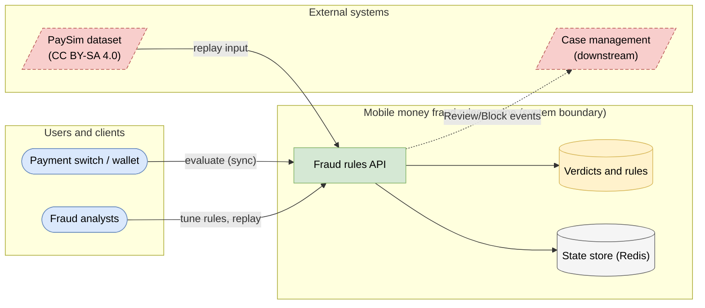
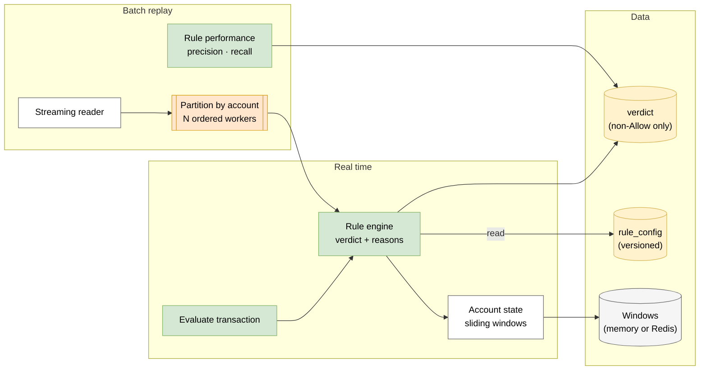
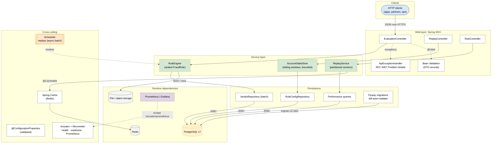
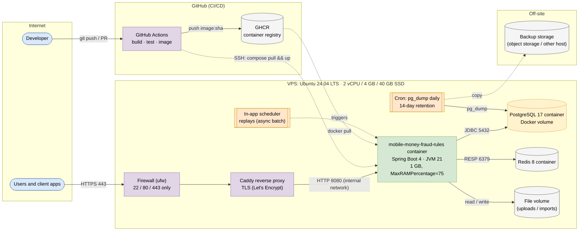
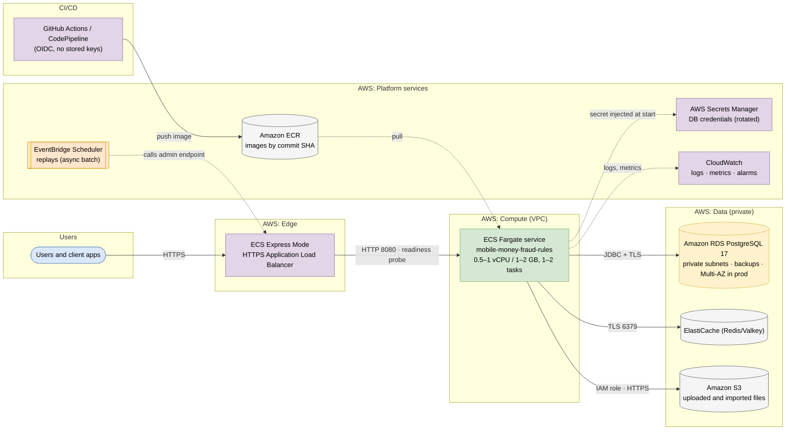

<!-- GENERATED by scripts/architecture/generate.py. Edit scripts/architecture/capstones.py instead. -->

# Mobile money fraud rules engine: architecture and system design

← [Capstone brief](../README.md) · [All capstones](../../README.md)

Evaluates mobile-money transactions against sealed, configurable fraud rules in real time, replays 6.3 million PaySim transactions in parallel, and measures each rule's precision and recall.

Five views of the same system, from the business context down to the cloud. Read them in order: each answers a different question that system-design interviews ask. Every diagram is provided as **Mermaid** (renders on GitHub), **draw.io / diagrams.net** XML (open and edit at [app.diagrams.net](https://app.diagrams.net)), **SVG** and **PNG**.

| # | View | Question it answers | Files |
| --- | --- | --- | --- |
| 1 | [Solution architecture](#1-solution-architecture) | Who uses the system, what does it integrate with, and where is its boundary? | [svg](solution.svg) · [png](solution.png) · [mermaid](solution.mmd) · [draw.io](solution.drawio) |
| 2 | [Logical architecture](#2-logical-architecture) | What are the capabilities and data, independent of technology? | [svg](logical.svg) · [png](logical.png) · [mermaid](logical.mmd) · [draw.io](logical.drawio) |
| 3 | [Technical architecture](#3-technical-architecture) | How is the code organised inside the service? | [svg](technical.svg) · [png](technical.png) · [mermaid](technical.mmd) · [draw.io](technical.drawio) |
| 4 | [Infrastructure architecture](#4-infrastructure-architecture) | Where does it run on a VPS, and how does code get there? | [svg](infra.svg) · [png](infra.png) · [mermaid](infra.mmd) · [draw.io](infra.drawio) |
| 5 | [Cloud architecture](#5-cloud-architecture) | How does it map to managed cloud services on AWS, Azure and GCP? | [svg](cloud.svg) · [png](cloud.png) · [mermaid](cloud.mmd) · [draw.io](cloud.drawio) |

**Legend:** blue = people/clients · green = services · white = components · yellow cylinders = databases · grey cylinders = caches/storage · red dashed = external systems · purple = infrastructure · orange = scheduled/batch jobs.

## 1. Solution architecture

**Solution architecture**: the switch calls the engine inline (sub-50 ms) before authorising a transfer or cash-out; analysts tune rules and review flagged activity; replays against PaySim provide evidence before a rule goes live.

Mermaid source

## 2. Logical architecture

**Logical architecture**: the *rule engine* combines independent rules into a verdict with reason codes; stateful rules read and update per-account *sliding windows*; the *replay* path partitions by account so each account's events stay in order while partitions run in parallel; *analytics* compute precision and recall per rule against labels.

Mermaid source

## 3. Technical architecture

**Technical architecture** shows *how the code is organised* inside the Spring Boot 4 service: thin controllers that validate and translate errors, services that hold the business rules and transaction boundaries, and a persistence layer (JPA where entity behaviour and locking help, `JdbcClient`/SQL for reporting and bulk work). Cross-cutting concerns (configuration, health, metrics, scheduling, outbound HTTP) are framework features configured once. Package by feature in code; the layers here are logical.

Mermaid source

## 4. Infrastructure architecture

**Infrastructure architecture** shows *where things run* on the cheapest production-like target, a single VPS (for example SSDNodes). Only Caddy is reachable from the internet; it terminates TLS and forwards to `mobile-money-fraud-rules` on Docker's internal network, so the database is never exposed (Docker port publishing bypasses `ufw`, so nothing else publishes ports). Images are built once by GitHub Actions, stored in GHCR by commit SHA, and pulled onto the server; backups leave the machine daily. Sizing and every command are in the [deployment guide](../../../deploy/README.md#3-deploy-to-a-vps).

Mermaid source

## 5. Cloud architecture

**Cloud architecture** maps the service onto managed cloud building blocks, drawn for AWS (ECS Express Mode, the AWS-recommended path for new accounts since App Runner closed to new customers in 2026). The database sits in private subnets; credentials come from the secret store, never from the image; images are immutable and tagged by commit SHA. The same design on the other clouds:

| AWS | Azure | GCP |
| --- | --- | --- |
| Amazon RDS for PostgreSQL | Azure Database for PostgreSQL Flexible Server | Cloud SQL for PostgreSQL |
| ECS Express Mode (Fargate) | Azure Container Apps | Cloud Run |
| Amazon ECR | Azure Container Registry | Artifact Registry |
| AWS Secrets Manager | Azure Key Vault | Secret Manager |
| CloudWatch | Azure Monitor / Log Analytics | Cloud Logging & Monitoring |
| EventBridge Scheduler | Container Apps jobs | Cloud Scheduler |
| ElastiCache | Azure Cache for Redis / Managed Redis | Memorystore |
| Amazon S3 | Azure Blob Storage | Cloud Storage |

Step-by-step setup for all three: [deployment guide](../../../deploy/README.md).

Mermaid source

## Architecture decisions

| ADR | Decision |
| --- | --- |
| [0001](adr/0001-one-deployable-spring-boot-service-modular-monolith-on-postg.md) | One deployable Spring Boot service (modular monolith) on PostgreSQL |
| [0002](adr/0002-sealed-rule-hierarchy-with-exhaustive-evaluation.md) | Sealed rule hierarchy with exhaustive evaluation |
| [0003](adr/0003-partition-by-account-to-keep-order-while-running-in-parallel.md) | Partition by account to keep order while running in parallel |
| [0004](adr/0004-bounded-state-in-memory-windows-with-eviction-redis-when-mul.md) | Bounded state: in-memory windows with eviction, Redis when multi-instance |
| [0005](adr/0005-persist-only-non-allow-verdicts.md) | Persist only non-Allow verdicts |

## Use these in your own capstone

Copy this folder into your repository, then change the diagrams to match what you actually built. In interviews, walk through the solution view first, then the logical view, then answer deep-dive questions with the technical, infrastructure and cloud views. Write a new ADR whenever you make a decision a future teammate would ask "why?" about.
