# Capstone 8: AML transaction monitoring

← [All capstones](../README.md) · [Step-by-step build guide](GUIDE.md) · [Starter](starter/README.md)

<!-- ARCHITECTURE:START (generated by scripts/architecture/generate.py) -->

## Architecture and system design (read this first)

Before you write code, study how this system is designed. These five views are the target architecture for a production-grade build; reproduce and adapt them in your own repository, and keep them current as you build. Full explanations, Mermaid, draw.io, SVG and PNG sources and the architecture decision records are in [architecture/](architecture/README.md).

### 1. Solution architecture

**Solution architecture**: transaction data arrives in batches from core systems (here the IBM AMLworld dataset); analysts work alerts and cases; the MLRO decides on suspicious transaction reports to the financial intelligence unit (the NFIU in Nigeria).

Sources: [Mermaid](architecture/solution.mmd) · [draw.io](architecture/solution.drawio) · [SVG](architecture/solution.svg) · [PNG](architecture/solution.png)

### 2. Logical architecture

**Logical architecture**: *loading* moves raw files through a staging table into a clean transaction model; *detection* runs each scenario (a versioned SQL file with named parameters) over a window and emits deduplicated alerts with evidence; *investigation* groups alerts into cases with append-only decisions; *effectiveness* compares alerts with labels.

Sources: [Mermaid](architecture/logical.mmd) · [draw.io](architecture/logical.drawio) · [SVG](architecture/logical.svg) · [PNG](architecture/logical.png)

### 3. Technical architecture

**Technical architecture** shows *how the code is organised* inside the Spring Boot 4 service: thin controllers that validate and translate errors, services that hold the business rules and transaction boundaries, and a persistence layer (JPA where entity behaviour and locking help, `JdbcClient`/SQL for reporting and bulk work). Cross-cutting concerns (configuration, health, metrics, scheduling, outbound HTTP) are framework features configured once. Package by feature in code; the layers here are logical.

Sources: [Mermaid](architecture/technical.mmd) · [draw.io](architecture/technical.drawio) · [SVG](architecture/technical.svg) · [PNG](architecture/technical.png)

### 4. Infrastructure architecture

**Infrastructure architecture** shows *where things run* on the cheapest production-like target, a single VPS (for example SSDNodes). Only Caddy is reachable from the internet; it terminates TLS and forwards to `aml-transaction-monitoring` on Docker's internal network, so the database is never exposed (Docker port publishing bypasses `ufw`, so nothing else publishes ports). Images are built once by GitHub Actions, stored in GHCR by commit SHA, and pulled onto the server; backups leave the machine daily. Sizing and every command are in the [deployment guide](../../deploy/README.md#3-deploy-to-a-vps).

Sources: [Mermaid](architecture/infra.mmd) · [draw.io](architecture/infra.drawio) · [SVG](architecture/infra.svg) · [PNG](architecture/infra.png)

### 5. Cloud architecture

**Cloud architecture** maps the service onto managed cloud building blocks, drawn for AWS (ECS Express Mode, the AWS-recommended path for new accounts since App Runner closed to new customers in 2026). The database sits in private subnets; credentials come from the secret store, never from the image; images are immutable and tagged by commit SHA. The same design on the other clouds:

Sources: [Mermaid](architecture/cloud.mmd) · [draw.io](architecture/cloud.drawio) · [SVG](architecture/cloud.svg) · [PNG](architecture/cloud.png)

### Key design decisions

1. [One deployable Spring Boot service (modular monolith) on PostgreSQL](architecture/adr/0001-one-deployable-spring-boot-service-modular-monolith-on-postg.md)
2. [Detection logic as versioned SQL scenarios](architecture/adr/0002-detection-logic-as-versioned-sql-scenarios.md)
3. [Deduplicated alerts by scenario, subject and window](architecture/adr/0003-deduplicated-alerts-by-scenario-subject-and-window.md)
4. [Append-only decisions enforced by the database](architecture/adr/0004-append-only-decisions-enforced-by-the-database.md)
5. [Staging + transform loading with COPY](architecture/adr/0005-staging-transform-loading-with-copy.md)

<!-- ARCHITECTURE:END -->

Weeks 7–12. Modules used: 1, 3, 4.

## Business context

Anti-money-laundering (AML) laws require banks to monitor transactions for patterns that suggest laundering and to report suspicious activity to their financial intelligence unit (in Nigeria, the NFIU, through suspicious transaction reports). Unlike real-time fraud rules (Capstone 7), AML monitoring usually runs **in batch over days or weeks of history**, looking for typologies: **structuring** (many deposits just under a reporting threshold), **fan-in / fan-out** (many accounts paying into one, or one paying out to many), **rapid movement** (money in and straight out), and **cycles** (funds that return to where they started).

You'll build an AML monitoring service whose detection logic is mostly **SQL**: window functions, CTEs and well-chosen indexes over millions of transactions, with an alert-and-case workflow for analysts.

## What you'll build

### Detection scenarios (each a scheduled or on-demand job)

| Scenario | Logic (sketch) |
| --- | --- |
| Structuring | ≥ N transactions from one account within 7 days, each between 80% and 100% of a configured threshold |
| Fan-in | One account receives from ≥ N distinct counterparties within a window |
| Fan-out | One account sends to ≥ N distinct counterparties within a window |
| Rapid movement | ≥ X% of funds received are sent out within 24 hours |
| Simple cycle | A → B → A (or A → B → C → A) within a window, via a recursive CTE with a depth limit |
| High-risk currency or payment format | Configurable list (e.g. cash, cross-currency) |

Each scenario is a SQL query in a versioned file (`src/main/resources/scenarios/*.sql`), parameterised with named parameters through `JdbcClient`, and produces **alerts** with the evidence (transaction IDs, totals, window).

### Alert and case workflow

| Method and path | Purpose |
| --- | --- |
| `POST /api/v1/scenario-runs` | Run one or all scenarios over a date range (async) |
| `GET /api/v1/scenario-runs/{id}` | Status, duration, alerts generated per scenario |
| `GET /api/v1/alerts?scenario=&status=&page=` | Alert queue |
| `GET /api/v1/alerts/{id}` | Evidence: involved transactions and accounts |
| `POST /api/v1/cases` | Group alerts into a case for investigation |
| `POST /api/v1/cases/{id}/decisions` | `NO_FURTHER_ACTION` / `FILE_SAR` with mandatory narrative; immutable and audited |
| `GET /api/v1/reports/scenario-effectiveness` | Using the dataset's labels: alerts, laundering transactions caught, precision per scenario |

### Rules and quality bar

1. **Deduplication:** re-running a scenario over the same period must not create duplicate alerts (unique key on scenario + subject + window).
2. Every scenario query has a documented `EXPLAIN (ANALYZE, BUFFERS)` before and after indexing, and runs in seconds on the HI-Small dataset.
3. Thresholds and windows are configuration, versioned, and stored on each alert.
4. Analysts' decisions are append-only.

## Data

| | |
| --- | --- |
| Dataset | **IBM Transactions for Anti Money Laundering (AMLworld)**: synthetic, labelled financial transactions generated from a multi-agent world model, with laundering typologies |
| Download | <https://www.kaggle.com/datasets/ealtman2019/ibm-transactions-for-anti-money-laundering-aml> (free Kaggle account). Use **`HI-Small_Trans.csv`** (~5 million transactions) for Phase 1; the patterns file lists labelled laundering attempts by typology |
| Licence | **Community Data License Agreement – Sharing 1.0** (CDLA-Sharing-1.0): use, modify and share including commercially; shared data must stay under the same agreement |
| Attribution | "IBM Transactions for Anti Money Laundering (AML), E. Altman et al., Kaggle, CDLA-Sharing-1.0." Background paper: Altman et al., *Realistic Synthetic Financial Transactions for Anti-Money Laundering Models*, NeurIPS 2023 Datasets and Benchmarks |
| Loading | Load with `COPY` (fastest) or JDBC batches into a staging table, then transform into `account`/`txn` tables with SQL. Keep the load idempotent |

## Skills you'll demonstrate

Advanced SQL (joins, CTEs including recursive, window functions) (3.1), indexing and query plans (3.3), migrations for large tables (3.4), bulk loading with JDBC/COPY (3.5), immutable audit design (1.7), async jobs and Problem Details (4.2), configuration properties (4.4).

## Acceptance criteria

- [ ] The loader imports HI-Small idempotently and reports counts.
- [ ] Each scenario has an integration test (Testcontainers) on a small hand-built fixture that must produce exactly the expected alerts.
- [ ] Re-running a scenario run over the same window creates no duplicate alerts.
- [ ] The effectiveness report shows precision per scenario against the dataset's laundering labels.
- [ ] Every scenario's query plan is documented, with the index that made it fast.
- [ ] Case decisions can't be edited or deleted (enforced in the database by permissions or triggers, not only in code).

## Infrastructure and deployment

During loading, PostgreSQL needs **2 vCPU / 4 GB RAM / 20 GB storage** (HI-Small is ~5M rows; tables plus indexes take a few GB). Increase `maintenance_work_mem` while creating indexes. The app itself is small (0.5 vCPU / 1 GB). Run scenario jobs on the VPS or locally; on cloud platforms use a managed PostgreSQL sized as above and remember to scale it down afterwards. CI from the starter (use a small fixture, never the full dataset, in CI); deploy with the [deployment guide](../../deploy/README.md).

## Stretch goals

- Customer risk rating that combines alert history and transaction profile.
- Graph exploration endpoint: an account's counterparties to depth 2 (recursive CTE), returned as nodes and edges for a UI.
- Compare a scenario's SQL in PostgreSQL and MySQL 8.4 and explain the plan differences.

## Interview talking points

- How you translated AML typologies into SQL, and how you tested them.
- The slowest scenario query and exactly how you made it fast.
- Why alerts and decisions are immutable, and how you enforced it.
