# Capstone 9: KYB legal entity lookup service

← [All capstones](../README.md) · [Step-by-step build guide](GUIDE.md) · [Starter](starter/README.md)

<!-- ARCHITECTURE:START (generated by scripts/architecture/generate.py) -->

## Architecture and system design (read this first)

Before you write code, study how this system is designed. These five views are the target architecture for a production-grade build; reproduce and adapt them in your own repository, and keep them current as you build. Full explanations, Mermaid, draw.io, SVG and PNG sources and the architecture decision records are in [architecture/](architecture/README.md).

### 1. Solution architecture

**Solution architecture**: onboarding officers search and verify legal entities; payment systems validate LEIs on messages in bulk; GLEIF publishes the global reference data several times a day.

Sources: [Mermaid](architecture/solution.mmd) · [draw.io](architecture/solution.drawio) · [SVG](architecture/solution.svg) · [PNG](architecture/solution.png)

### 2. Logical architecture

**Logical architecture**: *ingestion* loads the full file into staging and upserts records only when the source is newer, then applies deltas the same way; *validation* checks ISO 17442 check digits and status; *lookup and search* serve exact LEI reads and fuzzy name search from indexes; a cache absorbs hot lookups and is invalidated by deltas.

Sources: [Mermaid](architecture/logical.mmd) · [draw.io](architecture/logical.drawio) · [SVG](architecture/logical.svg) · [PNG](architecture/logical.png)

### 3. Technical architecture

**Technical architecture** shows *how the code is organised* inside the Spring Boot 4 service: thin controllers that validate and translate errors, services that hold the business rules and transaction boundaries, and a persistence layer (JPA where entity behaviour and locking help, `JdbcClient`/SQL for reporting and bulk work). Cross-cutting concerns (configuration, health, metrics, scheduling, outbound HTTP) are framework features configured once. Package by feature in code; the layers here are logical.

Sources: [Mermaid](architecture/technical.mmd) · [draw.io](architecture/technical.drawio) · [SVG](architecture/technical.svg) · [PNG](architecture/technical.png)

### 4. Infrastructure architecture

**Infrastructure architecture** shows *where things run* on the cheapest production-like target, a single VPS (for example SSDNodes). Only Caddy is reachable from the internet; it terminates TLS and forwards to `kyb-lei-lookup-service` on Docker's internal network, so the database is never exposed (Docker port publishing bypasses `ufw`, so nothing else publishes ports). Images are built once by GitHub Actions, stored in GHCR by commit SHA, and pulled onto the server; backups leave the machine daily. Sizing and every command are in the [deployment guide](../../deploy/README.md#3-deploy-to-a-vps).

Sources: [Mermaid](architecture/infra.mmd) · [draw.io](architecture/infra.drawio) · [SVG](architecture/infra.svg) · [PNG](architecture/infra.png)

### 5. Cloud architecture

**Cloud architecture** maps the service onto managed cloud building blocks, drawn for AWS (ECS Express Mode, the AWS-recommended path for new accounts since App Runner closed to new customers in 2026). The database sits in private subnets; credentials come from the secret store, never from the image; images are immutable and tagged by commit SHA. The same design on the other clouds:

Sources: [Mermaid](architecture/cloud.mmd) · [draw.io](architecture/cloud.drawio) · [SVG](architecture/cloud.svg) · [PNG](architecture/cloud.png)

### Key design decisions

1. [One deployable Spring Boot service (modular monolith) on PostgreSQL](architecture/adr/0001-one-deployable-spring-boot-service-modular-monolith-on-postg.md)
2. [Staging and newer-wins upserts](architecture/adr/0002-staging-and-newer-wins-upserts.md)
3. [Trigram GIN index for fuzzy name search](architecture/adr/0003-trigram-gin-index-for-fuzzy-name-search.md)
4. [Validate check digits before trusting any LEI](architecture/adr/0004-validate-check-digits-before-trusting-any-lei.md)

<!-- ARCHITECTURE:END -->

Weeks 9–13. Modules used: 1, 2, 3, 4.

## Business context

Before a bank opens an account for a company, lends to it or trades with it, it must "know your business" (KYB): confirm the legal entity exists, its registered address and status, and who owns it. In capital markets and cross-border payments, entities are identified by the **Legal Entity Identifier (LEI)**, a 20-character code (ISO 17442) managed by GLEIF, with public reference data and parent relationships. Corporate onboarding teams search this data constantly, and payment systems validate LEIs on messages.

You'll build an internal **LEI reference-data service**: bulk-load the global LEI dataset (or a large country subset), keep it current with delta files, and serve fast lookups and searches.

## What you'll build

### Ingestion

- Bulk load of the **GLEIF Golden Copy** (Level 1 "who is who" CSV): LEI, legal name, other names, legal and headquarters addresses, jurisdiction, legal form, entity status, registration status, last update date. Optionally Level 2 relationships ("who owns whom": direct and ultimate parents).
- Use PostgreSQL `COPY` through the JDBC driver's `CopyManager` (or batched inserts) into a staging table, then upsert (`INSERT ... ON CONFLICT (lei) DO UPDATE ... WHERE excluded.last_update > lei_record.last_update`).
- **Delta updates:** apply GLEIF delta files (changes in the last 8 hours, 24 hours, etc.) idempotently; record each run.
- Validate every LEI's **check digits** (ISO 17442 uses the ISO 7064 MOD 97-10 scheme, like IBANs) and report invalid records instead of loading them.

### API (suggested)

| Method and path | Purpose |
| --- | --- |
| `GET /api/v1/entities/{lei}` | Full record, plus parents if loaded |
| `GET /api/v1/entities?name=&country=&status=&page=` | Search by name (prefix and fuzzy via `pg_trgm`), country, status |
| `GET /api/v1/entities/{lei}/validation` | Is the LEI well-formed (check digits), issued, and currently `ISSUED` (vs `LAPSED`/`RETIRED`)? |
| `POST /api/v1/entities/validations` | Bulk validation of up to 1,000 LEIs (for a payments team) |
| `GET /api/v1/admin/import-runs` | Import and delta history |

### Quality bar

1. Lookups by LEI in < 5 ms server time; name searches in < 100 ms on the loaded dataset, proved with `EXPLAIN ANALYZE` and an index strategy (B-tree on `lei`, trigram GIN on normalised names, composite indexes for common filters).
2. The full load is **resumable or repeatable**: running it twice yields the same table.
3. Imports never block reads (load into staging, then upsert in batches, or swap tables in a transaction).
4. Cache hot lookups with a TTL; invalidate entries touched by a delta.

## Data

| Item | Details |
| --- | --- |
| Dataset | **GLEIF LEI Golden Copy** (Level 1 and optional Level 2): 2.5 million+ entities worldwide |
| Download | [GLEIF Golden Copy and delta files](https://www.gleif.org/en/lei-data/gleif-golden-copy); API for small tests: `https://api.gleif.org/api/v1/lei-records?filter[entity.legalAddress.country]=NG` |
| Licence | **CC0 1.0** ([GLEIF terms of use](https://www.gleif.org/en/meta/lei-data-terms-of-use)): no restrictions, commercial use allowed |
| Attribution | Not required; recommended: "LEI data: GLEIF, CC0." |
| Smaller option | Load only selected countries (e.g. NG, GB, US, DE, ZA) by filtering while streaming the CSV, to keep the database under 2 GB |

## Skills you'll demonstrate

Streaming large files and check-digit algorithms (1.2, 1.7), bulk loading with COPY and upserts (3.5), indexing and trigram search (3.3), migrations for large tables (3.4), caching with invalidation (3.6), pagination and Problem Details (4.2, 4.3), import metrics (4.5).

## Acceptance criteria

- [ ] LEI check-digit validation passes for known valid LEIs (for example GLEIF's own LEI `506700GE1G29325QX363`) and fails for altered ones.
- [ ] Loading the same file twice leaves identical row counts and data.
- [ ] A delta file updates changed records only when its `last_update` is newer.
- [ ] Name search finds entities with typos and different word order, using an index (plan documented).
- [ ] Bulk validation of 1,000 LEIs returns per-LEI results.
- [ ] Reads continue to work during an import (demonstrate with a concurrent test or a documented manual test).

## Infrastructure and deployment

Full global load: PostgreSQL **2 vCPU / 4 GB / 30–50 GB** while loading and indexing. Country subset: 1 vCPU / 2 GB / 10 GB. The app: 0.5–1 vCPU / 1 GB. Enable `pg_trgm` in a migration (supported on RDS, Azure Flexible Server and Cloud SQL). CI from the starter with a small fixture; deploy with the [deployment guide](../../deploy/README.md).

## Stretch goals

- Level 2 relationships with an "ultimate parent" endpoint using a recursive CTE.
- ISIN-to-LEI mapping (GLEIF publishes it) for securities use cases.
- A change feed: `GET /entities/changes?since=` for downstream systems.

## Interview talking points

- How you loaded millions of rows fast, safely and repeatably.
- The index strategy behind sub-100 ms fuzzy search.
- How the ISO 7064 check digits work and why they catch typos.
