# Capstone 10: Settlement reconciliation engine

← [All capstones](../README.md) · [Step-by-step build guide](GUIDE.md) · [Starter](starter/README.md)

<!-- ARCHITECTURE:START (generated by scripts/architecture/generate.py) -->

## Architecture and system design (read this first)

Before you write code, study how this system is designed. These five views are the target architecture for a production-grade build; reproduce and adapt them in your own repository, and keep them current as you build. Full explanations, Mermaid, draw.io, SVG and PNG sources and the architecture decision records are in [architecture/](architecture/README.md).

### 1. Solution architecture

**Solution architecture**: every value date, operations reconcile the bank's ledger with each partner's settlement file; breaks are worked to resolution before cut-off and summarised for finance.

Sources: [Mermaid](architecture/solution.mmd) · [draw.io](architecture/solution.drawio) · [SVG](architecture/solution.svg) · [PNG](architecture/solution.png)

### 2. Logical architecture

**Logical architecture**: *intake* stores each file once (by checksum) and parses it into staging; *matching* runs ordered passes over the remaining unmatched items (exact in SQL, then normalised reference, tolerance and date-window passes); *break management* classifies and resolves exceptions; *controls* prove that matched plus unmatched value equals each file's total.

Sources: [Mermaid](architecture/logical.mmd) · [draw.io](architecture/logical.drawio) · [SVG](architecture/logical.svg) · [PNG](architecture/logical.png)

### 3. Technical architecture

**Technical architecture** shows *how the code is organised* inside the Spring Boot 4 service: thin controllers that validate and translate errors, services that hold the business rules and transaction boundaries, and a persistence layer (JPA where entity behaviour and locking help, `JdbcClient`/SQL for reporting and bulk work). Cross-cutting concerns (configuration, health, metrics, scheduling, outbound HTTP) are framework features configured once. Package by feature in code; the layers here are logical.

Sources: [Mermaid](architecture/technical.mmd) · [draw.io](architecture/technical.drawio) · [SVG](architecture/technical.svg) · [PNG](architecture/technical.png)

### 4. Infrastructure architecture

**Infrastructure architecture** shows *where things run* on the cheapest production-like target, a single VPS (for example SSDNodes). Only Caddy is reachable from the internet; it terminates TLS and forwards to `settlement-reconciliation-engine` on Docker's internal network, so the database is never exposed (Docker port publishing bypasses `ufw`, so nothing else publishes ports). Images are built once by GitHub Actions, stored in GHCR by commit SHA, and pulled onto the server; backups leave the machine daily. Sizing and every command are in the [deployment guide](../../deploy/README.md#3-deploy-to-a-vps).

Sources: [Mermaid](architecture/infra.mmd) · [draw.io](architecture/infra.drawio) · [SVG](architecture/infra.svg) · [PNG](architecture/infra.png)

### 5. Cloud architecture

**Cloud architecture** maps the service onto managed cloud building blocks, drawn for AWS (ECS Express Mode, the AWS-recommended path for new accounts since App Runner closed to new customers in 2026). The database sits in private subnets; credentials come from the secret store, never from the image; images are immutable and tagged by commit SHA. The same design on the other clouds:

Sources: [Mermaid](architecture/cloud.mmd) · [draw.io](architecture/cloud.drawio) · [SVG](architecture/cloud.svg) · [PNG](architecture/cloud.png)

### Key design decisions

1. [One deployable Spring Boot service (modular monolith) on PostgreSQL](architecture/adr/0001-one-deployable-spring-boot-service-modular-monolith-on-postg.md)
2. [Ordered matching passes, set-based first](architecture/adr/0002-ordered-matching-passes-set-based-first.md)
3. [Control totals on every run](architecture/adr/0003-control-totals-on-every-run.md)
4. [Files in object storage, idempotent by checksum](architecture/adr/0004-files-in-object-storage-idempotent-by-checksum.md)

<!-- ARCHITECTURE:END -->

Weeks 9–13. Modules used: 1, 2, 3, 4.

## Business context

Every day, a bank's internal ledger must agree with external records: the card scheme's settlement file, the NIP/NIBSS settlement report, the mobile-money partner's statement, the correspondent bank's MT940. Where they disagree, money is at risk: a customer was debited but the partner never received it, or a partner settled a transaction the bank never recorded. **Reconciliation** teams match millions of records daily, chase exceptions, and must clear them within strict deadlines. Automating the matching, and making exceptions easy to investigate, is classic and valuable backend work.

You'll build a **reconciliation engine** that ingests an internal ledger extract and an external settlement file, matches them with configurable rules, classifies the breaks, and gives operations a workflow to resolve them.

## What you'll build

### Inputs

- **Internal ledger extract**: one row per transaction (reference, account, amount, currency, direction, value date, channel, status).
- **External settlement file**: the partner's view (partner reference, our reference where available, amount, fee, currency, settlement date, status).
- A **generator** (part of your project) that produces matching pairs of files from a base dataset, with deliberately injected breaks: missing on either side, amount mismatches, duplicated records, timing differences (settled a day later), reference formatting differences (leading zeros, prefixes, case). Use **PaySim** rows as the base transactions for realistic amounts and volumes, or generate entirely synthetic data.

### Matching

Configurable, ordered match rules (sealed hierarchy), applied in passes:

1. **Exact:** same reference, amount and currency.
2. **Normalised reference:** after stripping prefixes, leading zeros and case.
3. **Tolerance:** same reference, amount within a configured tolerance (for example partner fees), flagged `MATCHED_WITH_DIFFERENCE`.
4. **Date window:** same amount and account within ±1 business day when references are missing.

Each pass works only on records still unmatched. Implement the first pass as a set-based SQL `FULL OUTER JOIN` (topic 3.1) and the fuzzier passes in Java over bounded batches, or entirely in SQL: justify the split.

### Outcomes

`MATCHED`, `MATCHED_WITH_DIFFERENCE`, `MISSING_IN_LEDGER`, `MISSING_IN_PARTNER`, `DUPLICATE`, `AMOUNT_MISMATCH`, each with evidence.

### API (suggested)

| Method and path | Purpose |
| --- | --- |
| `POST /api/v1/files` | Upload a ledger or partner file (multipart), validated and loaded into staging with batching; idempotent by file checksum |
| `POST /api/v1/recon-runs` | Reconcile a ledger file against a partner file for a value date (async) |
| `GET /api/v1/recon-runs/{id}` | Summary: totals per outcome, matched value, unmatched value, duration |
| `GET /api/v1/recon-runs/{id}/breaks?type=&page=` | Exceptions to work |
| `POST /api/v1/breaks/{id}/resolutions` | Resolve with a reason (write-off, manual match, raised with partner); audited |
| `GET /api/v1/recon-runs/{id}/report.csv` | Exception report for operations |

### Quality bar

1. A run over **1 million records per side** completes in minutes on a laptop; document timings and where the time goes.
2. Totals always reconcile: matched value + unmatched value on each side equals that side's file total.
3. Re-uploading a file is idempotent (checksum); re-running a reconciliation produces the same result.
4. Manual matches and resolutions are audited and can be reversed with a reason.

## Data

| | |
| --- | --- |
| Base transactions (optional) | **PaySim** (CC BY-SA 4.0): <https://www.kaggle.com/datasets/ealaxi/paysim1>. Attribution: E. A. Lopez-Rojas, A. Elmir, S. Axelsson, "PaySim: A financial mobile money simulator for fraud detection", EMSS 2016. Derived files you redistribute must be CC BY-SA 4.0 |
| Synthetic files | Produced by your own generator: release them under CC0 |
| Never | Real customer statements or partner files |

## Skills you'll demonstrate

File parsing and streaming (1.7), sealed match rules (1.6), concurrency for parsing and matching in partitions (2.1–2.3), set-based SQL and full outer joins (3.1), indexing staging tables (3.3), batching and COPY (3.5), multipart uploads, async jobs and Problem Details (4.2), metrics (4.5).

## Acceptance criteria

- [ ] The generator injects a known number of each break type; the engine finds exactly those, per type.
- [ ] Normalised-reference matching handles prefixes, leading zeros and case (unit tests).
- [ ] Tolerance matching respects the configured tolerance at its boundaries.
- [ ] Control totals reconcile for every run.
- [ ] Uploading the same file twice is detected and doesn't duplicate data.
- [ ] A 1,000,000-per-side run completes, and the timing is reported in the README.

## Infrastructure and deployment

App 1–2 vCPU / 2 GB for million-row runs; PostgreSQL 2 vCPU / 4 GB / 20 GB. Set `spring.servlet.multipart.max-file-size` deliberately, and store uploaded files on disk or object storage (S3, Azure Blob, GCS), not in the database. Runs are batch jobs: avoid scale-to-zero platforms' request timeouts by running them asynchronously. CI from the starter with small generated fixtures; deploy with the [deployment guide](../../deploy/README.md).

## Stretch goals

- Parse a real-world format: SWIFT MT940 or ISO 20022 camt.053 statements (write a small parser and fixtures).
- Auto-resolution rules for known timing differences that clear the next day.
- Post write-offs to the Capstone 1 ledger through its API.

## Interview talking points

- How you designed matching passes, and the trade-off between SQL and Java for each.
- How you proved nothing was lost (control totals).
- How you made a million-row run fast, and what you'd change for 100 million.
