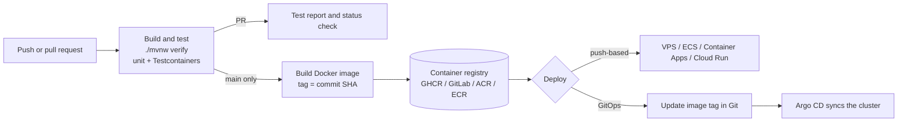

<!-- GENERATED by scripts/build.py from phases/01-foundations/cicd/guide.md and lms/videos.json. Edit the source, then run `python scripts/build.py`. -->


# CI/CD guide: six platforms, one pipeline design (Phase 1)

← [Phase 1](../README.md) · [Deployment guide](../deploy/README.md) · [Capstones](../capstones/README.md)

Banks and fintechs don't agree on one CI/CD tool. Lagos fintechs often run GitHub Actions or GitLab, banks and consultancies run Jenkins and Azure DevOps, AWS-first teams use CodePipeline, and Kubernetes platform teams deploy with Argo CD. Every Phase 1 starter therefore ships **the same pipeline on six platforms**, so you can learn the design once and recognise it anywhere.

| # | Platform | File in every starter | Recommended use in this programme |
| --- | --- | --- | --- |
| 1 | **GitHub Actions** | `.github/workflows/ci.yml` | **Primary.** Every capstone must be green here |
| 2 | **GitLab CI/CD** | `.gitlab-ci.yml` | **Secondary.** Mirror to a free gitlab.com account |
| 3 | **Azure DevOps Pipelines** | `azure-pipelines.yml` | Optional; common in banks and Microsoft shops |
| 4 | **AWS CodeBuild + CodePipeline** | `buildspec.yml` | Optional; for AWS-first teams (pairs with the AWS deployment) |
| 5 | **Jenkins** | `Jenkinsfile` | Optional; still the most common tool in enterprises and banks |
| 6 | **Argo CD (GitOps)** | `deploy/k8s/…`, `deploy/argocd/application.yaml` | Preview of Phase 3 (Kubernetes); try it on a local cluster |

How these files were checked: the GitHub Actions and GitLab files validate against their official JSON schemas. The Jenkinsfile passes Jenkins' own declarative linter. The Kubernetes manifests build with Kustomize and validate with kubeconform, and so does the Argo CD Application (against its CRD schema). The Azure Pipelines and CodeBuild files were reviewed against Microsoft and AWS documentation; you prove them the first time you connect a project.

## 1. The pipeline design (same everywhere)



Principles every implementation follows, and that interviewers ask about:

1. **One command builds and tests**: `./mvnw verify`, identical on laptops and CI. No "CI-only" scripts.
2. **Real integration tests**: Testcontainers starts PostgreSQL inside CI (every platform here provides Docker).
3. **Fast feedback on pull requests; artefacts only from `main`.** PRs run tests; only `main` publishes images.
4. **Immutable, traceable images**: tagged with the commit SHA (plus a moving `latest` for convenience). Deploy SHAs, never `latest`, to production.
5. **Secrets come from the platform** (GitHub secrets, GitLab CI variables, Azure service connections, AWS IAM roles, Jenkins credentials, Kubernetes Secrets). Never in the pipeline file.
6. **Test reports are published**, so failures are readable in the UI.
7. **Caching** of the Maven repository keeps builds to a few minutes.

## 2. GitHub Actions (primary)

Already covered in the [deployment guide](../deploy/README.md#2-cicd). In short: push to GitHub, and the `build` job runs on every push and pull request. On `main`, the `image` job pushes to `ghcr.io/<owner>/<repo>`. Turn on branch protection requiring the `build` check.

## 3. GitLab CI/CD (secondary)

Also covered in the [deployment guide](../deploy/README.md#gitlab-ci-secondary). The `test` job uses a `docker:27-dind` service for Testcontainers; the `build-image` job pushes to the project's GitLab Container Registry on the default branch. (A job can't be called `image`: that's a reserved GitLab keyword.)

## 4. Azure DevOps Pipelines

1. Create a free organisation and project at [dev.azure.com](https://dev.azure.com). The free tier includes Microsoft-hosted parallel jobs for public and private projects (new organisations may have to request the free grant).
2. **Connect your code:** *Pipelines → New pipeline → GitHub* (or Azure Repos), pick the repository, choose **Existing Azure Pipelines YAML file**, and select `/azure-pipelines.yml`.
3. **Create the registry connection** the `Image` stage uses: *Project settings → Service connections → New → Docker Registry*. Choose **Azure Container Registry** (or "Others" for GHCR/Docker Hub) and name it exactly `container-registry`.
4. Run the pipeline. Stage **Test** runs `./mvnw verify` with Maven caching and publishes JUnit results to the *Tests* tab. Stage **Image** (only on `main`) builds and pushes `<registry>/<repository>:<commit>` and `:latest` with the `Docker@2` task.
5. Add **branch policies** on `main` (*Repos → Branches → Branch policies → Build validation*) if your code lives in Azure Repos, or use GitHub branch protection with the Azure Pipelines check.
6. To deploy, add a stage using `AzureContainerApps@1` (or `AzureCLI@2` running the commands from [deployment guide section 5](../deploy/README.md#5-deploy-to-azure)) with an Azure Resource Manager service connection that uses **workload identity federation** (no stored secrets).

## 5. AWS CodeBuild and CodePipeline

1. **ECR repository:** `aws ecr create-repository --repository-name <artifactId>` (name must match `IMAGE_REPO_NAME` in `buildspec.yml`).
2. **CodeBuild project:** *CodeBuild → Create build project*. Source: GitHub through an **AWS CodeConnections** connection; environment: managed image, *Amazon Linux*, *Standard* runtime (supports `corretto21`), **Privileged** enabled (needed for Docker); buildspec: *Use a buildspec file*. Let it create a service role, then attach permissions to push to ECR (`AmazonEC2ContainerRegistryPowerUser` or a narrower inline policy).
3. **CodePipeline:** *CodePipeline → Create pipeline (V2)*. Source stage: the same GitHub connection, branch `main` (add a pull-request trigger if you want PR builds). Build stage: the CodeBuild project. Deploy stage (optional): **Amazon ECS** using `imageDetail.json`, or a CodeBuild action that runs `aws ecs update-express-gateway-service` for the ECS Express Mode service from [deployment guide section 4](../deploy/README.md#4-deploy-to-aws).
4. Test results appear under *CodeBuild → Report groups* (from the `reports` section of the buildspec).
5. Cost note: CodeBuild bills per build minute and CodePipeline per active pipeline; check the current free tier, and delete both when you're done.

## 6. Jenkins

Run Jenkins locally to learn it (in a bank you'll use the team's server):

```bash
docker network create jenkins
docker run -d --name jenkins --network jenkins -p 8080:8080 -v jenkins_home:/var/jenkins_home \
  -v /var/run/docker.sock:/var/run/docker.sock jenkins/jenkins:lts-jdk21
docker exec jenkins cat /var/jenkins_home/secrets/initialAdminPassword     # unlock the setup wizard
```

(Mounting the Docker socket lets builds use Docker. It effectively gives Jenkins root on your machine, which is fine for a laptop lab and never acceptable on a shared server, where you'd use dedicated Docker-capable agents.)

1. Finish the setup wizard with the suggested plugins (they include Pipeline, Git, JUnit and Credentials Binding). Install the Docker CLI inside the container, or attach an agent with Docker, so `docker build` works.
2. *Manage Jenkins → Tools → JDK installations*: add one named **`temurin-21`** (install automatically from Adoptium, or point at an existing JDK 21).
3. *Manage Jenkins → Credentials*: add a username/password (or token) credential with ID **`container-registry`**.
4. Set a global environment variable **`REGISTRY`** (e.g. `ghcr.io/<owner>`) under *Manage Jenkins → System*.
5. *New Item → Multibranch Pipeline*, add your GitHub repository as a branch source. Jenkins finds the `Jenkinsfile`, builds every branch and pull request, publishes JUnit results, and runs the `Image` stage only on `main`.
6. Validate changes to the Jenkinsfile before pushing, with the declarative linter: `curl -X POST -F "jenkinsfile=<Jenkinsfile" http://localhost:8080/pipeline-model-converter/validate` (add your user and API token if security is on).

## 7. Argo CD and GitOps on Kubernetes

GitOps flips deployment around: instead of CI pushing to the cluster, **the cluster pulls its desired state from Git**. Argo CD watches a path in your repository and keeps the cluster in sync, so every change is a reviewed commit and rollbacks are `git revert`. Kubernetes itself is taught in Phase 3 (Module 12); this section is a guided preview.

What's in each starter:

```text
deploy/
├── k8s/
│   ├── base/                 Deployment (probes, resource limits, non-root, read-only filesystem) + Service
│   └── overlays/
│       ├── local/            namespace, in-cluster PostgreSQL, local-only DB secret, image name
│       └── production/       2 replicas, pinned image SHA; secret supplied by the platform, not Git
└── argocd/application.yaml   Argo CD Application pointing at overlays/local, auto-sync with prune + self-heal
```

Try it on a local cluster (Docker Desktop's Kubernetes, kind or minikube):

```bash
kubectl create namespace argocd
kubectl apply -n argocd -f https://raw.githubusercontent.com/argoproj/argo-cd/stable/manifests/install.yaml
kubectl -n argocd rollout status deploy/argocd-server
# Edit deploy/k8s/overlays/local/kustomization.yaml: set newName to your image (e.g. ghcr.io/<you>/<repo>)
# Edit deploy/argocd/application.yaml: set repoURL to your repository. Commit and push both.
kubectl apply -n argocd -f deploy/argocd/application.yaml
kubectl -n argocd port-forward svc/argocd-server 8081:443     # UI at https://localhost:8081
kubectl -n argocd get secret argocd-initial-admin-secret -o jsonpath='{.data.password}' | base64 -d   # admin password (yours; don't share it)
```

The image must be pullable by the cluster: make the GHCR package public, or add an image pull secret. Local images aren't visible to most local clusters.

**Closing the loop:** add a step to your GitHub Actions `image` job that updates the image tag in Git, for example `cd deploy/k8s/overlays/production && kustomize edit set image <name>=<image>:${GITHUB_SHA}`, then commit it (directly, or better, open a pull request). Argo CD sees the commit and rolls out the new version. Argo CD Image Updater can automate this.

**Secrets in GitOps:** never commit real secrets. Use the External Secrets Operator (reading AWS Secrets Manager, Azure Key Vault or GCP Secret Manager) or Sealed Secrets. The `local` overlay's password is a local-cluster placeholder, in the same spirit as `.env.example`.

## 8. Which should you learn first?

1. **GitHub Actions**, required for your capstones.
2. **GitLab CI/CD**: mirror one capstone and get it green.
3. One of **Jenkins** or **Azure DevOps**, whichever appears more in the job ads you're targeting (Jenkins for most Nigerian banks and consultancies, Azure DevOps for Microsoft-heavy employers).
4. **AWS CodePipeline** if you deploy to AWS.
5. **Argo CD** in Phase 3, when you run Kubernetes properly.

Interview tip: be able to draw section 1's diagram and explain where secrets live, why images are tagged by SHA, and how a failed deployment is rolled back on two different platforms.

## Watch

All videos are in English with English captions and were checked on 2026-10-23. Moodle learners see them embedded.

- [Create Your First Azure Pipeline using YAML | Azure DevOps Tutorial | An IT Professional](https://www.youtube.com/watch?v=Nc_jITa2qYE) · An IT Professional · 12 min. Your first Azure DevOps YAML pipeline, step by step.
- [(Simple?) Real World Azure Pipelines YAML Walkthrough](https://www.youtube.com/watch?v=e0bF1LlclEs) · Julie Ng · 22 min. A real-world Azure Pipelines YAML file walked through stage by stage.
- [Build a CI/CD Pipeline with AWS CodePipeline | Training and Demo](https://www.youtube.com/watch?v=E-YanBx38Cs) · Digital Cloud Training · 15 min. AWS CodePipeline with CodeBuild: how the pieces connect.
- [How to Write a Pipeline Script in Jenkins](https://www.youtube.com/watch?v=TiTrcFEsj7A) · CloudBeesTV · 9 min. Writing a Jenkins pipeline script, from CloudBees (the company behind Jenkins' enterprise edition).
- [Let's do GitOps in Kubernetes! ArgoCD Tutorial](https://www.youtube.com/watch?v=Yb3_4PZX0B0) · Christian Lempa · 18 min. GitOps on Kubernetes with Argo CD, hands-on.

**Want more depth? (longer, optional)**

- [Azure DevOps Tutorial for Beginners | CI/CD with Azure Pipelines](https://www.youtube.com/watch?v=4BibQ69MD8c) · TechWorld with Nana · 36 min. Azure DevOps and Azure Pipelines end to end.
- [Complete Jenkins Pipeline Tutorial | Jenkinsfile explained](https://www.youtube.com/watch?v=7KCS70sCoK0) · TechWorld with Nana · 35 min. The complete Jenkinsfile explained.
- [ArgoCD Tutorial for Beginners | GitOps CD for Kubernetes](https://www.youtube.com/watch?v=MeU5_k9ssrs) · TechWorld with Nana · 48 min. Argo CD in depth: applications, sync and GitOps workflows.

