# Capstone 1: Payment gateway integration hub

← [All capstones](../README.md) · [Step-by-step build guide](GUIDE.md) · [Starter](starter/README.md) · Reference solution: your mentor shares it once your submission has passed

<!-- ARCHITECTURE:START (generated by scripts/architecture/generate.py) -->

## Architecture and system design (read this first)

Before you write code, study how this system is designed. These five views are the target architecture for a production-grade build; reproduce and adapt them in your own repository, and keep them current as you build. Full explanations, Mermaid, draw.io, SVG and PNG sources and the architecture decision records are in [architecture/](architecture/README.md).

### 1. Solution architecture



**Solution architecture**: merchant applications integrate once with the hub; the hub integrates with each payment provider. Providers call back with signed webhooks. Keycloak issues the merchants' tokens; operations watch provider health and payments.

Sources: [Mermaid](architecture/solution.mmd) · [draw.io](architecture/solution.drawio) · [SVG](architecture/solution.svg) · [PNG](architecture/solution.png)

### 2. Logical architecture



**Logical architecture**: three flows share one payment record. *Initialise* checks the idempotency key, picks a provider through the router and stores the payment as `PENDING`. *Webhooks* are verified (HMAC over the raw body), de-duplicated by provider event id and applied through the state machine. *Reconciliation* verifies stale pending payments. Every transition appends an immutable payment event.

Sources: [Mermaid](architecture/logical.mmd) · [draw.io](architecture/logical.drawio) · [SVG](architecture/logical.svg) · [PNG](architecture/logical.png)

### 3. Technical architecture



**Technical architecture** shows *how the code is organised* inside the Spring Boot 4 service: thin controllers that validate and translate errors, services that hold the business rules and transaction boundaries, and a persistence layer (JPA where entity behaviour and locking help, `JdbcClient`/SQL for reporting and bulk work). Cross-cutting concerns (configuration, health, metrics, scheduling, outbound HTTP) are framework features configured once. Package by feature in code; the layers here are logical.

Sources: [Mermaid](architecture/technical.mmd) · [draw.io](architecture/technical.drawio) · [SVG](architecture/technical.svg) · [PNG](architecture/technical.png)

### 4. Infrastructure architecture



**Infrastructure architecture** shows *where things run* on the cheapest production-like target, a single VPS (for example SSDNodes). Only Caddy is reachable from the internet; it terminates TLS and forwards to `payment-gateway-hub` on Docker's internal network, so the database is never exposed (Docker port publishing bypasses `ufw`, so nothing else publishes ports). Images are built once by GitHub Actions, stored in GHCR by commit SHA, and pulled onto the server; backups leave the machine daily. Keycloak is published on its own subdomain through Caddy so users and client apps can obtain tokens; the API only fetches its public signing keys (JWKS) and validates tokens locally. Sizing and every command are in the [deployment guide](../../deploy/README.md#3-deploy-to-a-vps).

Sources: [Mermaid](architecture/infra.mmd) · [draw.io](architecture/infra.drawio) · [SVG](architecture/infra.svg) · [PNG](architecture/infra.png)

### 5. Cloud architecture



**Cloud architecture** maps the service onto managed cloud building blocks, drawn for AWS (ECS Express Mode, the AWS-recommended path for new accounts since App Runner closed to new customers in 2026). The database sits in private subnets; credentials come from the secret store, never from the image; images are immutable and tagged by commit SHA. The same design on the other clouds:

Sources: [Mermaid](architecture/cloud.mmd) · [draw.io](architecture/cloud.drawio) · [SVG](architecture/cloud.svg) · [PNG](architecture/cloud.png)

### Key design decisions

1. [One secured Spring Boot service (modular monolith) with an external identity provider](architecture/adr/0001-one-secured-spring-boot-service-modular-monolith-with-an-ext.md)
2. [Contract first: the API description is written and reviewed before the code](architecture/adr/0002-contract-first-the-api-description-is-written-and-reviewed-b.md)
3. [Explicit payment state machine with an append-only event history](architecture/adr/0003-explicit-payment-state-machine-with-an-append-only-event-his.md)
4. [Idempotency keys for merchants, event-id deduplication for providers](architecture/adr/0004-idempotency-keys-for-merchants-event-id-deduplication-for-pr.md)
5. [Circuit breaker per provider with priority failover for initialisation only](architecture/adr/0005-circuit-breaker-per-provider-with-priority-failover-for-init.md)

<!-- ARCHITECTURE:END -->

**Required for every learner.** Weeks 16–25. Modules used: 5, 6, 7, 8.

## Business context

Nigerian fintechs, e-commerce platforms and banks rarely talk to card schemes directly: they integrate **payment service providers** (PSPs) such as Paystack, Flutterwave, Interswitch or Stripe. Every integration has the same hard parts: initialising a payment, sending the customer to the provider, receiving **webhooks** that may arrive late, twice or out of order, verifying the result, coping when the provider is slow or down, and never charging or crediting twice. Teams that do this well keep a single internal **payment hub** in front of all providers, so product teams integrate once.

You will build that hub for **ITL Commerce**: merchant applications call one clean API; the hub routes each payment to a provider, verifies signed webhooks, drives each payment through a strict state machine, fails over when a provider's circuit is open, and reconciles anything left pending.

## What you'll build

A secured Spring Boot 4 REST service backed by PostgreSQL, integrating two payment providers through one `PaymentProvider` interface.

### Providers

- **Provider A ("paystack-like")** and **Provider B ("flutterwave-like")**: in development and tests they are simulated with **WireMock** using the request/response shapes in the brief's [provider contract](#provider-contract). Optionally, point Provider A at **Paystack's test mode** with your own test secret key (never commit it).
- Each provider has a base URL, a secret key (for API calls and webhook signatures) and a priority, all from `@ConfigurationProperties` and environment variables.

### Payment state machine

```
INITIATED ──▶ PENDING ──▶ SUCCEEDED ──▶ REFUNDED (full) / PARTIALLY_REFUNDED
     │            │
     └──▶ FAILED ◀┘            (ABANDONED after 24 h pending with no provider result)
```

Only the transitions drawn are legal. A late `pending` event never moves a `SUCCEEDED` payment backwards; a `success` webhook for an `ABANDONED` payment is recorded and flagged for operations, not silently applied.

### API

| Method and path | Who | Purpose |
| --- | --- | --- |
| `POST /api/v1/payments` | Merchant app (`SCOPE_api.write`) | Initialise a payment. **Requires an `Idempotency-Key` header.** Returns 201 with `reference`, `provider`, `authorizationUrl`, `status` |
| `GET /api/v1/payments/{reference}` | The owning merchant (`SCOPE_api.read`) or `OPS` | Payment details and status history |
| `GET /api/v1/payments?status=&from=&to=&cursor=` | Owning merchant or `OPS` | Cursor-paginated list, newest first |
| `POST /api/v1/payments/{reference}/verify` | Owning merchant | Ask the provider for the latest status and apply it |
| `POST /api/v1/payments/{reference}/refunds` | Owning merchant (`SCOPE_api.write`) | Full or partial refund; total refunds may not exceed the amount |
| `POST /webhooks/{provider}` | The provider (no JWT) | Signed webhook. Verify the HMAC signature over the **raw body** before parsing |
| `GET /api/v1/ops/providers` | `OPS` | Each provider's circuit-breaker state and recent error rate |

The merchant is the token's `sub` (or `azp` for client-credentials tokens). Never accept a merchant id from the request body.

### Business rules

1. Amounts are integers in **minor units** (kobo, cents, pesewas) with an ISO 4217 currency: `NGN`, `GHS`, `KES`, `USD`. Minimum 100 minor units; maximum configurable per currency.
2. **Idempotency:** the same `Idempotency-Key` from the same merchant with the same payload returns the original response (status 201 replayed) and calls no provider. The same key with a different payload returns 422 `idempotency-key-reused`. Keys expire after 24 hours.
3. **Routing:** use the highest-priority provider that supports the currency and whose circuit breaker is not open. If none is available, return 503 `no-provider-available` with `Retry-After`.
4. **Webhooks:** reject an invalid or missing signature with 401 and store nothing. Process each provider event id **once** (store it with a unique constraint); duplicates return 200 so the provider stops retrying. Respond within 2 seconds: persist, then process.
5. **Outbound calls** have connect and read timeouts (2 s / 5 s). `verify` is retried up to 3 times with exponential backoff and jitter on timeouts and 5xx; `initialise` is **not** retried blindly (it is not idempotent at the provider unless you pass your reference).
6. **Reconciliation:** a scheduled job verifies payments `PENDING` for more than 15 minutes, and marks those older than 24 hours `ABANDONED`.
7. **Refunds:** only `SUCCEEDED` or `PARTIALLY_REFUNDED` payments; the sum of refunds never exceeds the original amount (enforce in the database too).
8. Every state change is appended to `payment_event` (who/what caused it, old and new status, provider event id) and is never updated or deleted.

### Errors

RFC 9457 Problem Details with stable `type` URIs: `validation-failed` (400), `unauthorized` (401), `forbidden` (403), `payment-not-found` (404, also returned for other merchants' payments so references can't be probed), `idempotency-key-missing` (400), `idempotency-key-reused` (422), `invalid-state-transition` (409), `refund-exceeds-amount` (422), `provider-unavailable` (502), `no-provider-available` (503).

### Provider contract

The simulator (and the WireMock stubs in your tests) follow this simplified contract, modelled on Paystack's public API:

| Call | Request | Response |
| --- | --- | --- |
| `POST {base}/transaction/initialize` | `{"reference","amount","currency","email","callback_url"}` with `Authorization: Bearer {secret}` | `{"status":true,"data":{"authorization_url","access_code","reference"}}` |
| `GET {base}/transaction/verify/{reference}` | `Authorization: Bearer {secret}` | `{"status":true,"data":{"reference","status":"success"\|"failed"\|"abandoned"\|"ongoing","amount","currency","id"}}` |
| `POST {base}/refund` | `{"transaction","amount"}` | `{"status":true,"data":{"id","status":"pending"\|"processed"}}` |
| Webhook to you | `{"event":"charge.success"\|"charge.failed"\|"refund.processed","data":{"id","reference","amount","currency","status"}}` | Header `x-provider-signature`: hex HMAC-SHA512 of the raw body with the provider secret |

## Data

- **No external dataset.** Payments are created through your API; write a load script that creates 10,000 payments across both providers and fires their webhooks (including duplicates and out-of-order events). Generated data is yours; publish it under CC0 if you share it.
- **Optional sandbox: Paystack test mode.** Free with a Paystack account; test keys start with `sk_test_` and move no real money. Read [Paystack's test payments](https://paystack.com/docs/payments/test-payments/) and [webhooks](https://paystack.com/docs/payments/webhooks/) documentation, and follow Paystack's terms of service. Never commit keys, never use live keys, and note that Paystack signs webhooks with header `x-paystack-signature`.
- Currency metadata (minor units) comes from `java.util.Currency`.

## Skills you'll demonstrate

| Topic | Where it shows |
| --- | --- |
| 5.1, 5.2 | Resource design, status codes, OpenAPI contract written first, URI versioning |
| 5.3 | Idempotency keys, cursor pagination, Problem Details |
| 5.4 | `RestClient` with timeouts, retries with backoff, circuit breakers, webhooks with HMAC verification |
| 6.1–6.3 | Resource server, scopes, `OPS` role, ownership checks (no BOLA) |
| 6.4, 6.5 | Constant-time signature comparison, secrets from the environment, dependency and secret scanning |
| 7.1–7.4 | TDD of the state machine, WireMock + Testcontainers integration tests, API tests, coverage gate |
| 8.2–8.5 | Image, quality-gated pipeline, deployment |

## Acceptance criteria

Your CI must run tests that prove:

- [ ] A payment is initialised with the highest-priority healthy provider and returns 201 with an authorisation URL.
- [ ] Replaying the same `Idempotency-Key` and payload returns the same body and makes **no** second provider call (verify with WireMock); a different payload returns 422.
- [ ] A webhook with a bad signature returns 401 and changes nothing; a valid `charge.success` moves `PENDING` to `SUCCEEDED`.
- [ ] The same webhook delivered twice, or twice **concurrently**, is applied once (one `payment_event` row).
- [ ] An out-of-order `pending`/`ongoing` result after `SUCCEEDED` does not change the status.
- [ ] When Provider A times out repeatedly its circuit opens and new payments route to Provider B; when both are open the API returns 503.
- [ ] `verify` retries a 503 from the provider and succeeds on the third attempt.
- [ ] A merchant can't read, verify or refund another merchant's payment (404), anonymous calls get 401, missing scope gets 403.
- [ ] Partial refunds that together exceed the amount are rejected with 422.
- [ ] The reconciliation job marks a 25-hour-old pending payment `ABANDONED`.
- [ ] The coverage gate (70% lines or higher) and every CI scan pass.

## Milestones

| Week | Deliverable |
| --- | --- |
| 15 | OpenAPI contract reviewed with a peer; state machine in plain Java with unit tests (TDD) |
| 16 | Schema and migrations; initialise and verify against WireMock; idempotency |
| 17–18 | Webhooks with signatures and dedup; security (Keycloak, scopes, ownership) |
| 19–20 | Circuit breakers, failover, reconciliation job; full test pyramid and coverage gate |
| 21–22 | Docker image, quality-gated CI, deployed with Keycloak |
| 23–24 | Load script, README, architecture pack, demo |

## Infrastructure and deployment

- **Local:** `docker compose up --build` runs PostgreSQL, Keycloak and the app; WireMock runs inside the tests (add a WireMock container to Compose for manual testing).
- **Sizing:** app 0.5 vCPU / 1 GB; PostgreSQL 1 vCPU / 1 GB; Keycloak 1 vCPU / 1 GB (or a managed identity provider). A 2 vCPU / 4 GB VPS runs all three.
- **Public webhooks:** providers must reach `/webhooks/{provider}` over HTTPS. On a VPS, Caddy gives you TLS; locally use the provider's test webhook tool or a tunnel only for testing.
- **Deploy:** follow the [Phase 2 deployment guide](../../deploy/README.md).

## Stretch goals

- A transactional outbox that publishes `PaymentSucceeded` events (the pattern you'll use with Kafka in Phase 3).
- Per-merchant rate limiting on `POST /payments` (Bucket4j) returning 429 with `Retry-After`.
- Replace WireMock in a dedicated test profile with Paystack test mode and record the differences you found.
- A small dashboard of payment success rate by provider (Micrometer + Grafana).

## Interview talking points

- Why the hub verifies the webhook signature over the raw bytes, and why the comparison must be constant-time.
- How idempotency keys differ from webhook event deduplication, and why you need both.
- What happens if your service crashes after the provider charged the card but before you saved the result.
- How the circuit breaker, retries and timeouts interact, and why `initialise` is not retried blindly.
