# Capstone 2: Secure open banking accounts API

← [All capstones](../README.md) · [Step-by-step build guide](GUIDE.md) · [Starter](starter/README.md) · Reference solution: your mentor shares it once your submission has passed

<!-- ARCHITECTURE:START (generated by scripts/architecture/generate.py) -->

## Architecture and system design (read this first)

Before you write code, study how this system is designed. These five views are the target architecture for a production-grade build; reproduce and adapt them in your own repository, and keep them current as you build. Full explanations, Mermaid, draw.io, SVG and PNG sources and the architecture decision records are in [architecture/](architecture/README.md).

### 1. Solution architecture



**Solution architecture**: the bank exposes the API; Keycloak authenticates both the TPPs (client credentials) and the customers (authorisation code + PKCE). TPPs never see customer credentials; customers review and revoke consents in the bank's own channels.

Sources: [Mermaid](architecture/solution.mmd) · [draw.io](architecture/solution.drawio) · [SVG](architecture/solution.svg) · [PNG](architecture/solution.png)

### 2. Logical architecture



**Logical architecture**: the *consent* is the centre. TPPs create it, customers authorise it for their own accounts, and every data request passes the *consent guard* (right TPP, authorised, not expired, permission granted, account included) before any account data is read. Every decision, allowed or denied, is written to the access log.

Sources: [Mermaid](architecture/logical.mmd) · [draw.io](architecture/logical.drawio) · [SVG](architecture/logical.svg) · [PNG](architecture/logical.png)

### 3. Technical architecture



**Technical architecture** shows *how the code is organised* inside the Spring Boot 4 service: thin controllers that validate and translate errors, services that hold the business rules and transaction boundaries, and a persistence layer (JPA where entity behaviour and locking help, `JdbcClient`/SQL for reporting and bulk work). Cross-cutting concerns (configuration, health, metrics, scheduling, outbound HTTP) are framework features configured once. Package by feature in code; the layers here are logical.

Sources: [Mermaid](architecture/technical.mmd) · [draw.io](architecture/technical.drawio) · [SVG](architecture/technical.svg) · [PNG](architecture/technical.png)

### 4. Infrastructure architecture



**Infrastructure architecture** shows *where things run* on the cheapest production-like target, a single VPS (for example SSDNodes). Only Caddy is reachable from the internet; it terminates TLS and forwards to `open-banking-api` on Docker's internal network, so the database is never exposed (Docker port publishing bypasses `ufw`, so nothing else publishes ports). Images are built once by GitHub Actions, stored in GHCR by commit SHA, and pulled onto the server; backups leave the machine daily. Keycloak is published on its own subdomain through Caddy so users and client apps can obtain tokens; the API only fetches its public signing keys (JWKS) and validates tokens locally. Sizing and every command are in the [deployment guide](../../deploy/README.md#3-deploy-to-a-vps).

Sources: [Mermaid](architecture/infra.mmd) · [draw.io](architecture/infra.drawio) · [SVG](architecture/infra.svg) · [PNG](architecture/infra.png)

### 5. Cloud architecture



**Cloud architecture** maps the service onto managed cloud building blocks, drawn for AWS (ECS Express Mode, the AWS-recommended path for new accounts since App Runner closed to new customers in 2026). The database sits in private subnets; credentials come from the secret store, never from the image; images are immutable and tagged by commit SHA. The same design on the other clouds:

Sources: [Mermaid](architecture/cloud.mmd) · [draw.io](architecture/cloud.drawio) · [SVG](architecture/cloud.svg) · [PNG](architecture/cloud.png)

### Key design decisions

1. [One secured Spring Boot service (modular monolith) with an external identity provider](architecture/adr/0001-one-secured-spring-boot-service-modular-monolith-with-an-ext.md)
2. [Contract first: the API description is written and reviewed before the code](architecture/adr/0002-contract-first-the-api-description-is-written-and-reviewed-b.md)
3. [Consent as a first-class resource checked on every data request](architecture/adr/0003-consent-as-a-first-class-resource-checked-on-every-data-requ.md)
4. [Deny with 403 and record every decision in an append-only access log](architecture/adr/0004-deny-with-403-and-record-every-decision-in-an-append-only-ac.md)

<!-- ARCHITECTURE:END -->

Weeks 18–25. Modules used: 5, 6, 7, 8.

## Business context

Open banking lets a customer give a licensed third party (a budgeting app, a lender, an accounting tool) **read access to their bank data through APIs**, instead of handing over their internet-banking password. The Central Bank of Nigeria's open banking framework and operational guidelines, the UK's Open Banking Standard and the EU's PSD2 all rest on the same ideas: **explicit, time-limited consent** for specific data, strong customer authentication at the bank, **OAuth 2.0** tokens for the third party, and an audit trail of every access.

You will build the **Account Information API** for ITL Bank: third-party providers (TPPs) create a consent, the customer approves it for chosen accounts, and the TPP can then read only what was approved, until it expires or the customer revokes it.

## What you'll build

A Spring Boot 4 resource server on PostgreSQL, secured by Keycloak, modelled on the [UK Open Banking Read/Write API](https://standards.openbanking.org.uk/api-specifications/) account-information flow (simplified; no certificate-bound tokens or request signing).

### Actors and tokens

| Actor | How they authenticate | Authorities |
| --- | --- | --- |
| **TPP** (third-party app) | Client credentials grant; client id in the token's `azp` claim | `SCOPE_accounts` |
| **Customer** | Authorisation code + PKCE at the bank (Keycloak user) | `ROLE_CUSTOMER` |
| **Operations** | Keycloak user | `ROLE_OPS` |

### Consent lifecycle

```
AwaitingAuthorisation ──(customer approves accounts)──▶ Authorised ──(customer revokes)──▶ Revoked
          │                                                  │
          └──(customer rejects)──▶ Rejected                  └──(expirationDateTime passes)──▶ Expired
```

Permissions (a consent holds one or more): `ReadAccountsBasic`, `ReadAccountsDetail`, `ReadBalances`, `ReadTransactionsBasic`, `ReadTransactionsDetail`. Detail permissions add the account number and the transaction's counterparty and narration.

### API

| Method and path | Who | Purpose |
| --- | --- | --- |
| `POST /open-banking/v1/account-access-consents` | TPP | Create a consent with permissions, `expirationDateTime` (max 90 days), optional transaction date window. 201, status `AwaitingAuthorisation` |
| `GET /open-banking/v1/account-access-consents/{consentId}` | The TPP that created it | Consent and status |
| `DELETE /open-banking/v1/account-access-consents/{consentId}` | The TPP that created it | Withdraw. 204 |
| `GET /customer/v1/consents` | Customer | The customer's consents (to review and revoke) |
| `POST /customer/v1/consents/{consentId}/authorise` | Customer | Approve for a list of **their own** account ids |
| `POST /customer/v1/consents/{consentId}/reject` and `/revoke` | Customer | Reject or revoke |
| `GET /open-banking/v1/accounts` | TPP + `x-consent-id` header | Accounts in the consent |
| `GET /open-banking/v1/accounts/{accountId}/balances` | TPP + consent with `ReadBalances` | Booked and available balances |
| `GET /open-banking/v1/accounts/{accountId}/transactions?fromBookingDateTime=&toBookingDateTime=&cursor=` | TPP + consent with a transactions permission | Paginated transactions inside the consent's date window |
| `GET /ops/v1/access-log?consentId=&from=&to=` | `OPS` | Audit of every data access |

### Business rules

1. A data request succeeds only if **all** hold: the consent exists, was created by the calling TPP (`azp`), is `Authorised`, has not expired, includes the permission the endpoint needs, and includes the account. Otherwise 403 with a specific problem type (the response must not reveal whether an account exists outside the consent).
2. A customer can authorise a consent only for accounts they own; one account they don't own fails the whole request (403).
3. `expirationDateTime` must be in the future and at most 90 days away; the transaction window must not start more than 12 months back.
4. Transactions are returned within the intersection of the consent's window and the request's window; `Basic` permissions omit `counterpartyName`, `counterpartyAccount` and `narration`.
5. Every data access (allowed or denied) writes an `access_log` row: time, TPP, consent, customer, endpoint, account, outcome. Logs are append-only.
6. The TPP may make at most 4 unattended calls per account per day for each endpoint (configurable), modelled on the UK standard's limit for unattended access; above it, 429 with `Retry-After`. Track it in the database.
7. Money is `BigDecimal` with the account currency's scale; times are ISO 8601 with offsets.

### Errors

Problem Details: `validation-failed` (400), `unauthorized` (401), `consent-not-found` (404, also for another TPP's consent), `consent-not-authorised` (403), `consent-expired` (403), `permission-not-granted` (403), `account-not-in-consent` (403), `not-account-owner` (403), `invalid-consent-transition` (409), `rate-limit-exceeded` (429).

## Data

- **Synthetic, generated by you (CC0).** A Flyway seed or generator creates customers, 2–4 accounts each (current, savings, domiciliary USD) and 12 months of transactions (salary, transfers, card payments, bills) with Nigerian-style narrations. Generate at least 200 customers and 100,000 transactions so pagination and indexes matter.
- **Specifications (read, don't copy):** [UK Open Banking Read/Write API specifications](https://standards.openbanking.org.uk/api-specifications/) for the consent model and permission names; the Central Bank of Nigeria's open banking framework and operational guidelines (search "CBN open banking operational guidelines" on [cbn.gov.ng](https://www.cbn.gov.ng/)) for the Nigerian context. Credit the specification in your README; your code and data are your own.
- Keycloak users and the TPP client are created by your local setup script; never commit real secrets.

## Skills you'll demonstrate

| Topic | Where it shows |
| --- | --- |
| 5.1–5.3 | Resource design, OpenAPI contract, cursor pagination, Problem Details |
| 6.1, 6.2 | Resource server, client credentials vs authorisation code + PKCE, audience and issuer checks |
| 6.3 | Scopes vs roles, consent-based authorisation, ownership, BOLA prevention |
| 6.4, 6.5 | Least data exposure, audit logging, secrets, scanning |
| 7.1–7.4 | Consent state machine with TDD, Testcontainers, API tests for every 401/403 path, coverage gate |
| 8.x | Quality-gated pipeline and deployment |

## Acceptance criteria

- [ ] The full flow works: TPP creates consent → customer authorises two of three accounts → TPP reads accounts, balances and transactions for those two only.
- [ ] Reading an account not in the consent, another TPP's consent, or with a missing permission returns 403 and writes a `DENIED` access-log row.
- [ ] An expired or revoked consent returns 403 even with a valid token.
- [ ] A customer can't authorise a consent with an account they don't own.
- [ ] `Basic` transaction permission hides counterparty and narration; `Detail` shows them.
- [ ] Transactions outside the consent's window are never returned, whatever the query parameters.
- [ ] The fifth unattended call for the same account and endpoint in a day returns 429.
- [ ] Every endpoint returns 401 without a token and 403 with the wrong role or scope.
- [ ] Coverage gate and every CI scan pass.

## Milestones

| Week | Deliverable |
| --- | --- |
| 17 | OpenAPI contract; consent state machine with unit tests; synthetic data generator |
| 18 | Keycloak realm with TPP client and customer users; resource server; customer endpoints |
| 19–20 | Data endpoints with consent checks, access log, pagination; full test suite |
| 21–22 | Rate limiting, image, quality-gated CI, deployment |
| 23–24 | README, architecture pack, threat model, demo |

## Infrastructure and deployment

- **Local:** PostgreSQL, Keycloak and the app via `docker compose up --build`.
- **Sizing:** same as Capstone 1 (a 2 vCPU / 4 GB VPS runs all three).
- **Identity:** in the cloud use Keycloak in a container with a managed PostgreSQL, or a managed provider (Amazon Cognito, Microsoft Entra ID, Google Identity Platform); the API only needs the issuer URI.
- **Deploy:** [Phase 2 deployment guide](../../deploy/README.md).

## Stretch goals

- A minimal TPP web app that runs the authorisation code + PKCE flow and displays the data.
- Payment initiation consents (single domestic payment) reusing Phase 1's ledger.
- Sender-constrained tokens with DPoP (Spring Security supports DPoP-bound access tokens) and a write-up of why FAPI requires sender constraining.
- A written threat model (STRIDE) for the consent flow in `architecture/`.

## Interview talking points

- Why scopes in the token are not enough, and how the consent adds per-customer, per-account authorisation.
- Client credentials vs authorisation code + PKCE: who is authenticated in each, and why the TPP never sees the customer's password.
- How you prevented broken object level authorisation, and how your tests prove it.
- What the access log is for, and who reads it.
