# Capstone 3: Card tokenisation vault

← [All capstones](../README.md) · [Step-by-step build guide](GUIDE.md) · [Starter](starter/README.md)

<!-- ARCHITECTURE:START (generated by scripts/architecture/generate.py) -->

## Architecture and system design (read this first)

Before you write code, study how this system is designed. These five views are the target architecture for a production-grade build; reproduce and adapt them in your own repository, and keep them current as you build. Full explanations, Mermaid, draw.io, SVG and PNG sources and the architecture decision records are in [architecture/](architecture/README.md).

### 1. Solution architecture

**Solution architecture**: only the vault and the processor path see card numbers, which keeps every other system out of PCI DSS scope. Merchants and checkout work with tokens.

Sources: [Mermaid](architecture/solution.mmd) · [draw.io](architecture/solution.drawio) · [SVG](architecture/solution.svg) · [PNG](architecture/solution.png)

### 2. Logical architecture

**Logical architecture**: tokenisation validates the card, looks it up by keyed HMAC (same card, same token per merchant), encrypts it with a fresh data key, and wraps that key with the current key-encryption key (KEK). Detokenisation is a separate, narrowly scoped and audited path. Rotation re-wraps data keys in batches.

Sources: [Mermaid](architecture/logical.mmd) · [draw.io](architecture/logical.drawio) · [SVG](architecture/logical.svg) · [PNG](architecture/logical.png)

### 3. Technical architecture

**Technical architecture** shows *how the code is organised* inside the Spring Boot 4 service: thin controllers that validate and translate errors, services that hold the business rules and transaction boundaries, and a persistence layer (JPA where entity behaviour and locking help, `JdbcClient`/SQL for reporting and bulk work). Cross-cutting concerns (configuration, health, metrics, scheduling, outbound HTTP) are framework features configured once. Package by feature in code; the layers here are logical.

Sources: [Mermaid](architecture/technical.mmd) · [draw.io](architecture/technical.drawio) · [SVG](architecture/technical.svg) · [PNG](architecture/technical.png)

### 4. Infrastructure architecture

**Infrastructure architecture** shows *where things run* on the cheapest production-like target, a single VPS (for example SSDNodes). Only Caddy is reachable from the internet; it terminates TLS and forwards to `card-vault` on Docker's internal network, so the database is never exposed (Docker port publishing bypasses `ufw`, so nothing else publishes ports). Images are built once by GitHub Actions, stored in GHCR by commit SHA, and pulled onto the server; backups leave the machine daily. Keycloak is published on its own subdomain through Caddy so users and client apps can obtain tokens; the API only fetches its public signing keys (JWKS) and validates tokens locally. Sizing and every command are in the [deployment guide](../../deploy/README.md#3-deploy-to-a-vps).

Sources: [Mermaid](architecture/infra.mmd) · [draw.io](architecture/infra.drawio) · [SVG](architecture/infra.svg) · [PNG](architecture/infra.png)

### 5. Cloud architecture

**Cloud architecture** maps the service onto managed cloud building blocks, drawn for AWS (ECS Express Mode, the AWS-recommended path for new accounts since App Runner closed to new customers in 2026). The database sits in private subnets; credentials come from the secret store, never from the image; images are immutable and tagged by commit SHA. The same design on the other clouds:

Sources: [Mermaid](architecture/cloud.mmd) · [draw.io](architecture/cloud.drawio) · [SVG](architecture/cloud.svg) · [PNG](architecture/cloud.png)

### Key design decisions

1. [One secured Spring Boot service (modular monolith) with an external identity provider](architecture/adr/0001-one-secured-spring-boot-service-modular-monolith-with-an-ext.md)
2. [Envelope encryption with versioned key-encryption keys](architecture/adr/0002-envelope-encryption-with-versioned-key-encryption-keys.md)
3. [Keyed HMAC for card lookup, random tokens](architecture/adr/0003-keyed-hmac-for-card-lookup-random-tokens.md)
4. [Separate scope and audit for detokenisation](architecture/adr/0004-separate-scope-and-audit-for-detokenisation.md)

<!-- ARCHITECTURE:END -->

Weeks 18–25. Modules used: 5, 6, 7, 8.

## Business context

Any company that stores card numbers falls under **PCI DSS**, the card industry's security standard, and every system that touches a primary account number (PAN) is "in scope" for audits. Payment companies shrink that scope with a **token vault**: one small, heavily protected service stores encrypted PANs and hands everyone else a meaningless **token**. Checkout, subscriptions and refunds then work with tokens; only the vault, and the narrow path to the card network, ever see the real number.

You will build that vault for ITL Pay: tokenise, detokenise under strict authorisation, rotate encryption keys without downtime, and prove with tests and logs that PANs never leak.

## What you'll build

A Spring Boot 4 service on PostgreSQL, secured by Keycloak.

### API

| Method and path | Who | Purpose |
| --- | --- | --- |
| `POST /api/v1/tokens` | Checkout service (`SCOPE_vault.tokenise`) | Body: `pan`, `expiryMonth`, `expiryYear`, `cardholderName`. Returns `token`, `last4`, `brand`, `expiry`. Same PAN for the same merchant returns the **same token** |
| `GET /api/v1/tokens/{token}` | Merchant (`SCOPE_api.read`, owner only) | Metadata only: `last4`, `brand`, `expiry`, `status`. Never the PAN |
| `POST /api/v1/tokens/{token}/detokenise` | Payment processor client only (`SCOPE_vault.detokenise`) | Returns the PAN. Requires a `purpose` (`AUTHORISATION`, `REFUND`, `CHARGEBACK`); every call is audited |
| `DELETE /api/v1/tokens/{token}` | Owner merchant | Deactivate (crypto-shred: destroy the data key) |
| `POST /api/v1/admin/keys/rotate` | `ADMIN` with a second `ADMIN` approval (maker-checker) | Start rotation to a new key-encryption key |
| `GET /api/v1/admin/audit?token=&from=&to=` | `OPS` | Detokenisation audit trail |

### Business rules

1. Validate PANs with the **Luhn** check, 13–19 digits, and detect the brand from the IIN prefix (Visa 4, Mastercard 51–55 and 2221–2720, Verve 5060/5061/6500, Amex 34/37). Expired cards are rejected.
2. **Envelope encryption:** each PAN is encrypted with AES-256-GCM using a random per-record data key; the data key is encrypted ("wrapped") with the current key-encryption key (KEK). Store ciphertext, IV, wrapped key and KEK version, never the PAN or the plain data key.
3. **Deterministic lookup** for "same PAN → same token" uses an HMAC-SHA256 of the PAN with a separate secret, never a plain hash (PANs are guessable, so unkeyed hashes can be brute-forced).
4. Tokens are random (at least 128 bits), URL-safe, prefixed `tok_`, and not derived from the PAN. A format-preserving token (16 digits, passing Luhn, keeping the last four) is a stretch goal.
5. **Key rotation:** new tokens use the new KEK immediately; a background job re-wraps old data keys in batches; both versions decrypt during rotation; the old KEK is retired when no record uses it.
6. PANs, CVVs and full tokens never appear in logs, exceptions, metrics tags or Problem Details. **CVV is never accepted or stored** (a request containing `cvv` is rejected with 400).
7. Detokenisation is rate limited per client and alerts (a metric and a log event) above a threshold.

### Errors

`validation-failed` (400), `invalid-pan` (422), `card-expired` (422), `token-not-found` (404, also for other merchants' tokens), `forbidden` (403), `approval-required` (409), `rate-limit-exceeded` (429).

## Data

- **Test card numbers only.** Use the published test PANs from payment providers' documentation (for example [Stripe's testing page](https://docs.stripe.com/testing)) and Luhn-valid numbers you generate with test prefixes. **Never use or store a real card number**, even your own.
- **Keys:** locally the KEK comes from an environment variable or a file outside Git; in the cloud from AWS KMS, Azure Key Vault or Google Cloud KMS (stretch).
- Standards to read: [PCI Security Standards Council document library](https://www.pcisecuritystandards.org/document_library/) (PCI DSS v4.0.1 summary and tokenisation guidelines), and the [OWASP Cryptographic Storage Cheat Sheet](https://cheatsheetseries.owasp.org/cheatsheets/Cryptographic_Storage_Cheat_Sheet.html).
- Generated data is yours (CC0).

## Skills you'll demonstrate

| Topic | Where it shows |
| --- | --- |
| 5.1–5.3 | Resource design, Problem Details without sensitive data |
| 6.1–6.3 | Fine-grained scopes, maker-checker approval, ownership |
| 6.4, 6.5 | AES-GCM envelope encryption, HMAC lookup, key rotation, log redaction, secrets management |
| 7.1–7.4 | Property-style tests for Luhn and round-trips, a test that scans logs for PANs, coverage gate |
| 8.x | Quality-gated pipeline, image scanning |

## Acceptance criteria

- [ ] Tokenise then detokenise returns the original PAN; the database row contains no PAN digits beyond `last4` (test it with a SQL `LIKE` search).
- [ ] The same PAN for the same merchant returns the same token; for a different merchant a different token.
- [ ] Invalid Luhn, expired cards and requests with a `cvv` field are rejected.
- [ ] Only a client with `SCOPE_vault.detokenise` can detokenise; every attempt (allowed or not) is audited.
- [ ] After rotation, old and new tokens both detokenise; after re-wrapping, no row references the old KEK version.
- [ ] Deleting a token makes detokenisation impossible (data key destroyed).
- [ ] A test captures all log output during the suite and finds no test PAN in it.
- [ ] Rotation needs two different admins.
- [ ] Coverage gate and every CI scan pass.

## Milestones

| Week | Deliverable |
| --- | --- |
| 17 | Luhn, brand detection and envelope encryption in plain Java, with tests |
| 18 | Schema, tokenise/detokenise API, scopes and audit |
| 19–20 | Key rotation job, maker-checker, log redaction tests |
| 21–22 | Pipeline, image scanning, deployment |
| 23–24 | README, threat model, architecture pack, demo |

## Infrastructure and deployment

- **Sizing:** small (0.5 vCPU / 1 GB app, 1 GB PostgreSQL). The database must not be reachable from the internet; enable encryption at rest on managed databases.
- **Network:** in production the vault sits in its own subnet, reachable only from the checkout and processor services (security groups / network policies).
- **Deploy:** [Phase 2 deployment guide](../../deploy/README.md). Use the cloud's key management service for the KEK.

## Stretch goals

- KEK in AWS KMS / Azure Key Vault / Google Cloud KMS via their Java SDKs, with the local implementation behind the same interface.
- Format-preserving tokens.
- Network tokens: model a scheme token alongside your vault token.

## Interview talking points

- What envelope encryption buys you, and how key rotation works without decrypting everything at once.
- Why an unkeyed SHA-256 of a PAN is not safe for lookups.
- How you kept PANs out of logs, and how your tests prove it.
- How tokenisation reduces PCI DSS scope for the rest of the platform.
