# Capstone 4: KYC identity verification orchestrator

← [All capstones](../README.md) · [Step-by-step build guide](GUIDE.md) · [Starter](starter/README.md)

<!-- ARCHITECTURE:START (generated by scripts/architecture/generate.py) -->

## Architecture and system design (read this first)

Before you write code, study how this system is designed. These five views are the target architecture for a production-grade build; reproduce and adapt them in your own repository, and keep them current as you build. Full explanations, Mermaid, draw.io, SVG and PNG sources and the architecture decision records are in [architecture/](architecture/README.md).

### 1. Solution architecture

**Solution architecture**: the onboarding app submits once; the orchestrator calls four external providers and returns a tier the account-opening system can act on.

Sources: [Mermaid](architecture/solution.mmd) · [draw.io](architecture/solution.drawio) · [SVG](architecture/solution.svg) · [PNG](architecture/solution.png)

### 2. Logical architecture

**Logical architecture**: the orchestrator runs the cheap, decisive identity check first, then face match and watchlist screening in parallel, then waits for the asynchronous address result. The tier policy turns results into Tier 1–3 or REFER; compliance decides referrals. Stored data is minimised.

Sources: [Mermaid](architecture/logical.mmd) · [draw.io](architecture/logical.drawio) · [SVG](architecture/logical.svg) · [PNG](architecture/logical.png)

### 3. Technical architecture

**Technical architecture** shows *how the code is organised* inside the Spring Boot 4 service: thin controllers that validate and translate errors, services that hold the business rules and transaction boundaries, and a persistence layer (JPA where entity behaviour and locking help, `JdbcClient`/SQL for reporting and bulk work). Cross-cutting concerns (configuration, health, metrics, scheduling, outbound HTTP) are framework features configured once. Package by feature in code; the layers here are logical.

Sources: [Mermaid](architecture/technical.mmd) · [draw.io](architecture/technical.drawio) · [SVG](architecture/technical.svg) · [PNG](architecture/technical.png)

### 4. Infrastructure architecture

**Infrastructure architecture** shows *where things run* on the cheapest production-like target, a single VPS (for example SSDNodes). Only Caddy is reachable from the internet; it terminates TLS and forwards to `kyc-orchestrator` on Docker's internal network, so the database is never exposed (Docker port publishing bypasses `ufw`, so nothing else publishes ports). Images are built once by GitHub Actions, stored in GHCR by commit SHA, and pulled onto the server; backups leave the machine daily. Keycloak is published on its own subdomain through Caddy so users and client apps can obtain tokens; the API only fetches its public signing keys (JWKS) and validates tokens locally. Sizing and every command are in the [deployment guide](../../deploy/README.md#3-deploy-to-a-vps).

Sources: [Mermaid](architecture/infra.mmd) · [draw.io](architecture/infra.drawio) · [SVG](architecture/infra.svg) · [PNG](architecture/infra.png)

### 5. Cloud architecture

**Cloud architecture** maps the service onto managed cloud building blocks, drawn for AWS (ECS Express Mode, the AWS-recommended path for new accounts since App Runner closed to new customers in 2026). The database sits in private subnets; credentials come from the secret store, never from the image; images are immutable and tagged by commit SHA. The same design on the other clouds:

Sources: [Mermaid](architecture/cloud.mmd) · [draw.io](architecture/cloud.drawio) · [SVG](architecture/cloud.svg) · [PNG](architecture/cloud.png)

### Key design decisions

1. [One secured Spring Boot service (modular monolith) with an external identity provider](architecture/adr/0001-one-secured-spring-boot-service-modular-monolith-with-an-ext.md)
2. [Sequence the decisive check first, then run independent checks in parallel](architecture/adr/0002-sequence-the-decisive-check-first-then-run-independent-check.md)
3. [Provider outage leads to PENDING_RETRY, not rejection](architecture/adr/0003-provider-outage-leads-to-pending-retry-not-rejection.md)
4. [Store masked identifiers plus HMAC, purge raw responses](architecture/adr/0004-store-masked-identifiers-plus-hmac-purge-raw-responses.md)

<!-- ARCHITECTURE:END -->

Weeks 17–24. Modules used: 5, 6, 7, 8.

## Business context

Before a Nigerian bank or fintech opens an account it must **know its customer** (KYC): verify identity numbers such as the BVN and NIN, match the customer's name and date of birth, check a selfie against the ID photo, and screen against watchlists. Each check is a call to a different external provider, each with its own latency, outages, pricing and response format. Onboarding teams therefore build an **orchestrator** that runs the checks in the right order (some in parallel), tolerates provider failures, decides a tier (CBN's tiered KYC: Tier 1, 2, 3 with different limits) and leaves a complete audit trail for compliance.

## What you'll build

A Spring Boot 4 service on PostgreSQL that orchestrates four simulated providers (WireMock in tests and locally): **identity number lookup** (BVN/NIN style), **address verification**, **face match** and **watchlist screening**.

### API

| Method and path | Who | Purpose |
| --- | --- | --- |
| `POST /api/v1/verifications` | Onboarding app (`SCOPE_kyc.write`) | Start a verification: name, date of birth, phone, identity number and type, address, selfie reference. 202 + `Location` |
| `GET /api/v1/verifications/{id}` | Onboarding app (owner) or `OPS` | Status, each check's result, decided tier, reasons |
| `POST /api/v1/verifications/{id}/checks/{check}/retry` | `OPS` | Retry one failed check |
| `POST /api/v1/verifications/{id}/review` | `ADMIN` (compliance) | Manual decision with a reason, for `REFER` outcomes |
| `POST /webhooks/address-provider` | Provider (signed) | Asynchronous address verification result |

### Business rules

1. Run identity lookup first; if it fails to match, stop (don't pay for the other checks). Run face match and watchlist screening **in parallel** (virtual threads or `CompletableFuture`), then wait for the asynchronous address result.
2. Name matching tolerates order, case, diacritics and common Nigerian name variants (normalisation plus a similarity threshold from configuration); date of birth must match exactly.
3. Tier decision: identity match only → Tier 1; plus face match ≥ threshold → Tier 2; plus verified address → Tier 3. Any watchlist hit → `REFER` for manual review, never automatic approval.
4. Each provider call has timeouts, at most 2 retries with backoff for transient errors, and a circuit breaker; an open circuit marks the check `UNAVAILABLE` and the verification `PENDING_RETRY`, not failed.
5. Store only what you need: identity numbers are stored masked (`*******1234`) plus an HMAC for lookups; provider raw responses are encrypted or dropped after 30 days (a scheduled purge job).
6. Every check result and decision is recorded in an append-only `verification_event` table with the provider's request id.

### Errors

`validation-failed` (400), `verification-not-found` (404), `check-not-retryable` (409), `forbidden` (403), `provider-unavailable` (503 on synchronous retry).

## Data

- **Synthetic identities only (CC0)**, generated by your script: names drawn from common Nigerian first and family names, random dates of birth, fake 11-digit numbers. **Never use real BVNs, NINs or photos of real people.**
- **Provider simulators:** WireMock stubs you write from the contract in your OpenAPI file; include slow, failing and mismatching scenarios.
- Context to read: the CBN's three-tiered KYC requirements (search "CBN three-tiered KYC" on [cbn.gov.ng](https://www.cbn.gov.ng/)) and the Nigeria Data Protection Act 2023 principles of data minimisation (summarised on [ndpc.gov.ng](https://ndpc.gov.ng/)).

## Skills you'll demonstrate

| Topic | Where it shows |
| --- | --- |
| 5.3, 5.4 | 202 + polling, webhooks, timeouts, retries, circuit breakers, parallel calls |
| 6.3–6.5 | Role-separated review, data minimisation, masking and HMAC, signed webhooks |
| 7.1–7.4 | TDD of the tier rules and name matching, WireMock scenarios, Testcontainers, coverage gate |
| 8.x | Quality-gated pipeline and deployment |

## Acceptance criteria

- [ ] Happy path reaches Tier 3 with all four checks recorded.
- [ ] Identity mismatch stops the flow: no calls to face match or watchlist (verified with WireMock).
- [ ] Face match and watchlist run concurrently (total time close to the slower of the two, not the sum).
- [ ] A watchlist hit yields `REFER`; only `ADMIN` can decide it, with a reason.
- [ ] A provider outage opens its circuit and leaves the verification `PENDING_RETRY`; an `OPS` retry later completes it.
- [ ] Identity numbers are never stored or logged in full.
- [ ] The purge job removes raw provider responses older than 30 days.
- [ ] Coverage gate and every CI scan pass.

## Milestones

| Week | Deliverable |
| --- | --- |
| 17 | Name matching and tier rules in plain Java (TDD); OpenAPI contract |
| 18 | Orchestration with WireMock providers; persistence and events |
| 19–20 | Resilience, webhooks, security and roles; full test suite |
| 21–22 | Pipeline, deployment |
| 23–24 | Data-protection notes, README, architecture pack, demo |

## Infrastructure and deployment

Small service sizing (as Capstone 1). Provider base URLs and secrets come from configuration. [Phase 2 deployment guide](../../deploy/README.md).

## Stretch goals

- Swap one simulator for a real provider's sandbox (read and follow its terms; never commit keys).
- A cost report: provider calls per verification and money saved by short-circuiting.
- Structured logs with a correlation id passed to every provider call.

## Interview talking points

- How you ordered and parallelised the checks, and the cost and latency trade-off.
- How a provider outage is handled without rejecting genuine customers.
- What personal data you store, for how long, and why.
