# Capstone 5: Merchant onboarding and API key platform

← [All capstones](../README.md) · [Step-by-step build guide](GUIDE.md) · [Starter](starter/README.md)

<!-- ARCHITECTURE:START (generated by scripts/architecture/generate.py) -->

## Architecture and system design (read this first)

Before you write code, study how this system is designed. These five views are the target architecture for a production-grade build; reproduce and adapt them in your own repository, and keep them current as you build. Full explanations, Mermaid, draw.io, SVG and PNG sources and the architecture decision records are in [architecture/](architecture/README.md).

### 1. Solution architecture

**Solution architecture**: the developer platform of a payments company: businesses sign up, are verified against the company registry, and integrate with API keys.

Sources: [Mermaid](architecture/solution.mmd) · [draw.io](architecture/solution.drawio) · [SVG](architecture/solution.svg) · [PNG](architecture/solution.png)

### 2. Logical architecture

**Logical architecture**: two front doors. Dashboard users authenticate with Keycloak JWTs to register merchants and manage keys; merchant servers authenticate with API keys (optionally HMAC-signed requests) and are rate limited per key. Keys are stored only as hashes.

Sources: [Mermaid](architecture/logical.mmd) · [draw.io](architecture/logical.drawio) · [SVG](architecture/logical.svg) · [PNG](architecture/logical.png)

### 3. Technical architecture

**Technical architecture** shows *how the code is organised* inside the Spring Boot 4 service: thin controllers that validate and translate errors, services that hold the business rules and transaction boundaries, and a persistence layer (JPA where entity behaviour and locking help, `JdbcClient`/SQL for reporting and bulk work). Cross-cutting concerns (configuration, health, metrics, scheduling, outbound HTTP) are framework features configured once. Package by feature in code; the layers here are logical.

Sources: [Mermaid](architecture/technical.mmd) · [draw.io](architecture/technical.drawio) · [SVG](architecture/technical.svg) · [PNG](architecture/technical.png)

### 4. Infrastructure architecture

**Infrastructure architecture** shows *where things run* on the cheapest production-like target, a single VPS (for example SSDNodes). Only Caddy is reachable from the internet; it terminates TLS and forwards to `merchant-platform` on Docker's internal network, so the database is never exposed (Docker port publishing bypasses `ufw`, so nothing else publishes ports). Images are built once by GitHub Actions, stored in GHCR by commit SHA, and pulled onto the server; backups leave the machine daily. Keycloak is published on its own subdomain through Caddy so users and client apps can obtain tokens; the API only fetches its public signing keys (JWKS) and validates tokens locally. Sizing and every command are in the [deployment guide](../../deploy/README.md#3-deploy-to-a-vps).

Sources: [Mermaid](architecture/infra.mmd) · [draw.io](architecture/infra.drawio) · [SVG](architecture/infra.svg) · [PNG](architecture/infra.png)

### 5. Cloud architecture

**Cloud architecture** maps the service onto managed cloud building blocks, drawn for AWS (ECS Express Mode, the AWS-recommended path for new accounts since App Runner closed to new customers in 2026). The database sits in private subnets; credentials come from the secret store, never from the image; images are immutable and tagged by commit SHA. The same design on the other clouds:

Sources: [Mermaid](architecture/cloud.mmd) · [draw.io](architecture/cloud.drawio) · [SVG](architecture/cloud.svg) · [PNG](architecture/cloud.png)

### Key design decisions

1. [One secured Spring Boot service (modular monolith) with an external identity provider](architecture/adr/0001-one-secured-spring-boot-service-modular-monolith-with-an-ext.md)
2. [Two security filter chains: JWT for people, API keys for servers](architecture/adr/0002-two-security-filter-chains-jwt-for-people-api-keys-for-serve.md)
3. [Store API key hashes, show the secret once](architecture/adr/0003-store-api-key-hashes-show-the-secret-once.md)
4. [Token-bucket rate limits per key in a shared store](architecture/adr/0004-token-bucket-rate-limits-per-key-in-a-shared-store.md)

<!-- ARCHITECTURE:END -->

Weeks 17–24. Modules used: 5, 6, 7, 8.

## Business context

Payment companies earn money when **merchants** integrate their API. That needs a developer platform: businesses sign up, are checked against the company registry (know your business), get **test and live API keys**, sign requests, stay within **rate limits**, and receive webhooks. Stripe, Paystack and Flutterwave all run such a platform. Getting API-key security wrong (storing keys in plain text, never rotating them, no scoping) is one of the most common causes of fintech breaches.

## What you'll build

A Spring Boot 4 service on PostgreSQL with two security models side by side: **Keycloak JWTs** for the merchant dashboard users, and **API keys with HMAC request signing** for merchants' servers.

### API

| Method and path | Who | Purpose |
| --- | --- | --- |
| `POST /api/v1/merchants` | Signed-in user (`ROLE_CUSTOMER`) | Register a business with its UK Companies House company number (or a manual registration number) |
| `POST /api/v1/merchants/{id}/verify` | `OPS` | Run the company lookup and record the result; activate or reject |
| `POST /api/v1/merchants/{id}/keys` | Merchant owner | Create a key pair: `pk_test_…`/`sk_test_…` or (only when active) `pk_live_…`/`sk_live_…`. The secret is shown **once** |
| `GET /api/v1/merchants/{id}/keys` | Merchant owner | Key ids, prefixes, scopes, created/last-used dates; never secrets |
| `POST /api/v1/merchants/{id}/keys/{keyId}/roll` | Merchant owner | Rotate with an overlap window (old key valid for 24 h) |
| `DELETE /api/v1/merchants/{id}/keys/{keyId}` | Merchant owner | Revoke immediately |
| `GET /api/v1/echo` and `POST /api/v1/charges-preview` | Merchant server with an API key | Sample protected endpoints to prove authentication, scopes and limits |

### Business rules

1. **Key storage:** store only a hash of each secret (SHA-256 of a high-entropy random secret is acceptable because the secret is not guessable; explain why this differs from passwords) and the first 8 characters for display. Compare in constant time.
2. **Request signing:** merchant servers send `Authorization: Bearer sk_…` **or** (stretch-required for live keys) `X-Signature: t=<unix>,v1=<hex HMAC-SHA256 of t.method.path.body>`; reject timestamps older than 5 minutes (replay protection).
3. Test keys only reach test-mode data; live keys require an `ACTIVE`, verified merchant.
4. Key scopes (`charges:read`, `charges:write`) restrict endpoints.
5. **Rate limits** per key: e.g. 100 requests/minute for test, 500 for live (configurable), token-bucket (Bucket4j or your own with PostgreSQL/Redis). Exceeding returns 429 with `Retry-After` and `RateLimit-*` headers.
6. Company verification: the company must exist and be `active`; record the name and registered office returned by the registry, and flag mismatches with the submitted name.
7. Every key creation, roll and revocation is audited with the acting user.

### Errors

`validation-failed` (400), `invalid-api-key` (401), `signature-expired` (401), `insufficient-scope` (403), `merchant-not-active` (409), `company-not-found` (422), `rate-limit-exceeded` (429).

## Data

- **UK Companies House Public Data API**: free; register for an API key at the [Companies House developer hub](https://developer.company-information.service.gov.uk/). Company data is available under the [Open Government Licence v3.0](https://www.nationalarchives.gov.uk/doc/open-government-licence/version/3/). Attribution: "Contains public sector information licensed under the Open Government Licence v3.0." Respect the published rate limit (600 requests per 5 minutes) and keep the key out of Git.
- Tests use WireMock stubs of the company profile endpoint, so CI never calls the real API.
- Merchants and keys are created through your API (synthetic, CC0).

## Skills you'll demonstrate

| Topic | Where it shows |
| --- | --- |
| 5.1–5.4 | API design, consuming a public API with resilience, rate-limit headers |
| 6.1–6.5 | Two authentication mechanisms in one filter chain, API key hashing, HMAC signing, replay protection, auditing |
| 7.1–7.4 | Filter tests, WireMock, Testcontainers, coverage gate |
| 8.x | Pipeline and deployment |

## Acceptance criteria

- [ ] A key's secret is returned once; the database contains no secret in plain text.
- [ ] A valid key authenticates; a revoked or wrong key gets 401; a test key can't use live mode.
- [ ] A signed request older than 5 minutes is rejected; a replayed body with a changed amount fails the signature.
- [ ] Rolling a key keeps the old secret working for the overlap window only.
- [ ] The 101st request in a minute on a test key returns 429 with `Retry-After`.
- [ ] Company verification works against WireMock for active, dissolved and unknown companies.
- [ ] Dashboard endpoints accept only JWTs; merchant-server endpoints accept only API keys.
- [ ] Coverage gate and every CI scan pass.

## Milestones

| Week | Deliverable |
| --- | --- |
| 17 | Key generation, hashing and signature verification in plain Java (TDD) |
| 18 | Two security filter chains, merchant registration, Companies House client |
| 19–20 | Rate limiting, key rotation, audit; full test suite |
| 21–24 | Pipeline, deployment, README, architecture pack, demo |

## Infrastructure and deployment

Small service sizing. Redis is optional for distributed rate limiting (required if you run more than one instance). [Phase 2 deployment guide](../../deploy/README.md).

## Stretch goals

- Webhook endpoints per merchant with signed deliveries and retries with backoff.
- A secret-scanning partner pattern: a regex that GitHub secret scanning could use to detect your `sk_live_` keys.
- Usage analytics per key.

## Interview talking points

- Why API keys can be stored with a fast hash but passwords can't.
- How HMAC request signing and timestamps prevent tampering and replay.
- How rate limiting works across several instances.
