# Capstone 6: Company financials GraphQL API

← [All capstones](../README.md) · [Step-by-step build guide](GUIDE.md) · [Starter](starter/README.md)

<!-- ARCHITECTURE:START (generated by scripts/architecture/generate.py) -->

## Architecture and system design (read this first)

Before you write code, study how this system is designed. These five views are the target architecture for a production-grade build; reproduce and adapt them in your own repository, and keep them current as you build. Full explanations, Mermaid, draw.io, SVG and PNG sources and the architecture decision records are in [architecture/](architecture/README.md).

### 1. Solution architecture



**Solution architecture**: client apps ask for exactly the fields they need from one GraphQL endpoint; the service keeps its own copy of SEC data so clients never hit the SEC directly.

Sources: [Mermaid](architecture/solution.mmd) · [draw.io](architecture/solution.drawio) · [SVG](architecture/solution.svg) · [PNG](architecture/solution.png)

### 2. Logical architecture



**Logical architecture**: an *import* path maps XBRL concepts to metrics and keeps every filed value (restatements included); a *query* path resolves GraphQL fields in batches and calculates ratios on read.

Sources: [Mermaid](architecture/logical.mmd) · [draw.io](architecture/logical.drawio) · [SVG](architecture/logical.svg) · [PNG](architecture/logical.png)

### 3. Technical architecture



**Technical architecture** shows *how the code is organised* inside the Spring Boot 4 service: thin controllers that validate and translate errors, services that hold the business rules and transaction boundaries, and a persistence layer (JPA where entity behaviour and locking help, `JdbcClient`/SQL for reporting and bulk work). Cross-cutting concerns (configuration, health, metrics, scheduling, outbound HTTP) are framework features configured once. Package by feature in code; the layers here are logical.

Sources: [Mermaid](architecture/technical.mmd) · [draw.io](architecture/technical.drawio) · [SVG](architecture/technical.svg) · [PNG](architecture/technical.png)

### 4. Infrastructure architecture



**Infrastructure architecture** shows *where things run* on the cheapest production-like target, a single VPS (for example SSDNodes). Only Caddy is reachable from the internet; it terminates TLS and forwards to `financials-graphql` on Docker's internal network, so the database is never exposed (Docker port publishing bypasses `ufw`, so nothing else publishes ports). Images are built once by GitHub Actions, stored in GHCR by commit SHA, and pulled onto the server; backups leave the machine daily. Keycloak is published on its own subdomain through Caddy so users and client apps can obtain tokens; the API only fetches its public signing keys (JWKS) and validates tokens locally. Sizing and every command are in the [deployment guide](../../deploy/README.md#3-deploy-to-a-vps).

Sources: [Mermaid](architecture/infra.mmd) · [draw.io](architecture/infra.drawio) · [SVG](architecture/infra.svg) · [PNG](architecture/infra.png)

### 5. Cloud architecture



**Cloud architecture** maps the service onto managed cloud building blocks, drawn for AWS (ECS Express Mode, the AWS-recommended path for new accounts since App Runner closed to new customers in 2026). The database sits in private subnets; credentials come from the secret store, never from the image; images are immutable and tagged by commit SHA. The same design on the other clouds:

Sources: [Mermaid](architecture/cloud.mmd) · [draw.io](architecture/cloud.drawio) · [SVG](architecture/cloud.svg) · [PNG](architecture/cloud.png)

### Key design decisions

1. [One secured Spring Boot service (modular monolith) with an external identity provider](architecture/adr/0001-one-secured-spring-boot-service-modular-monolith-with-an-ext.md)
2. [Schema-first GraphQL with batch mapping](architecture/adr/0002-schema-first-graphql-with-batch-mapping.md)
3. [Limit depth, page size and complexity; disable introspection in production](architecture/adr/0003-limit-depth-page-size-and-complexity-disable-introspection-i.md)
4. [Keep all filed values and select the latest on read](architecture/adr/0004-keep-all-filed-values-and-select-the-latest-on-read.md)

<!-- ARCHITECTURE:END -->

Weeks 16–24. Modules used: 5, 6, 7, 8.

## Business context

Investment platforms, equity research teams and credit analysts need **company fundamentals**: revenue, net income, assets, liabilities and cash flow, per company and period. Clients want very different slices (a mobile app needs three numbers, an analyst's spreadsheet needs ten years of twenty metrics), which is where **GraphQL** shines: one endpoint, and each client asks for exactly the fields it needs. The US SEC publishes every listed company's XBRL financial data free of charge.

You will build a GraphQL API over SEC EDGAR "company facts" data, with a REST import pipeline, sensible query limits and caching.

## What you'll build

A Spring Boot 4 service with **Spring for GraphQL** on PostgreSQL.

### Schema (core)

```graphql
type Query {
  company(ticker: String, cik: ID): Company
  companies(first: Int = 20, after: String, sector: String): CompanyConnection!
  compare(tickers: [String!]!, metric: Metric!, fiscalYear: Int!): [MetricValue!]!
}
type Company { cik: ID!  ticker: String  name: String!  facts(metric: Metric!, period: PeriodType = ANNUAL, last: Int = 5): [MetricValue!]!  ratios(fiscalYear: Int!): Ratios }
type MetricValue { metric: Metric!  value: BigDecimal!  unit: String!  fiscalYear: Int!  fiscalPeriod: String!  periodEnd: Date!  form: String!  filed: Date! }
type Ratios { netMargin: BigDecimal  debtToEquity: BigDecimal  currentRatio: BigDecimal  returnOnEquity: BigDecimal }
enum Metric { REVENUE NET_INCOME TOTAL_ASSETS TOTAL_LIABILITIES STOCKHOLDERS_EQUITY CURRENT_ASSETS CURRENT_LIABILITIES OPERATING_CASH_FLOW }
enum PeriodType { ANNUAL QUARTERLY }
```

Plus `type Mutation { importCompany(cik: ID!): ImportResult! }` for `ADMIN`.

### Business rules

1. Map each `Metric` to one or more XBRL US-GAAP concepts in configuration (for example `REVENUE` → `Revenues`, `RevenueFromContractWithCustomerExcludingAssessedTax`, `SalesRevenueNet`), using the first one the company reports.
2. Annual values come from `10-K` filings with `fp = FY`; when a fact was restated, use the **latest filed** value for that period and keep the history.
3. Ratios are calculated with `BigDecimal` (scale 4, `HALF_EVEN`) and are `null`, not an error, when a component is missing or a denominator is zero.
4. Solve the N+1 problem with `@BatchMapping` (or DataLoader) so `companies { facts(...) }` makes a constant number of SQL queries.
5. Protect the server: maximum query depth 6, maximum `first` 100, a query complexity limit, and a timeout. Introspection is disabled in production profiles.
6. Queries need `SCOPE_api.read`; `importCompany` needs `ROLE_ADMIN`.
7. The importer calls the SEC with a descriptive `User-Agent` including a contact email (SEC fair-access policy), stays under 10 requests per second, and is idempotent.

## Data

- **SEC EDGAR APIs** ([documentation](https://www.sec.gov/search-filings/edgar-application-programming-interfaces)): `https://data.sec.gov/api/xbrl/companyfacts/CIK##########.json` per company, the bulk `companyfacts.zip`, and the ticker list `https://www.sec.gov/files/company_tickers.json`.
- **Terms:** information on SEC.gov is public information that may be copied or distributed without the SEC's permission ([SEC privacy and website information](https://www.sec.gov/about/privacy-information)); follow the fair-access rules: declare your `User-Agent`, max 10 requests per second. Attribution: "Source: U.S. Securities and Exchange Commission, EDGAR."
- For development, import 50–100 companies (for example the 30 Dow Jones constituents plus a few banks); the full bulk file is over 1 GB.

## Skills you'll demonstrate

| Topic | Where it shows |
| --- | --- |
| 5.4, 5.5 | Consuming a public API politely, GraphQL schema design, batching, pagination (connections), limits |
| 6.1–6.4 | Securing GraphQL (scopes, roles), denial-of-service protection |
| 7.1–7.4 | `GraphQlTester` tests, Testcontainers, importer tests with recorded JSON, coverage gate |
| 8.x | Pipeline and deployment |

## Acceptance criteria

- [ ] Import of a recorded `companyfacts` file produces the expected annual revenue for three known years.
- [ ] A restated value replaces the earlier one in queries, and both are stored.
- [ ] `companies(first: 20) { facts(metric: REVENUE) }` runs a constant number of SQL queries (assert with a query counter).
- [ ] A query deeper than 6 levels, or with `first: 1000`, is rejected with a GraphQL error.
- [ ] Ratios return `null` when equity is zero.
- [ ] Anonymous queries are rejected; only `ADMIN` can import.
- [ ] Coverage gate and every CI scan pass.

## Milestones

| Week | Deliverable |
| --- | --- |
| 16 | Schema-first design reviewed; importer parsing recorded JSON (TDD) |
| 17–18 | Persistence, queries, batch mapping, security |
| 19–20 | Limits, caching, full test suite |
| 21–24 | Pipeline, deployment, README, architecture pack, demo |

## Infrastructure and deployment

Small app; PostgreSQL 2 GB / 20 GB for a few hundred companies. Run imports as an admin mutation or a scheduled job. [Phase 2 deployment guide](../../deploy/README.md).

## Stretch goals

- A REST endpoint alongside GraphQL for the same data, and a written comparison.
- Persisted queries for the mobile client.
- Add Nigerian Exchange-listed companies from their published annual reports (manual CSV, with sources cited).

## Interview talking points

- When you would choose GraphQL over REST, and when not.
- How you prevented N+1 queries and abusive queries.
- How you handled restatements and missing concepts in real financial data.
