# Capstone 7: Interbank transfer gRPC service

← [All capstones](../README.md) · [Step-by-step build guide](GUIDE.md) · [Starter](starter/README.md)

<!-- ARCHITECTURE:START (generated by scripts/architecture/generate.py) -->

## Architecture and system design (read this first)

Before you write code, study how this system is designed. These five views are the target architecture for a production-grade build; reproduce and adapt them in your own repository, and keep them current as you build. Full explanations, Mermaid, draw.io, SVG and PNG sources and the architecture decision records are in [architecture/](architecture/README.md).

### 1. Solution architecture



**Solution architecture**: customers start transfers in their bank's app; banks exchange messages through the switch over gRPC with mutual TLS.

Sources: [Mermaid](architecture/solution.mmd) · [draw.io](architecture/solution.drawio) · [SVG](architecture/solution.svg) · [PNG](architecture/solution.png)

### 2. Logical architecture



**Logical architecture**: the sending bank runs name enquiry, debits locally, sends the transfer through the switch with a deadline, and treats a timeout as *pending*, resolving it by status queries. Session ids make every step idempotent; failures reverse the debit.

Sources: [Mermaid](architecture/logical.mmd) · [draw.io](architecture/logical.drawio) · [SVG](architecture/logical.svg) · [PNG](architecture/logical.png)

### 3. Technical architecture



**Technical architecture** shows *how the code is organised* inside the Spring Boot 4 service: thin controllers that validate and translate errors, services that hold the business rules and transaction boundaries, and a persistence layer (JPA where entity behaviour and locking help, `JdbcClient`/SQL for reporting and bulk work). Cross-cutting concerns (configuration, health, metrics, scheduling, outbound HTTP) are framework features configured once. Package by feature in code; the layers here are logical.

Sources: [Mermaid](architecture/technical.mmd) · [draw.io](architecture/technical.drawio) · [SVG](architecture/technical.svg) · [PNG](architecture/technical.png)

### 4. Infrastructure architecture



**Infrastructure architecture** shows *where things run* on the cheapest production-like target, a single VPS (for example SSDNodes). Only Caddy is reachable from the internet; it terminates TLS and forwards to `interbank-switch` on Docker's internal network, so the database is never exposed (Docker port publishing bypasses `ufw`, so nothing else publishes ports). Images are built once by GitHub Actions, stored in GHCR by commit SHA, and pulled onto the server; backups leave the machine daily. Keycloak is published on its own subdomain through Caddy so users and client apps can obtain tokens; the API only fetches its public signing keys (JWKS) and validates tokens locally. Sizing and every command are in the [deployment guide](../../deploy/README.md#3-deploy-to-a-vps).

Sources: [Mermaid](architecture/infra.mmd) · [draw.io](architecture/infra.drawio) · [SVG](architecture/infra.svg) · [PNG](architecture/infra.png)

### 5. Cloud architecture



**Cloud architecture** maps the service onto managed cloud building blocks, drawn for AWS (ECS Express Mode, the AWS-recommended path for new accounts since App Runner closed to new customers in 2026). The database sits in private subnets; credentials come from the secret store, never from the image; images are immutable and tagged by commit SHA. The same design on the other clouds:

Sources: [Mermaid](architecture/cloud.mmd) · [draw.io](architecture/cloud.drawio) · [SVG](architecture/cloud.svg) · [PNG](architecture/cloud.png)

### Key design decisions

1. [gRPC with Protocol Buffers between banks and switch, REST at the customer edge](architecture/adr/0001-grpc-with-protocol-buffers-between-banks-and-switch-rest-at-.md)
2. [A timeout is PENDING, resolved by status queries](architecture/adr/0002-a-timeout-is-pending-resolved-by-status-queries.md)
3. [Mutual TLS between services](architecture/adr/0003-mutual-tls-between-services.md)

<!-- ARCHITECTURE:END -->

Weeks 17–25. Modules used: 5, 6, 7, 8.

## Business context

When you send money from one Nigerian bank to another, your bank first runs a **name enquiry** (who owns this account at the other bank?) and then a **funds transfer**, both through NIBSS Instant Payment (NIP), followed by a **transaction status query** if the response is late. Internally, banks and switches use fast binary protocols between services; **gRPC** with Protocol Buffers is the modern choice: strongly typed contracts, HTTP/2, deadlines and streaming.

You will build a simplified **switch** and two **participant bank** services that talk gRPC, with deadlines, retries on status queries, idempotent transfers and mutual TLS.

## What you'll build

Two Spring Boot 4 applications using **Spring gRPC** (or one application started twice with different profiles), each with its own PostgreSQL schema:

- **Switch**: routes requests by the destination bank code, records every message, and settles net positions at the end of the day.
- **Participant bank** (run two instances, for example bank code `999001` and `999002`): holds accounts and balances, answers name enquiries, credits incoming transfers.

### Contract (`interbank.proto`)

```proto
service Interbank {
  rpc NameEnquiry(NameEnquiryRequest) returns (NameEnquiryResponse);
  rpc FundsTransfer(FundsTransferRequest) returns (FundsTransferResponse);
  rpc TransactionStatus(TransactionStatusRequest) returns (FundsTransferResponse);
  rpc StreamSettlementReport(SettlementRequest) returns (stream SettlementLine);
}
```

Messages carry a **session id** (unique, 30 characters: sender bank code + timestamp + random), amounts in kobo (`int64`), and NIP-style response codes (`00` success, `07` invalid account, `51` insufficient funds, `25` unable to locate record, `91` beneficiary bank not available, `94` duplicate transaction, `96` system malfunction).

A small REST API on the sending bank (`POST /api/v1/transfers`, secured with JWT) lets a mobile app start a transfer.

### Business rules

1. Every gRPC call sets a **deadline** (name enquiry 3 s, transfer 10 s). Deadline exceeded on a transfer is **not** a failure: the sender marks it `PENDING` and queries `TransactionStatus` with backoff until a final answer (max 5 attempts, then `REQUIRES_REVIEW`).
2. **Idempotency:** a repeated session id returns the original result (`94` only if the payload differs).
3. The debit at the sending bank and the credit at the receiving bank are separate local transactions; the sender reverses its debit when the final status is a failure.
4. Name enquiry results are cached for 10 minutes and must be quoted in the transfer (the name enquiry reference).
5. Services authenticate each other with **mutual TLS** (certificates generated by a script, never committed for production); gRPC errors map to proper `Status` codes, not exceptions with stack traces.
6. The switch streams the end-of-day settlement report (net position per bank) with server streaming.

## Data

- **Synthetic accounts and transfers (CC0)** generated by a seed script: 1,000 accounts per bank with Nigerian-style names and 10-digit account numbers (NUBAN check-digit algorithm from the CBN's published NUBAN standard is a good exercise).
- Background reading: NIBSS's public description of [NIP](https://nibss-plc.com.ng/) and ISO 20022 concepts (`pacs.008` credit transfer, `pacs.002` status report) at [iso20022.org](https://www.iso20022.org/). Codes here are simplified for learning.

## Skills you'll demonstrate

| Topic | Where it shows |
| --- | --- |
| 5.4, 5.5 | gRPC contracts, deadlines, status codes, retries with backoff, server streaming |
| 6.x | mTLS between services, JWT on the REST edge |
| 7.x | In-process gRPC server tests, Testcontainers, failure-injection tests, coverage gate |
| 8.x | Multi-service Compose, pipeline and deployment |

## Acceptance criteria

- [ ] Name enquiry returns the account name for a valid account and `07` for an unknown one.
- [ ] A transfer debits the sender and credits the receiver; a repeated session id doesn't move money twice.
- [ ] When the receiving bank is slower than the deadline, the transfer becomes `PENDING` and is resolved by status queries.
- [ ] A failed final status reverses the sender's debit.
- [ ] A client without a valid certificate can't connect.
- [ ] The settlement stream's net positions sum to zero.
- [ ] Coverage gate and every CI scan pass.

## Milestones

| Week | Deliverable |
| --- | --- |
| 16 | Proto contract reviewed; NUBAN and response-code logic in plain Java |
| 17–18 | Bank and switch services, name enquiry and transfer |
| 19–20 | Deadlines, status queries, reversals, mTLS; full test suite |
| 21–24 | Compose, pipeline, deployment, README, architecture pack, demo |

## Infrastructure and deployment

Three small containers (switch + two banks) and PostgreSQL (one database per service). gRPC needs HTTP/2 end to end: on cloud load balancers use an HTTP/2-capable target (Cloud Run supports gRPC; on AWS use an ALB with gRPC target groups; Azure Container Apps supports HTTP/2). [Phase 2 deployment guide](../../deploy/README.md).

## Stretch goals

- gRPC health checking and server reflection for `grpcurl`.
- A REST/JSON gateway generated from the proto (transcoding) and a comparison of payload sizes.
- Fraud hooks: call Phase 1's fraud rules before debiting.

## Interview talking points

- Why a timeout on a transfer must not be treated as a failure.
- How idempotent session ids and status queries give exactly-once *effects* over an unreliable network.
- gRPC vs REST for internal service calls.
