# Capstone 8: Bill payments aggregator

← [All capstones](../README.md) · [Step-by-step build guide](GUIDE.md) · [Starter](starter/README.md)

<!-- ARCHITECTURE:START (generated by scripts/architecture/generate.py) -->

## Architecture and system design (read this first)

Before you write code, study how this system is designed. These five views are the target architecture for a production-grade build; reproduce and adapt them in your own repository, and keep them current as you build. Full explanations, Mermaid, draw.io, SVG and PNG sources and the architecture decision records are in [architecture/](architecture/README.md).

### 1. Solution architecture

**Solution architecture**: the banking app integrates once; the aggregator handles each biller's protocol, outages and settlement.

Sources: [Mermaid](architecture/solution.mmd) · [draw.io](architecture/solution.drawio) · [SVG](architecture/solution.svg) · [PNG](architecture/solution.png)

### 2. Logical architecture

**Logical architecture**: each payment debits the wallet, then vends through the biller's adapter. Timeouts become UNKNOWN and are resolved by status queries before any refund. Daily settlement files are reconciled against payments.

Sources: [Mermaid](architecture/logical.mmd) · [draw.io](architecture/logical.drawio) · [SVG](architecture/logical.svg) · [PNG](architecture/logical.png)

### 3. Technical architecture

**Technical architecture** shows *how the code is organised* inside the Spring Boot 4 service: thin controllers that validate and translate errors, services that hold the business rules and transaction boundaries, and a persistence layer (JPA where entity behaviour and locking help, `JdbcClient`/SQL for reporting and bulk work). Cross-cutting concerns (configuration, health, metrics, scheduling, outbound HTTP) are framework features configured once. Package by feature in code; the layers here are logical.

Sources: [Mermaid](architecture/technical.mmd) · [draw.io](architecture/technical.drawio) · [SVG](architecture/technical.svg) · [PNG](architecture/technical.png)

### 4. Infrastructure architecture

**Infrastructure architecture** shows *where things run* on the cheapest production-like target, a single VPS (for example SSDNodes). Only Caddy is reachable from the internet; it terminates TLS and forwards to `bill-payments` on Docker's internal network, so the database is never exposed (Docker port publishing bypasses `ufw`, so nothing else publishes ports). Images are built once by GitHub Actions, stored in GHCR by commit SHA, and pulled onto the server; backups leave the machine daily. Keycloak is published on its own subdomain through Caddy so users and client apps can obtain tokens; the API only fetches its public signing keys (JWKS) and validates tokens locally. Sizing and every command are in the [deployment guide](../../deploy/README.md#3-deploy-to-a-vps).

Sources: [Mermaid](architecture/infra.mmd) · [draw.io](architecture/infra.drawio) · [SVG](architecture/infra.svg) · [PNG](architecture/infra.png)

### 5. Cloud architecture

**Cloud architecture** maps the service onto managed cloud building blocks, drawn for AWS (ECS Express Mode, the AWS-recommended path for new accounts since App Runner closed to new customers in 2026). The database sits in private subnets; credentials come from the secret store, never from the image; images are immutable and tagged by commit SHA. The same design on the other clouds:

Sources: [Mermaid](architecture/cloud.mmd) · [draw.io](architecture/cloud.drawio) · [SVG](architecture/cloud.svg) · [PNG](architecture/cloud.png)

### Key design decisions

1. [One secured Spring Boot service (modular monolith) with an external identity provider](architecture/adr/0001-one-secured-spring-boot-service-modular-monolith-with-an-ext.md)
2. [Adapter per biller with its own bulkhead, timeouts and circuit breaker](architecture/adr/0002-adapter-per-biller-with-its-own-bulkhead-timeouts-and-circui.md)
3. [UNKNOWN is a status, resolved before refunding](architecture/adr/0003-unknown-is-a-status-resolved-before-refunding.md)

<!-- ARCHITECTURE:END -->

Weeks 17–25. Modules used: 5, 6, 7, 8.

## Business context

Airtime, data bundles, electricity tokens, cable TV and government levies are among the most frequent transactions in Nigerian banking apps. Behind the "Pay bill" button, an **aggregator** talks to dozens of billers, each with its own API quirks, outages and reconciliation files. The hard problems are the classic integration problems: validate the customer (meter number, smartcard), take the customer's money exactly once, deliver the value (a token, a top-up) or refund, and reconcile with each biller daily.

## What you'll build

A Spring Boot 4 service on PostgreSQL integrating three simulated billers (WireMock), each with a different protocol style:

| Biller | Style | Quirks to handle |
| --- | --- | --- |
| **PowerCo** (prepaid electricity) | REST/JSON, synchronous token vend | Slow (2–8 s), sometimes times out after vending |
| **TelcoX** (airtime and data) | REST/JSON, asynchronous: accepts then sends a callback | Duplicate callbacks |
| **CableTV** (subscriptions) | XML over HTTP | Validation returns customer name and plan; vend is idempotent by your reference |

### API

| Method and path | Who | Purpose |
| --- | --- | --- |
| `GET /api/v1/billers` and `/billers/{id}/products` | Customer | Catalogue (cached) |
| `POST /api/v1/billers/{id}/validate` | Customer | Validate meter / phone / smartcard; returns customer name |
| `POST /api/v1/bill-payments` | Customer (`SCOPE_api.write`) | Pay; requires `Idempotency-Key`; debits the customer's wallet (a local table) then vends |
| `GET /api/v1/bill-payments/{id}` | Owner or `OPS` | Status and token/receipt |
| `POST /callbacks/telcox` | TelcoX (signed) | Async result |
| `POST /api/v1/ops/reconciliation/{biller}` | `OPS` | Upload the biller's daily settlement CSV and reconcile |

### Business rules

1. Status flow: `CREATED → DEBITED → VENDING → SUCCEEDED | FAILED → REFUNDED`, or `VENDING → UNKNOWN` on timeout. **Never refund an `UNKNOWN`**: query the biller's status endpoint with backoff first, because the token may already have been delivered.
2. Per-biller resilience: timeouts sized to each biller, retries only for idempotent calls, a circuit breaker and a **bulkhead** (limit concurrent calls) so a slow biller can't exhaust threads for the others.
3. When a biller's circuit is open, the catalogue marks it unavailable and new payments are refused before debiting.
4. Electricity tokens are shown to the owner only and masked in logs.
5. Reconciliation matches by your reference: missing on your side, missing on the biller's side, and amount mismatches go to an exception report.
6. Wallet debits and refunds are double-entry postings (reuse your Phase 1 ledger thinking).

## Data

- **Synthetic (CC0):** customers, wallets, meter numbers and smartcards generated by your seed; biller simulators written as WireMock stubs, including failure scenarios; settlement CSVs generated by your script with injected breaks.
- No real biller API is required. If you use a real aggregator sandbox for a stretch goal, read and follow its terms and never commit keys.

## Skills you'll demonstrate

| Topic | Where it shows |
| --- | --- |
| 5.3, 5.4 | Idempotency, async callbacks, XML and JSON clients, timeouts, retries, circuit breakers, bulkheads |
| 6.x | Ownership, signed callbacks, masking |
| 7.x | WireMock scenarios (stateful), Testcontainers, reconciliation tests, coverage gate |
| 8.x | Pipeline and deployment |

## Acceptance criteria

- [ ] Paying for electricity returns a token; the wallet is debited once even if the request is retried.
- [ ] A timeout after vend leads to `UNKNOWN`, then a status query resolves it to `SUCCEEDED` without refunding.
- [ ] A definite failure refunds the wallet with a reversing posting.
- [ ] Duplicate TelcoX callbacks are applied once.
- [ ] With PowerCo hanging, TelcoX payments still complete within their normal time (bulkhead).
- [ ] Reconciliation reports each injected break correctly.
- [ ] Coverage gate and every CI scan pass.

## Milestones

| Week | Deliverable |
| --- | --- |
| 16 | Status machine and wallet postings in plain Java (TDD); OpenAPI contract |
| 17–18 | Three biller clients with WireMock; payment flow |
| 19–20 | Resilience, callbacks, security; reconciliation |
| 21–24 | Pipeline, deployment, README, architecture pack, demo |

## Infrastructure and deployment

Small service sizing. [Phase 2 deployment guide](../../deploy/README.md).

## Stretch goals

- Scheduled automatic status resolution for all `UNKNOWN` payments with alerts.
- Per-biller success-rate dashboards.
- Commission calculation per biller and product.

## Interview talking points

- Why an unknown outcome is different from a failure, and what you do about it.
- Bulkheads vs circuit breakers.
- How reconciliation catches what real-time processing misses.
