# Capstone 9: Mortgage application decision API

← [All capstones](../README.md) · [Step-by-step build guide](GUIDE.md) · [Starter](starter/README.md)

<!-- ARCHITECTURE:START (generated by scripts/architecture/generate.py) -->

## Architecture and system design (read this first)

Before you write code, study how this system is designed. These five views are the target architecture for a production-grade build; reproduce and adapt them in your own repository, and keep them current as you build. Full explanations, Mermaid, draw.io, SVG and PNG sources and the architecture decision records are in [architecture/](architecture/README.md).

### 1. Solution architecture

**Solution architecture**: officers submit, the engine decides, underwriters handle referrals and overrides, and risk teams backtest rule changes on public data before activating them.

Sources: [Mermaid](architecture/solution.mmd) · [draw.io](architecture/solution.drawio) · [SVG](architecture/solution.svg) · [PNG](architecture/solution.png)

### 2. Logical architecture

**Logical architecture**: the decision engine reads only financial inputs and the active rule set version, and stores inputs, version and reasons with each decision. Overrides and rule changes follow segregation-of-duties rules. Protected attributes exist only in the HMDA backtest area.

Sources: [Mermaid](architecture/logical.mmd) · [draw.io](architecture/logical.drawio) · [SVG](architecture/logical.svg) · [PNG](architecture/logical.png)

### 3. Technical architecture

**Technical architecture** shows *how the code is organised* inside the Spring Boot 4 service: thin controllers that validate and translate errors, services that hold the business rules and transaction boundaries, and a persistence layer (JPA where entity behaviour and locking help, `JdbcClient`/SQL for reporting and bulk work). Cross-cutting concerns (configuration, health, metrics, scheduling, outbound HTTP) are framework features configured once. Package by feature in code; the layers here are logical.

Sources: [Mermaid](architecture/technical.mmd) · [draw.io](architecture/technical.drawio) · [SVG](architecture/technical.svg) · [PNG](architecture/technical.png)

### 4. Infrastructure architecture

**Infrastructure architecture** shows *where things run* on the cheapest production-like target, a single VPS (for example SSDNodes). Only Caddy is reachable from the internet; it terminates TLS and forwards to `mortgage-decisions` on Docker's internal network, so the database is never exposed (Docker port publishing bypasses `ufw`, so nothing else publishes ports). Images are built once by GitHub Actions, stored in GHCR by commit SHA, and pulled onto the server; backups leave the machine daily. Keycloak is published on its own subdomain through Caddy so users and client apps can obtain tokens; the API only fetches its public signing keys (JWKS) and validates tokens locally. Sizing and every command are in the [deployment guide](../../deploy/README.md#3-deploy-to-a-vps).

Sources: [Mermaid](architecture/infra.mmd) · [draw.io](architecture/infra.drawio) · [SVG](architecture/infra.svg) · [PNG](architecture/infra.png)

### 5. Cloud architecture

**Cloud architecture** maps the service onto managed cloud building blocks, drawn for AWS (ECS Express Mode, the AWS-recommended path for new accounts since App Runner closed to new customers in 2026). The database sits in private subnets; credentials come from the secret store, never from the image; images are immutable and tagged by commit SHA. The same design on the other clouds:

Sources: [Mermaid](architecture/cloud.mmd) · [draw.io](architecture/cloud.drawio) · [SVG](architecture/cloud.svg) · [PNG](architecture/cloud.png)

### Key design decisions

1. [One secured Spring Boot service (modular monolith) with an external identity provider](architecture/adr/0001-one-secured-spring-boot-service-modular-monolith-with-an-ext.md)
2. [Versioned rule sets stored with every decision](architecture/adr/0002-versioned-rule-sets-stored-with-every-decision.md)
3. [Protected attributes are unreachable from the decision path](architecture/adr/0003-protected-attributes-are-unreachable-from-the-decision-path.md)

<!-- ARCHITECTURE:END -->

Weeks 17–24. Modules used: 5, 6, 7, 8.

## Business context

Lenders decide mortgage applications with **rules** (affordability, loan-to-value, debt-to-income), and regulators expect those decisions to be **explainable, consistent and fair**. In the US, every mortgage lender reports each application and its outcome under the Home Mortgage Disclosure Act (HMDA), and the anonymised data is public: millions of real applications with loan amounts, incomes, property values, debt-to-income bands and outcomes. It is a rich, free dataset for building and testing a decision service.

You will build an **application decision API**: loan officers submit applications, a versioned rule set produces an explained decision, underwriters override with reasons, and a portfolio view compares your rules with real HMDA outcomes.

## What you'll build

A Spring Boot 4 service on PostgreSQL with role-based workflows.

### API

| Method and path | Who | Purpose |
| --- | --- | --- |
| `POST /api/v1/applications` | Loan officer (`ROLE_OFFICER` or `CUSTOMER` in your realm mapping) | Submit: loan amount, property value, income, monthly debts, loan type, purpose, term |
| `POST /api/v1/applications/{id}/decision` | System / officer | Run the current rule set; returns `APPROVE`, `REFER` or `DECLINE` with every rule's result and reason codes |
| `POST /api/v1/applications/{id}/override` | `ROLE_UNDERWRITER` (not the submitting officer) | Override with a reason; audited |
| `GET /api/v1/applications/{id}` | Submitting officer, underwriters, `OPS` | Application, decisions, overrides |
| `GET /api/v1/rulesets` and `POST /api/v1/rulesets` | `ADMIN` | Versioned rule thresholds; activating a version needs a second admin |
| `GET /api/v1/analytics/backtest?ruleset=&year=&state=` | `OPS` | Run a rule set over imported HMDA applications and compare with actual outcomes |

### Business rules

1. Loan-to-value (LTV) = loan amount ÷ property value; debt-to-income (DTI) = monthly debts (including the new payment) ÷ monthly income. Calculate the monthly payment with the standard amortisation formula in `BigDecimal`.
2. Default rule set v1 (configurable): DTI ≤ 43% and LTV ≤ 80% → `APPROVE`; DTI ≤ 50% and LTV ≤ 95% → `REFER`; otherwise `DECLINE`. Each decision stores the rule set version and the inputs.
3. **Explainability:** every decline lists reason codes (`DTI_TOO_HIGH`, `LTV_TOO_HIGH`, `INCOME_NOT_VERIFIED`) in plain language.
4. **Fairness guard:** the decision service never reads protected attributes (race, ethnicity, sex, age). They exist in HMDA data only for the backtest's disparity report, which compares approval rates across groups and flags gaps above a threshold for human review.
5. Segregation of duties: an underwriter can't override their own submission; rule changes need two admins.
6. Decisions and overrides are append-only and auditable.

## Data

- **HMDA public loan-level data**, published by the US Consumer Financial Protection Bureau and the FFIEC. Use the [Data Browser API](https://ffiec.cfpb.gov/documentation/api/data-browser/), for example `curl -L "https://ffiec.cfpb.gov/v2/data-browser-api/view/csv?states=DC&years=2024&actions_taken=1,3"` (originated and denied applications in one state; start small).
- **Terms:** US federal government work, in the public domain in the US. Attribution recommended: "Source: FFIEC/CFPB Home Mortgage Disclosure Act data." HMDA values are reported in bands and some fields are modified to protect privacy; never try to re-identify applicants, and don't present your backtests as official statistics.
- Applications submitted through your API are synthetic (CC0).

## Skills you'll demonstrate

| Topic | Where it shows |
| --- | --- |
| 5.1–5.3 | Resource design, versioned configuration, Problem Details |
| 6.1–6.4 | Fine-grained roles, segregation of duties, maker-checker, audit |
| 7.1–7.4 | Rule tests at every boundary (parameterised), backtest tests with a sample file, Testcontainers, coverage gate |
| 8.x | Pipeline and deployment |

## Acceptance criteria

- [ ] Boundary tests: DTI exactly 43% approves, 43.01% refers; LTV exactly 80% and 95% likewise.
- [ ] Each decision records the rule set version and reason codes.
- [ ] An underwriter can't override their own submission; an officer can't override at all.
- [ ] Activating a rule set version requires two different admins.
- [ ] The importer loads a sample HMDA CSV and the backtest reports agreement with actual outcomes and per-group approval rates.
- [ ] The decision code has no access to protected attributes (enforced by package structure and a test).
- [ ] Coverage gate and every CI scan pass.

## Milestones

| Week | Deliverable |
| --- | --- |
| 17 | Rule engine and amortisation in plain Java (TDD) |
| 18 | API, roles, segregation of duties |
| 19–20 | HMDA importer, backtest, disparity report; full test suite |
| 21–24 | Pipeline, deployment, README, architecture pack, demo |

## Infrastructure and deployment

Small app; PostgreSQL 2 GB / 20 GB for one or two states' data. [Phase 2 deployment guide](../../deploy/README.md).

## Stretch goals

- Rule set as data (JSON) with a simple expression language and its own tests.
- A "what would change the decision?" endpoint (counterfactual explanation).
- Export decisions for a model-risk review.

## Interview talking points

- How you made decisions explainable and reproducible.
- Why the decision path must not see protected attributes, yet fairness still has to be measured.
- How segregation of duties is enforced in code and tested.
