# Capstone 10: Fraud case management service

← [All capstones](../README.md) · [Step-by-step build guide](GUIDE.md) · [Starter](starter/README.md)

<!-- ARCHITECTURE:START (generated by scripts/architecture/generate.py) -->

## Architecture and system design (read this first)

Before you write code, study how this system is designed. These five views are the target architecture for a production-grade build; reproduce and adapt them in your own repository, and keep them current as you build. Full explanations, Mermaid, draw.io, SVG and PNG sources and the architecture decision records are in [architecture/](architecture/README.md).

### 1. Solution architecture

**Solution architecture**: fraud rules feed alerts; the fraud team works cases; approved actions call card and account systems; auditors read the trail.

Sources: [Mermaid](architecture/solution.mmd) · [draw.io](architecture/solution.drawio) · [SVG](architecture/solution.svg) · [PNG](architecture/solution.png)

### 2. Logical architecture

**Logical architecture**: alerts are grouped into cases; analysts work cases they are allowed to see (CasePolicy), propose actions that a different supervisor must approve, and every read of sensitive data and every change is appended to a hash-chained audit log.

Sources: [Mermaid](architecture/logical.mmd) · [draw.io](architecture/logical.drawio) · [SVG](architecture/logical.svg) · [PNG](architecture/logical.png)

### 3. Technical architecture

**Technical architecture** shows *how the code is organised* inside the Spring Boot 4 service: thin controllers that validate and translate errors, services that hold the business rules and transaction boundaries, and a persistence layer (JPA where entity behaviour and locking help, `JdbcClient`/SQL for reporting and bulk work). Cross-cutting concerns (configuration, health, metrics, scheduling, outbound HTTP) are framework features configured once. Package by feature in code; the layers here are logical.

Sources: [Mermaid](architecture/technical.mmd) · [draw.io](architecture/technical.drawio) · [SVG](architecture/technical.svg) · [PNG](architecture/technical.png)

### 4. Infrastructure architecture

**Infrastructure architecture** shows *where things run* on the cheapest production-like target, a single VPS (for example SSDNodes). Only Caddy is reachable from the internet; it terminates TLS and forwards to `fraud-cases` on Docker's internal network, so the database is never exposed (Docker port publishing bypasses `ufw`, so nothing else publishes ports). Images are built once by GitHub Actions, stored in GHCR by commit SHA, and pulled onto the server; backups leave the machine daily. Keycloak is published on its own subdomain through Caddy so users and client apps can obtain tokens; the API only fetches its public signing keys (JWKS) and validates tokens locally. Sizing and every command are in the [deployment guide](../../deploy/README.md#3-deploy-to-a-vps).

Sources: [Mermaid](architecture/infra.mmd) · [draw.io](architecture/infra.drawio) · [SVG](architecture/infra.svg) · [PNG](architecture/infra.png)

### 5. Cloud architecture

**Cloud architecture** maps the service onto managed cloud building blocks, drawn for AWS (ECS Express Mode, the AWS-recommended path for new accounts since App Runner closed to new customers in 2026). The database sits in private subnets; credentials come from the secret store, never from the image; images are immutable and tagged by commit SHA. The same design on the other clouds:

Sources: [Mermaid](architecture/cloud.mmd) · [draw.io](architecture/cloud.drawio) · [SVG](architecture/cloud.svg) · [PNG](architecture/cloud.png)

### Key design decisions

1. [One secured Spring Boot service (modular monolith) with an external identity provider](architecture/adr/0001-one-secured-spring-boot-service-modular-monolith-with-an-ext.md)
2. [Object-level authorisation in one policy, enforced with @PreAuthorize](architecture/adr/0002-object-level-authorisation-in-one-policy-enforced-with-preau.md)
3. [Maker-checker for actions that move money or affect customers](architecture/adr/0003-maker-checker-for-actions-that-move-money-or-affect-customer.md)
4. [Hash-chained audit log](architecture/adr/0004-hash-chained-audit-log.md)

<!-- ARCHITECTURE:END -->

Weeks 18–25. Modules used: 5, 6, 7, 8.

## Business context

Fraud rules (Phase 1, Capstone 7) produce **alerts**; people turn alerts into **cases**: investigate, contact the customer, block cards, recover funds, file reports, and close with an outcome. Case management is where security matters most inside a bank: analysts see sensitive data, decisions move money, and every action must be attributable. Regulators and auditors check **who saw what, who decided what, and whether one person could act alone**.

You will build the case management backend for ITL Bank's fraud team: alert intake, assignment, investigation notes, maker-checker actions, SLAs and a tamper-evident audit trail.

## What you'll build

A Spring Boot 4 service on PostgreSQL with fine-grained authorisation.

### Roles

| Role | Can |
| --- | --- |
| `ANALYST` | View and work cases assigned to them or their team; propose actions |
| `SUPERVISOR` | Assign cases, approve or reject proposed actions, close cases |
| `OPS` | Read-only dashboards and SLA reports |
| `AUDITOR` | Read the audit trail; nothing else |

(Add the extra roles to your Keycloak realm.)

### API

| Method and path | Purpose |
| --- | --- |
| `POST /api/v1/alerts` | Ingest alerts (service client, `SCOPE_alerts.write`); related alerts for the same customer within 48 h join one case |
| `GET /api/v1/cases?status=&assignee=&priority=&cursor=` | Cases visible to the caller |
| `POST /api/v1/cases/{id}/assign` | Supervisor assigns |
| `POST /api/v1/cases/{id}/notes` | Analyst adds a note (notes are immutable; corrections are new notes) |
| `POST /api/v1/cases/{id}/actions` | Analyst proposes `BLOCK_CARD`, `FREEZE_ACCOUNT`, `REFUND_CUSTOMER`, `REPORT_TO_REGULATOR` |
| `POST /api/v1/actions/{id}/approve` or `/reject` | Supervisor, never the proposer |
| `POST /api/v1/cases/{id}/close` | Supervisor, with outcome (`CONFIRMED_FRAUD`, `FALSE_POSITIVE`, `CUSTOMER_ERROR`) |
| `GET /api/v1/audit?caseId=` | Auditor |
| `GET /api/v1/reports/sla` | OPS: cases breaching SLA by priority |

### Business rules

1. Priority from the alert score and amount; SLAs: `P1` 1 hour to first action, `P2` 4 hours, `P3` 24 hours (configurable). A scheduled job flags breaches and escalates.
2. **Object-level authorisation:** analysts see only their or their team's cases; any other case returns 404. Implement with a policy class and `@PreAuthorize` calling it, and test every endpoint for it.
3. **Maker-checker:** money- or customer-affecting actions need approval by a different person with `SUPERVISOR`; approvals are recorded with both identities.
4. **Tamper-evident audit:** every read of customer data and every change writes an audit record containing the SHA-256 hash of the previous record (a hash chain). An endpoint verifies the chain.
5. Customer PII (phone, account number) is masked in list views and shown in full only on the case detail, which is audited.
6. Closed cases are read-only.

## Data

- **PaySim** synthetic mobile-money transactions by E. Lopez-Rojas, on Kaggle ([dataset page](https://www.kaggle.com/datasets/ealaxi/paysim1)), licensed **CC BY-SA 4.0**: attribution required, and data you derive and redistribute must use the same licence. Use its `isFraud` and `isFlaggedFraud` rows to generate alerts, or reuse your Phase 1 Capstone 7 rules to create them.
- Analysts, teams and customers are synthetic (CC0).

## Skills you'll demonstrate

| Topic | Where it shows |
| --- | --- |
| 5.1–5.3 | Resource design, cursor pagination, Problem Details |
| 6.1–6.4 | Fine-grained roles, object-level authorisation, maker-checker, masking, audit hash chain |
| 7.1–7.4 | Authorisation test matrix (every role × every endpoint), Testcontainers, coverage gate |
| 8.x | Pipeline and deployment |

## Acceptance criteria

- [ ] Alerts for the same customer within 48 hours join one case.
- [ ] An analyst can't see another team's case (404) or approve any action (403).
- [ ] A supervisor can't approve their own proposal.
- [ ] Tampering with an audit row in the database is detected by the chain verification.
- [ ] Viewing a case's full PII writes an audit record; list views show masked values.
- [ ] SLA breaches are flagged by the scheduled job.
- [ ] An authorisation matrix test covers every role and endpoint.
- [ ] Coverage gate and every CI scan pass.

## Milestones

| Week | Deliverable |
| --- | --- |
| 17 | Case and action state machines, SLA calculator, hash chain in plain Java (TDD) |
| 18 | API with roles and policies; alert intake from PaySim |
| 19–20 | Maker-checker, masking, audit, SLA job; authorisation matrix tests |
| 21–24 | Pipeline, deployment, README, architecture pack, demo |

## Infrastructure and deployment

Small service sizing. [Phase 2 deployment guide](../../deploy/README.md).

## Stretch goals

- Attach evidence files (object storage, virus-scanned, size limited).
- Case timeline view combining alerts, notes, actions and audit.
- Export closed confirmed-fraud cases for regulatory reporting.

## Interview talking points

- How you implemented and tested object-level authorisation.
- Why maker-checker matters and how you enforced it.
- How a hash chain makes the audit trail tamper-evident, and its limits.
