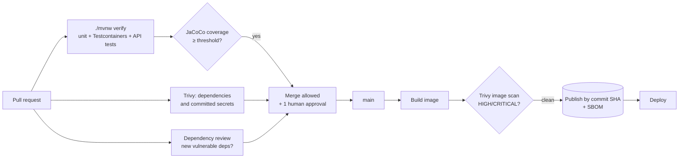

<!-- GENERATED by scripts/build.py from phases/02-professional-backend/cicd/guide.md and lms/videos.json. Edit the source, then run `python scripts/build.py`. -->


# CI/CD guide (Phase 2): quality gates on six platforms

← [Phase 2](../README.md) · [Deployment guide](../deploy/README.md) · [Capstones](../capstones/README.md)

Phase 1 gave every starter the same build-test-publish pipeline on six platforms ([Phase 1 CI/CD guide](../../01-foundations/cicd/README.md): read it first). Phase 2 adds **quality gates**: automatic checks that stop code from merging or images from shipping when they fall below the team's bar. This is what "the pipeline is green" means in a professional team (topics 7.4, 7.5, 8.3, 8.4).

## 1. The gates



| Gate | Tool | Where it's configured | Fails when |
| --- | --- | --- | --- |
| Tests | JUnit 6, Testcontainers, MockMvc | `./mvnw verify` | Any test fails |
| Coverage | JaCoCo 0.8.15 | `pom.xml` (`coverage.minimum`, default 0.70) | Line coverage below the threshold |
| Dependency vulnerabilities and secrets | Trivy (`aquasecurity/trivy-action@v0.36.0`) | `scan` job | HIGH/CRITICAL with a fix available, or a secret in the repository |
| New vulnerable dependencies in a PR | `actions/dependency-review-action@v5` | `dependency-review` job | The PR adds a dependency with a high-severity advisory |
| Image vulnerabilities | Trivy image scan | `image` job, before pushing | HIGH/CRITICAL fixable vulnerabilities in the image |
| SBOM | CycloneDX (managed by Spring Boot) | `pom.xml` | Never fails: it's evidence, stored as an artefact |
| Human review | Branch protection / merge request approvals | Repository settings | No approving review |

Gates only work if they're **required**: in GitHub, *Settings → Branches → Branch protection rule for `main`*: require a pull request with one approval, require status checks `build`, `scan` (and `dependency-review` for PRs), and block force pushes.

**When a gate fails:** read it, don't silence it. Raise coverage by testing behaviour, not by excluding classes. For a vulnerability, upgrade the dependency (often a Spring Boot patch release fixes it). If a finding is a genuine false positive or not exploitable in your use, record it in `.trivyignore` with a comment, a reason and an expiry date, and get it reviewed like code.

## 2. GitHub Actions (primary)

Already in every Phase 2 starter (`.github/workflows/ci.yml`): jobs `build`, `scan`, `dependency-review` (PRs only) and `image` (main only: build, scan, then push). To add the deployment from the [Phase 1 guide](../../01-foundations/deploy/README.md#37-deploy-updates), add a `deploy` job with `needs: image`, and protect it with a GitHub **environment** (`environment: production`) that requires a reviewer: a manual approval gate before production.

Optional, recommended for portfolios: **SonarQube Cloud** (free for public repositories) adds code smells, duplication and a quality gate on new code. Import the repository at sonarcloud.io, add `SONAR_TOKEN` as a repository secret and follow its "With GitHub Actions" instructions for Maven; JaCoCo's XML report (`target/site/jacoco/jacoco.xml`) feeds its coverage.

## 3. GitLab CI/CD (secondary)

`.gitlab-ci.yml` adds a `scan` stage with `trivy fs` and keeps the coverage gate inside `./mvnw verify`. In the project: *Settings → Merge requests → Pipelines must succeed*, and *Settings → Repository → Protected branches* for `main`. GitLab can display coverage in merge requests: add `coverage: '/Total.*?([0-9]{1,3})%/'` to the `test` job and print the JaCoCo summary, or publish `jacoco.xml` as a `coverage_report` artefact.

## 4. Azure DevOps

The starter's `azure-pipelines.yml` runs `./mvnw verify`, so the coverage gate already applies. Add a scan step to the Test stage:

```yaml
    - script: |
        docker run --rm -v "$(Build.SourcesDirectory)":/src aquasec/trivy:0.75.0 \
          fs --scanners vuln,secret --severity HIGH,CRITICAL --ignore-unfixed --exit-code 1 /src
      displayName: Trivy dependency and secret scan
```

Publish coverage to the pipeline UI with `PublishCodeCoverageResults@2` (`summaryFileLocation: target/site/jacoco/jacoco.xml`). Make the pipeline a required **build validation** branch policy on `main`.

## 5. AWS CodeBuild and CodePipeline

`buildspec.yml` already runs `./mvnw verify`. Add a Trivy step in the `build` phase before `docker push` (download the Trivy release binary or run the container, as above, against the built image), and enable **Amazon ECR enhanced scanning** (Amazon Inspector) on the repository for continuous image scanning after publication. Add a *Manual approval* action in CodePipeline before the production deploy stage.

## 6. Jenkins

Add a stage to the starter's `Jenkinsfile` after `Test`:

```groovy
        stage('Security scan') {
            steps {
                sh 'docker run --rm -v "$WORKSPACE":/src aquasec/trivy:0.75.0 fs --scanners vuln,secret --severity HIGH,CRITICAL --ignore-unfixed --exit-code 1 /src'
            }
        }
```

Record coverage with the **Coverage** plugin (`recordCoverage(tools: [[parser: 'JACOCO']])`) and, for approvals, use an `input` step before deployment. In a multibranch pipeline, require the Jenkins status check in your Git host's branch protection.

## 7. Argo CD (GitOps)

GitOps moves the "deploy" gate into Git: CI opens a pull request that changes the image tag in `deploy/k8s/overlays/production/kustomization.yaml`, a human approves it, and Argo CD syncs the cluster. Only images that passed the image scan get a tag PR. Add an admission policy (for example Kyverno or Sigstore policy-controller) in Phase 3 to reject unsigned or unscanned images in the cluster itself.

## 8. Checklist for every Phase 2 capstone

- [ ] `main` is protected: PR, one approval, required checks.
- [ ] Coverage threshold raised as tests grow (aim for 80% on capstones).
- [ ] Trivy finds no HIGH/CRITICAL fixable issues; any `.trivyignore` entry has a reason and an expiry.
- [ ] The published image is tagged by commit SHA and its SBOM is attached to the run.
- [ ] Production deployment needs a human approval.

## Watch

All videos are in English with English captions and were checked on 2026-10-30. Moodle learners see them embedded.

- [Build and Push Docker Images with GitHub Actions](https://www.youtube.com/watch?v=x7f9x30W_dI) · Rishab in Cloud · 13 min. Build and push Docker images with GitHub Actions.
- [Container Image Scanning with Trivy -- Ep. 1 Trivy Overview](https://www.youtube.com/watch?v=-IH5inFyEqU) · Aqua Security Open Source · 6 min. Scanning container images with Trivy, from Aqua Security.

