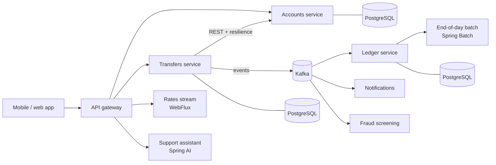

<!-- GENERATED by scripts/build.py from phases/03-enterprise-cloud-native/phase.md and curriculum.json. Edit the source, then run `python scripts/build.py`. -->

# Phase 3: Enterprise & Cloud-Native (weeks 26-37)

← [Home](../../README.md) · [Full curriculum](../../CURRICULUM.md)

From "junior engineer who can ship a secure service" to "engineer a bank can trust with a distributed system": splitting a domain into services, event-driven processing with Kafka, batch jobs, Kubernetes and the cloud, observability and performance, reactive Java and AI features built with Spring AI. Instead of ten separate capstones, you build **one capstone system** that grows module by module, which is how real platforms grow and what intermediate-level interviews probe.

> **Status: being built.** Module 10 is ready; the other modules are published as they're finished. The topic list and weekly plan below are final.

> **Prerequisite:** Phases 1 and 2 (or equivalent): Spring Boot 4 services with JPA, Flyway, validation, Problem Details, security with OAuth2, a test pyramid with Testcontainers, Docker, and a CI pipeline with quality gates.

## How to study this phase

Each topic page has the same three parts as before: **read** the lesson and type the code, **watch** the curated videos, and take the **Check your understanding** quiz (unlimited attempts; aim for 70% or more). Each module then adds one step to your capstone system and has a module project. The Phase 2 practice track has ended; keep your interview skills warm with one problem from it each week.

### What you need

Running several services, Kafka, PostgreSQL and Keycloak together needs a machine with **16 GB of RAM** (8 GB works if you run only the services you're working on, or use a small cloud VM or GitHub Codespaces). Everything in Modules 10–14 runs locally for free. For Module 12, a local Kubernetes cluster (kind) is free; a managed cluster on AWS (EKS) costs roughly US$75 a month for the control plane alone, so you create it, deploy, record the evidence and destroy it the same day, with a budget alarm set first. A US$10–20 VPS running k3s is an equally valid deployment target.

### How much time this phase takes

| Work | Hours |
| --- | --- |
| 26 topics in Modules 10–15 (reading, videos, quiz, practice tasks) | 85–100 |
| 6 module projects | 30–40 |
| Capstone system, built across the phase | 110–140 |
| Module 16: system-design practice, mock interviews, defence | 20–25 |
| **Total** | **about 245–305** |

That is **20–25 hours a week over the 12 scheduled weeks**. With 12–15 hours a week, plan for **18–22 weeks** instead and tell your mentor; the order of the work stays the same.

## The capstone system: ITL Pay

A digital wallet and payments platform for a Nigerian fintech, built in steps. Each module ends with a tagged release of your system and a short architecture decision record (ADR).

| Module | Weeks | What your system gains | Release |
| --- | --- | --- | --- |
| 10 Microservices | 26–27 | Accounts, Transfers and Ledger services with a database each, behind a gateway; resilient synchronous calls; a context map | `v0.1` |
| 11 Kafka and batch | 28–29 | Transfers publish events through an outbox; a saga with compensation; notification and fraud consumers with dead-letter topics; an end-of-day interest batch | `v0.2` |
| 12 Kubernetes and cloud | 30–31 | Helm charts, probes and autoscaling; deployed to kind locally and to a cloud cluster with Terraform and Argo CD | `v0.3` |
| 13 Observability | 32–33 | Traces across HTTP and Kafka, business metrics, dashboards, alerts, SLOs and a load-test report | `v0.4` |
| 14 Reactive | 34 | A streaming FX-rates endpoint with WebFlux, benchmarked against virtual threads | `v0.5` |
| 15 Spring AI | 35 | A support assistant grounded in your API docs, with read-only tool calls and guardrails | `v0.6` |
| 16 Finish and defend | 36–37 | Hardened, deployed, documented with ADRs and a runbook, then defended | `v1.0` |

You may build an equivalent system in another domain (loan origination, a marketplace or a logistics backend) if your mentor agrees by week 27; it must meet the same requirements at every release.

## Weekly plan

| Week | Module | Topics | Milestone |
| --- | --- | --- | --- |
| 26 | 10 Microservices & Distributed Systems | 10.1 Domain-driven design, 10.2 Gateway, config and discovery | Context map and service split (ADR 1) |
| 27 | 10 | 10.3 Resilience between services, 10.4 Data consistency across services | Release `v0.1`; Module 10 project |
| 28 | 11 Event-Driven Architecture with Kafka, and Batch Processing | 11.1 Kafka fundamentals, 11.2 Spring for Apache Kafka and RabbitMQ | Transfer events on Kafka |
| 29 | 11 | 11.3 Outbox, sagas and idempotent consumers, 11.4 Dead letters, retries and schemas, 11.5 Spring Batch | Release `v0.2`; Module 11 project |
| 30 | 12 Kubernetes, Helm & Cloud on AWS | 12.1 Kubernetes objects, 12.2 Probes, resources and autoscaling, 12.3 Helm and local clusters | System running on kind |
| 31 | 12 | 12.4 AWS essentials, 12.5 Terraform and GitOps | Release `v0.3` deployed to a cloud cluster |
| 32 | 13 Observability, Performance & Production Support | 13.1 OpenTelemetry, 13.2 Prometheus, Grafana and logging | Traces across services and Kafka |
| 33 | 13 | 13.3 JVM profiling, 13.4 Caching and databases under load, 13.5 Load testing, SLOs and incidents | Release `v0.4` with a load-test report |
| 34 | 14 Reactive & High-Throughput Java | 14.1 WebFlux and Reactor, 14.2 R2DBC, 14.3 Reactive versus virtual threads | Release `v0.5` with a benchmark |
| 35 | 15 AI Integration with Spring AI | 15.1 ChatClient, 15.2 RAG with pgvector, 15.3 Tool calling and MCP, 15.4 Guardrails and evaluation | Release `v0.6` |
| 36 | 16 Capstone, System Design & Interview Prep | 16.1 Capstone build, 16.2 Deployment, ADRs and runbook | Feature freeze; runbook drafted |
| 37 | 16 | 16.3 Observability and load report, 16.4 System-design interviews, 16.5 Mock interviews | **Release `v1.0`**, **capstone defence**, **system-design interview**, **end-of-phase exam** |

## Modules

| Module | Weeks | What you build |
| --- | --- | --- |
| [10. Microservices & Distributed Systems](10-microservices-distributed-systems/README.md) | 26–27 | Banking services (accounts, transfers, ledger) behind a gateway; e-commerce services as an alternative |
| 11. Event-Driven Architecture with Kafka, and Batch Processing | 28–29 | Event-driven payments, real-time notifications, an audit pipeline and an end-of-day batch |
| 12. Kubernetes, Helm & Cloud on AWS | 30–31 | Helm charts, a managed-cluster deployment and Terraform modules |
| 13. Observability, Performance & Production Support | 32–33 | End-to-end tracing, dashboards and alerts, a memory-leak and latency lab |
| 14. Reactive & High-Throughput Java | 34 | A streaming rates endpoint and a reactive-versus-virtual-threads benchmark |
| 15. AI Integration with Spring AI | 35 | A grounded support assistant and a transaction-query agent |
| 16. Capstone, System Design & Interview Prep | 36–37 | ITL Pay `v1.0` (or an approved alternative), deployed, documented and defended |

## Stack additions

Spring Boot 4.1 with **Spring Cloud 2025.1** (Gateway server WebMvc, Config, CircuitBreaker with Resilience4j), Spring Modulith, Apache Kafka 4 in KRaft mode with Spring for Apache Kafka, Spring Batch, Kubernetes with kind and Helm, Terraform, Argo CD, OpenTelemetry with Prometheus, Grafana and Tempo, Spring WebFlux and R2DBC, and Spring AI with Ollama or a hosted model.

## End-of-phase assessments

- **Exam:** a 2-hour, 60-question scenario-based CBT on every Phase 3 topic, in week 37. Pass mark 70%.
- **Capstone defence:** 30 minutes on your system: a demo, an architecture walk-through, questions on your ADRs and a live change ([format and rubric](../../docs/assessments/capstone-defence.md)).
- **System-design interview:** 45 minutes designing an unfamiliar banking system with a mentor, scored with the same rubric employers use for intermediate roles (Module 16).
- **Mock interviews:** one technical and one behavioural, with written feedback.

## Phase 3 exit criteria

- All Phase 3 topic quizzes attempted (aim for 70%+).
- One project per module in Modules 10–15.
- The capstone system at `v1.0`: deployed on Kubernetes from CI, traced end to end, with a load-test report, ADRs and a runbook, and defended.
- System-design interview and both mock interviews completed; end-of-phase exam passed (70%+).
